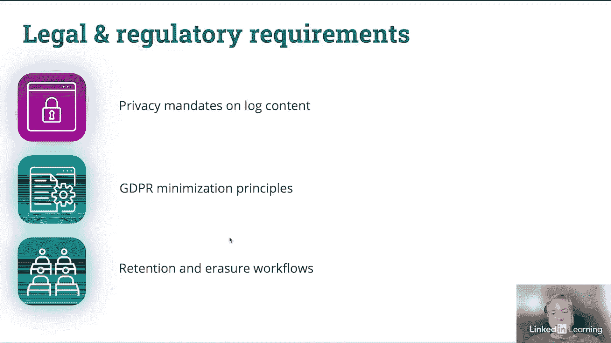
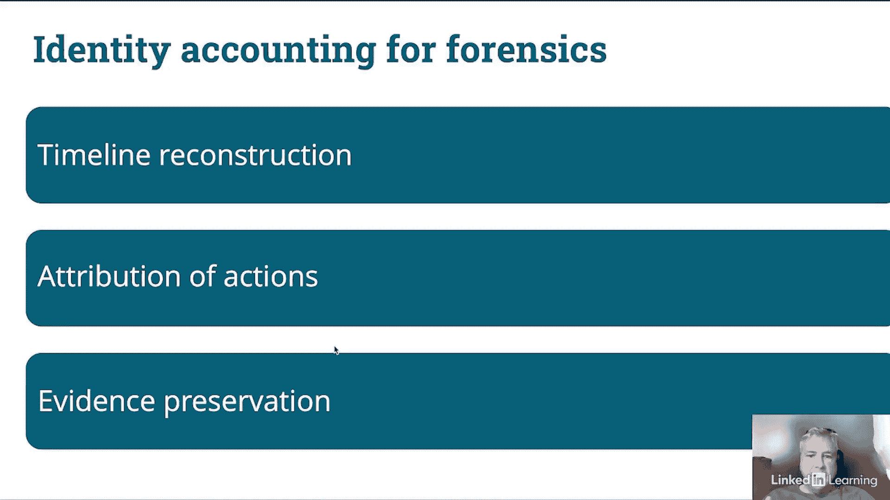
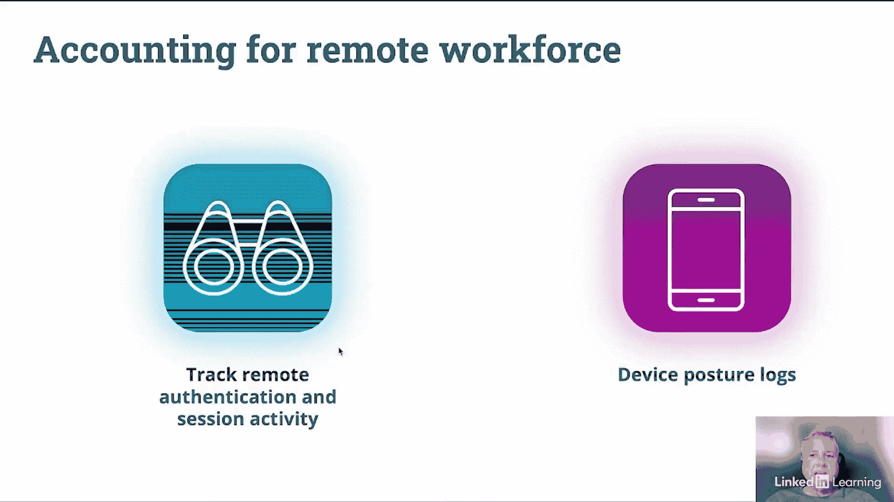

# 信息系统安全架构专业认证（ISSAP）：08：保密性 🔒

在本节课中，我们将学习CIA三元组中的保密性（Confidentiality）。刚才我们聊完了完整性（Integrity），CIA三元组还包括可用性（Availability），现在我们来聊聊保密性。保密性的核心目标就是防止未授权的人看到敏感信息。为了实现这个目标，我们需要考虑很多种方法来保护数据的保密性，而加密（Encryption）是其中最常用的手段。CIA三元组可以用下面的公式来表示：CIA = {机密性（Confidentiality），完整性（Integrity），可用性（Availability）}。简单来说，保密性就是让数据只在正确的人手里，防止泄露。

本节内容将围绕如何保护数据在传输、存储和处理过程中的保密性展开，我们会一步步介绍安全飞地、可信执行环境、证明机制、日志管理、合规要求、取证调查以及远程访问安全等核心话题。每一个知识点都是构建安全架构的基础，初学者也不用担心，我们会用大白话把每个概念讲清楚。

接下来我们先来看看安全飞地的创建与跟踪。这是保护数据在使用过程中保密性的关键手段之一。

## 安全飞地与可信执行环境 🛡️

我们要讲的第一个重要概念是安全飞地（Enclave）的创建，以及对飞地创建过程的跟踪。这里的思路是：我们需要找到一种方法，在代码运行处理数据的同时，保护数据的保密性。通常我们的做法是：数据存储时是加密的，需要用的时候解密，处理完之后再加密保存。但在安全飞地里，情况不一样，我们要在数据运行过程中对其进行加密和保护。

这种环境被称为可信执行环境（TEE, Trusted Execution Environment）。在TEE中，处理器会基于硬件进行隔离，这样数据和代码才能得到保护。简单来说，TEE就像是处理器里的一个“安全小房间”，外面的程序进不去，里面的数据也看不见。TEE可以用下面的代码风格描述：TEE = 硬件隔离 + 受信任的执行环境。有了这个隔离环境，我们还需要知道是谁创建了这个飞地，以及什么时候创建的，因为飞地是一种非常强大的隐藏信息的方式，记录创建者和创建内容非常重要。

具体来说，我们需要记录以下信息：

- 创建者身份
- 创建时间
- 加载的工作负载

此外，还要记录飞地的证明（Attestation）状态信息。这些记录可以确保飞地确实被使用过，并且清楚它是如何被使用的。在证明事件中，我们会记录证据，证明这个飞地是合法的，并且运行的是经过批准的代码。只有在飞地通过验证之后，敏感数据和密钥才会被释放给它。我们要确保飞地区域内发生的一切都是经过授权和身份认证的。

说完了安全飞地，我们接着看日志管理与安全执行日志。有了安全飞地之后，日志记录就变得尤为重要，因为我们需要既要有审计痕迹，又不能泄露敏感数据。

## 日志管理与安全执行 📋

当然，我们还需要记录日志，并且这些日志必须是安全的，需要保护执行日志。我们依然需要提供问责机制（Accountability），但要注意日志不能泄露飞地保护的敏感明文。在保护日志信息的同时，我们需要权衡可见性（Visibility）与保密性（Confidentiality）。这始终是一个挑战。我们需要足够的日志来形成审计痕迹（Audit Trail），但是，这些日志不能破坏保密性的初衷。

举个例子，假设一个保密工作负载在处理医疗记录，那么证明（Attestation）环节就很重要。飞地经过验证，密钥被释放，数据在飞地内部处理，安全事件被记录。审计系统会跟踪：工作负载X在经过验证的飞地Y中执行，时间是10点15分，成功访问了数据集Z。但是，审计系统看不到飞地内部实际处理的患者数据。不过，我们已经拥有足够的信息来形成审计痕迹了。

所以，保密计算并不会消除记账（Accounting）的需求。我们仍然需要在保持审计痕迹的同时，保护信息的保密性。

说完了日志的基本要求，我们接着看看合规性与法规要求。合规始终是我们的主要目标之一。

## 合规性与法规要求 📜

我们之所以重视记账，主要是为了合规（Compliance），用来证明合规。常见的合规标准包括：

- PCI（支付卡行业数据安全标准）
- SOX（萨班斯法案，财务报告）
- HIPAA（医疗保险可携带和责任法案，医疗信息）

以PCI日志为例，相关的就是持卡人数据，这些信息需要被追踪。同样，SOX关注财务报告，HIPAA关注医疗保健信息。我们要确保日志被创建，并且要集中化、时间同步。要控制对日志的访问，保护日志的完整性。日志需要保留适当的时间段。这些法规都会明确具体要求，合规始终是我们的主要目标之一。

再次强调，法律和法规对我们收集的信息有隐私方面的要求。记住，在做日志时，我们想提供审计痕迹，但仍要平衡数据本身的保密性。我们合法可以收集什么信息？我们可以记录什么信息，这些可能会受到监管。我们要确保不记录密码、密钥、令牌，也不记录不必要的个人身份信息（PII）或敏感数据。如果不需要，就不要收集，或者收集了也要丢弃。

GDPR特别要求数据最小化（Data Minimization），只收集为特定明确目的所必需的个人信息。那种“记录所有日志并永久保存”的想法，与GDPR是不兼容的。然后我们要考虑保留期限要求，日志需要存储多久。这通常由法律法规等外部因素决定。我们需要依据这些规定，确定日志保留多久，以及如何保护。

对，我们要保护日志。日志可能包含敏感信息，比如IP地址、用户名。访问模式也可能属于敏感信息或个人身份信息，在GDPR下可能受到保护。理解这些法律法规，是确保合规的首要步骤。

说完了合规要求，我们继续来看取证调查与时间同步。取证虽然复杂，但从架构角度理解对我们很有帮助。

## 取证调查与时间同步 🔍

另一个需要考虑的是取证调查（Forensic Investigation）。作为一个组织，如果有犯罪发生的可能，我们可能会收集取证信息。所以在取证中，身份记账很重要，要确保在事件发生后，调查人员能够确切知道发生了什么，涉及哪个身份，以及响应情况。对每一个动作都要能够重建时间线，这意味着我们的系统必须进行时间同步。不应该有任何未记录的时间偏移。再说一遍，NTP（网络时间协议）非常重要，用来确保时间同步。时间同步可以用下面的公式表示：系统时间 ≈ 标准时间（通过NTP同步）。我们必须能够将动作归属到特定身份，可以是用户、服务、工作负载或设备。

然后是证据保全。第一响应者最重要的工作之一，就是立即保全证据。我们的日志必须防止被修改，这一点之前已经提过。我们已经讨论过日志不可篡改性的需求。别忘了保管链（Chain of Custody），建立证据一直由有资格的人持有的记录。所有这些环节，都是为了确保我们收集的证据在法庭上是被允许或可采纳的。

取证非常复杂，考试不会深入讲解。但从架构角度来看，这意味着我们需要在事件发生前就设计好环境。这样在事故发生之前，我们就已经拥有调查所需的证据了。我们需要预定义数据源。需要收集什么证据呢？很可能需要身份访问管理（IAM）和特权访问管理（PAM）元素，终端设备，可能还有网络设备，比如路由器和交换机。我们可以列很多，但也要考虑云平台、容器、SaaS系统。今天的世界越来越复杂，也越来越分布式。

说完了取证的基本思路，我们接着看日志聚合与事件关联。这是把分散的日志串联起来的关键步骤。

## 日志聚合与事件关联 🔗

所以我们需要一个集中收集点，也就是SIEM系统，把这些信息汇集在一起。这样即使攻击者攻破了服务器，也不能只是删掉本地日志。对，我们是在中心位置收集日志的。我们的日志必须设计成能够收集正确信息的方式，包括身份、动作、系统、时间和结果。还要有清晰的路径和可追溯性。这对审计和合规很重要，同样，对取证也非常重要。

然后是事件关联（Event Correlation）。我们要把不同的安全事件连接到同一个身份上，看到全貌，而不是一堆零散的日志条目。身份将是主要的关联点，把事件与身份关联起来。这样事件之间的联系，比单纯依赖机器或IP地址更可靠。我们需要把事件关联回身份，把身份与终端、设备、安全态势关联起来，把身份与EDR警报或恶意软件检测关联起来。我们要关联网络上的事件，比如防火墙日志、VPN、DNS、代理服务器、IDS、IPS。网络设备和网络流可以列举很多，然后还要考虑应用事件、API、数据库访问事务。

别忘了SIEM系统可以把所有这些汇集在一起，进行标准化和关联。在调查中，SIEM系统绝对关键。举个例子，假设我成功在某个时间点进行了身份验证。8点03分，EDR系统检测到我在笔记本电脑上的PowerShell里做了可疑的事情。防火墙显示连接到了恶意IP地址。8点10分，应用日志显示Kelly访问了敏感记录。8点12分，DLP检测到大量数据传输。如果你单独看每个事件，可能没有太多证据，但一旦把这些信息围绕同一个身份关联起来，这就构成了更有力的证据链。这是对信息滥用、处理不当的更好证据。关联和聚合是关键，我们的SIEM系统可以提供这种能力。

说完了事件关联，我们继续看日志的高可用性。如果日志系统挂了，证据就丢了，所以这点非常重要。

## 日志高可用性与安全传输 🚀

还有，保密性、完整性和可用性。日志的高可用性很重要，因为如果在停电或攻击期间日志系统失效，我最需要的证据可能就没了。所以我们的架构也要包含防止单点故障的设计。使用冗余采集器，多个日志采集器接收事件，如果一个采集器失效，日志不会停止，我们会继续记录。多区域日志存储，同样是高可用性，只要提到高可用性，冗余就至关重要。还有故障转移摄入管道，如果从系统到日志存储的主路径失效，我们就将事件重新路由到备用路径。所以，再次强调，所有这些部分共同作用，给我们提供了高可用性。

当然，这是一个安全问题，因为如果采集器失效，如果管道失效，我们就无法记录这些潜在的恶意攻击，或者至少是破坏性攻击，那么我们就很难收集到需要的证据了。

然后，我们的日志必须安全传输。我们之前说过，这些日志可能包含敏感信息，所以我们不会以明文在网络上发送它们。我们会使用TLS来保护传输中的日志。我们会确保消息有数字签名，这样我们可以证明日志消息来自预期的来源，并且没有被修改。我们能够检测到日志丢失，缺失的日志。我们做到这一点的方法之一是通过序列号排序，如果你收到了1、2、3、4、6，你知道，5号日志出问题了。可靠传输，基于TCP的传输，以及查询和确认机制，我们知道TCP与可靠性相关联。所以我们要确保日志能够收到，并且安全传输，它们要保护敏感信息，同时我们也能验证日志的真实性和完整性。

最后，我们来看远程身份验证与会话活动。远程访问比本地访问风险更高，所以需要额外的防护措施。

## 远程身份验证与会话活动 🌐

最后要提到的考虑因素是远程身份验证和会话活动。任何人在非物理连接的情况下访问我们的网络时，在物理登录之外，超出传统边界，他们没有那层物理安全保护，因此这会带来更高的风险。所以，对于任何进行远程身份验证的人，我们都会记录该信息。我们会要求多因素身份验证（MFA）。我们会追踪会话活动。他们是通过VPN、SASE、云还是其他方式连接的？我们要确保记录设备态势，设备是否满足安全要求，是否安装了反恶意软件，是否通过了扫描，是否打上了补丁？然后我们要关联身份和设备，并监控会话。

所以在谈到远程员工时，我们要采取一些额外措施。我们要考虑他们如何进行身份验证，以及我们如何追踪这些信息，因为这带来了更具风险的连接方式。

本节课中我们一起学习了保密性（Confidentiality）的核心知识。我们介绍了CIA三元组中的保密性目标，重点讲解了安全飞地（Enclave）与可信执行环境（TEE）如何在数据处理过程中保护机密信息，讨论了证明（Attestation）机制与安全执行日志的记录方法，说明了如何在合规要求下平衡日志可见性与数据保密性，介绍了GDPR数据最小化原则以及日志保留和保护要求，阐述了取证调查、时间同步（NTP）与证据保全的基本思路，解释了SIEM系统在日志聚合和事件关联中的作用，强调了日志高可用性与安全传输（TLS、数字签名）的重要性，最后还介绍了远程员工身份验证与会话监控的关键措施。希望这些内容能帮助你建立起对保密性架构的整体认识。
