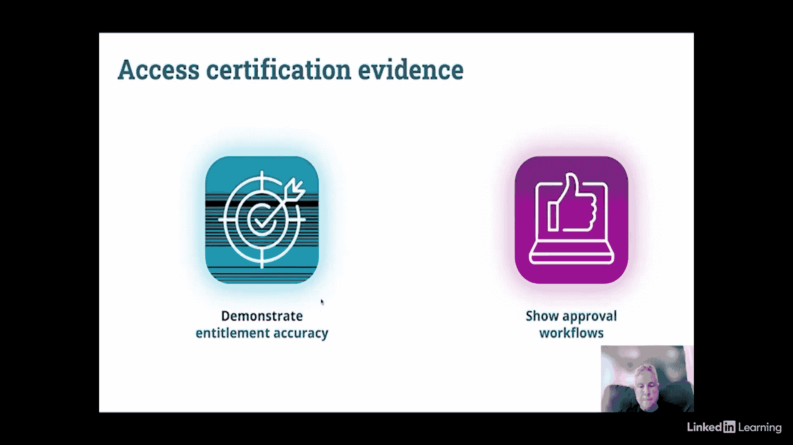

# 🔐 linkedin ISC2 ISSAP：09：通信管理

在本节课中，我们将学习信息安全架构中的通信管理内容。通信管理的核心目标是确保正确的安全信息送达到正确的人员手中，并通过关键绩效指标、身份监控和事件响应机制，建立起完整的安全问责体系。我们会从如何衡量安全状态入手，逐步延伸到特权账户监控、身份事件处置以及审计证据留存，帮助初学者理解架构师在日常运营中需要承担的责任。

## 责任与问责

上一节我们介绍了信息收集与安全框架的基本概念，本节中我们来看看通信如何支撑安全问责。

在安全工作中，仅仅收集日志和事件数据是不够的，真正的价值在于让我们清楚谁该对哪些安全事项负责。当我们把分散的日志、访问记录和安全事件汇集在一起后，就能形成一张完整的责任图景，知道系统中发生了什么，以及相关责任人是谁。这种问责机制是后续所有安全决策的基础，没有它，安全团队就无法快速定位问题，也无法在出现问题时追溯到具体责任人。因此，通信管理不仅是传递信息，更是建立责任认同的重要手段。

## 关键绩效指标

刚才我们讲到了责任与问责的重要性，接下来我们需要具体的衡量手段来判断安全工作是否到位。

我们需要知道如何把正确的信息传递给正确的人，这时关键绩效指标就派上用场了。关键绩效指标，我们可以用下面的公式来表示：

**KPI = 关键绩效指标 = 用于反映当前安全状态与待处理工作的度量**

常见的身份与访问相关KPI包括失败登录次数、多因素认证失败次数、休眠账户数量、过度特权使用情况以及过度特权分配情况。这些指标能告诉我们当前的安全状况如何，还有哪些工作没有完成，是否需要立即采取行动。简单来说，KPI就像是安全工作的仪表盘，让我们一眼看出现在的状况，以及接下来应该关注什么。

## 身份管理的核心指标

了解了KPI的概念后，我们可以把注意力集中到身份管理上，看看具体应该追踪哪些数据，才能更好地掌控账户安全。

在身份管理中，我们会监控以下几类指标：

- 失败登录率：统计所有系统、关键系统以及整个环境中的登录失败次数，而不是只看单台设备上的情况。
- 同一身份持续认证失败：如果某个身份反复认证失败，这通常是恶意活动的重要触发信号。
- 特权使用频率：可以用下面的简单公式来理解：

  **特权使用频率 = 特权操作次数 / 观察时间周期**

  这个指标是双向的。某个账户使用特权过于频繁，可能存在滥用风险；另一个账户分配了特权却从不使用，则说明拥有的权限超过了实际需要，应该及时回收。
- 配置准确性：检查已经分配的账户信息需要被修改多少次，以及用户是否根据其角色或属性获得了正确的访问权限。理想情况下，第一次分配就应该准确，避免后续反复修改。

监控这些指标的目的，就是让我们在问题扩大之前发现异常，并及时调整账户配置。

## 特权账户管理与用户监控

有了身份指标的监控方向，我们还需要专门针对特权账户进行管理，因为特权账户是系统中最高权限的账户，风险也最高。

特权账户管理，简称PAM，意味着我们必须对特权账户进行持续的用户监控。普通账户和特权账户的风险等级完全不同，特权账户一旦被攻陷，攻击者就能获得对系统的几乎完全控制权。因此，架构师必须在系统设计阶段就考虑如何实时监控这些账户，记录它们的每一次操作，并建立快速发现异常行为的机制。只有在设计时就考虑好监控需求，后续运维才能做到有的放矢。

## 基于身份的事件响应

当特权账户或普通账户出现异常时，我们就需要启动事件响应流程，而之前的监控指标正是用来发现这些异常的。

基于身份的事件响应，也就是身份事件分类处理。虽然这个说法听起来很专业，但目的很简单，就是发现可疑活动并快速处置。整个流程可以分为以下步骤：

- 确定受影响的身份及其拥有的访问权限。
- 了解该身份接触过哪些系统，入侵范围有多大。
- 遏制该身份，撤销其凭据或会话。
- 调查事件原因。
- 恢复正常业务。
- 持续监控，防止问题再次发生。

在事件响应过程中，我们需要检查自己是否遵循了正确的步骤，是否能快速确定哪个身份受影响，它访问了什么，触碰了哪些系统，妥协范围究竟有多广。为此，必须协调身份与访问管理系统，结合安全信息与事件管理（SIEM）日志，才能完整还原攻击范围。

针对特权账户，我们需要快速采取行动，包括：

- 立即禁用或锁定账户。
- 撤销凭据。
- 更换密码和密钥，甚至销毁已被泄露的密码和密钥。
- 对该账户持续开展监督。

归根结底，安全架构师需要确保身份系统在设计之初就支持快速响应，而不是依赖管理员手动在多个系统和日志中寻找线索。这时自动化检测与响应就显得格外有用，我们可以用下面的公式来概括：

**自动化响应能力 = 自动检测异常 + 自动执行遏制操作 + 自动记录处置结果**

有了自动化能力，安全团队在面对异常时就不会手忙脚乱，能够在第一时间完成遏制与取证。

## 审计差距与日志完整性

事件响应依赖日志，而日志的质量直接决定取证成败，因此接下来我们需要审视审计差距和日志完整性问题。

审计记录只有在完整且准确时才有意义。我们之前讨论过时间同步的重要性，确保所有系统的时间戳保持一致。日志记录必须在需要时可用，并且内容要完整。如果缺少身份日志，就存在追踪盲区，时间戳不一致会让碎片化的证据难以拼凑，这在法医学调查中可能是致命的。

日志保留也需要精确控制，既不能保留过久，也不能过短，必须正好满足业务和合规要求。日志完整性可以用下面的公式简单表达：

**日志完整性 = 时间戳一致性 × 记录完整度 × 可用性**

只有这三个方面都做到位，审计人员和安全团队才能信赖日志作为证据。

## 审计证据与访问生命周期

解决了日志质量问题后，最后我们需要考虑如何向审计人员证明合规性，这涉及整个访问生命周期的证据留存。

我们需要向审计人员提供哪些证据，来证明用户权限与其岗位职责匹配？必须保留相关文档，并能够出示证明信息。具体包括审批流程的证据，展示从最初的身份请求开始，谁请求了访问权限，谁批准了访问，何时批准，批准理由是什么。

安全架构必须保留整个访问生命周期的证据。如果审计人员问为什么某位员工拥有某个数据库的管理员权限，我们应该能够立即展示：

- 业务理由
- 批准授权的管理者
- 配置记录中的当前访问权限
- 最近一次权限审查的结果

这正是信息安全架构师的责任所在，架构师需要在系统设计阶段就把证据留存机制考虑进去，而不是在审计临近时才临时补齐资料。

## 总结

本节课中我们一起学习了通信管理在安全架构中的作用，包括如何通过关键绩效指标衡量安全状态、如何监控身份与特权账户的使用情况、如何开展基于身份的事件响应、如何保证日志的完整性与时间同步，以及如何为审计人员提供完整的访问生命周期证据。这些内容共同构成了安全问责与合规的基础，也是信息安全架构师在日常工作中需要掌握的核心能力。

