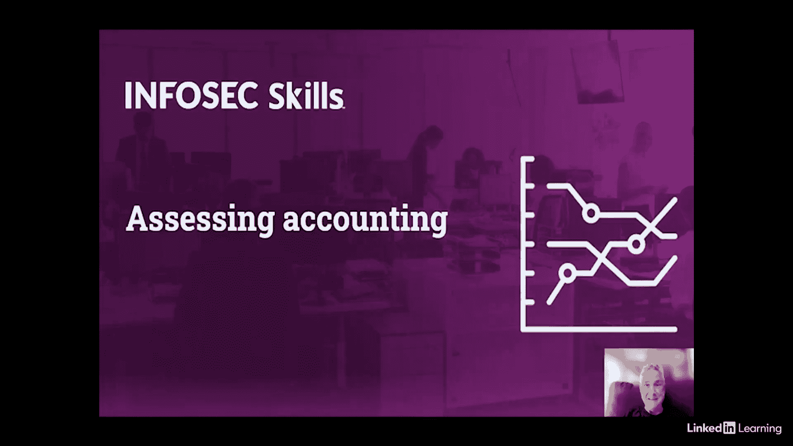
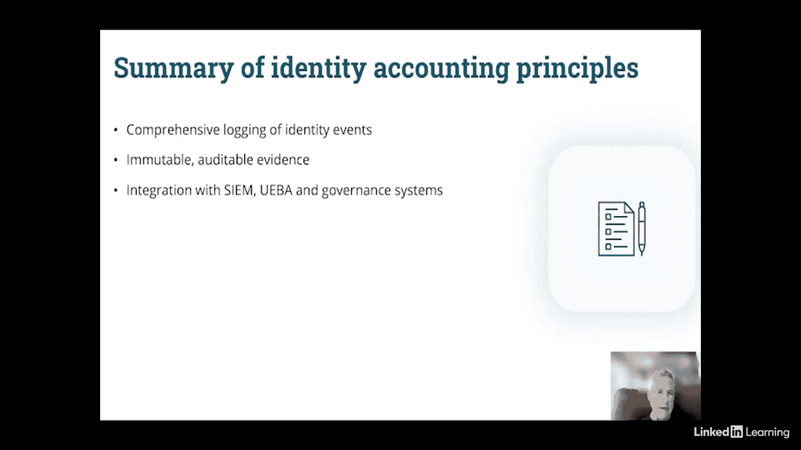

# 🔐 ISSAP 身份系统安全架构专业：10：评估身份记账

在本节课中，我们将学习身份记账评估的核心内容。身份记账其实就是记录谁在什么时候对哪些身份资源做了什么操作，确保审计追踪完整可靠。我们会从身份协调、重复账户清理、备份审计，一直到配置日志、OAuth 令牌追踪，再到 DevOps 环境下的非人类身份管理，最后还会讨论治理要求如何转化为技术架构，以及如何保证日志不可篡改。这看起来很多，但我们会一步一步讲清楚。


首先，从架构师的角度来看，身份协调是评估记账的基础。身份协调证据必须被呈现，这是基本要求。我们需要能够协调身份源，把它们追溯到起源点，因为一个身份可能参与很多系统，也可能从很多系统获取资源。如果不协调，就容易出现混乱，无法清楚知道某个账户到底在哪些地方被使用过。

```
身份源 A ↔ 身份源 B ↔ ... ↔ 起源点（必须可关联）
Kelly H == K hand == K do H（视为同一人，需去重）
```

接下来我们来看重复账户。重复账户是指同一个人在不同系统里出现了不同的名字，比如某个目录数据库里叫 Kelly H，另一个叫 K hand，还有另一个叫 K do H，这显然会造成混乱。如果存在重复，配置和取消配置就会变得脆弱，最常见的后果就是孤儿账户，也就是用户已经离职，但账户还保留着访问权限，长期不被回收。为了避免这种情况，我们需要做身份协调，通过系统监控，确保各个身份源之间有关联，必要时要把重复账户解决掉。


有了身份协调和重复账户处理之后，还不能忘记备份操作的审计。以下是备份操作审计需要关注的关键字段。

- 执行备份或恢复的人是谁
- 谁给了他权限或授权
- 备份发生的时间
- 涉及了哪些身份数据
- 备份是否成功

备份操作非常重要，因为身份系统在故障或攻击后必须能够恢复。恢复之后，我们仍然需要保持同等程度的问责性，而且要确保不会恢复到被污染的身份数据。比如，如果你正在从勒索软件攻击中恢复，而昨天的备份里正好包含同样的恶意软件，那么恢复之后问题依然存在，没有任何改善。所以不能仅仅因为备份看起来成功，就假设身份和访问管理运作正常。我们需要回去验证恢复后的目录和身份存储，不管是 Active Directory 还是其他身份存储，都要检查账户是否仍然可用，是否还处于禁用状态，最近被撤销的权限是否仍然被撤销，这就是我们的应尽职责。


备份审计处理好了，接下来我们要看看配置日志和 OAuth 令牌事件。配置日志和令牌事件通常包含以下操作类型。

- 创建账户
- 修改账户
- 删除账户
- 令牌颁发
- 令牌刷新
- 令牌撤销

配置系统让账户配置变得自动化，但作为架构师，我们需要确认它是否正在正确地跨系统修改和删除账户。我们必须拥有对被创建、被更改、被删除的身份进行验证和可追溯性。然后是 OAuth 令牌事件，任何重要的令牌身份活动，无论是令牌被颁发、刷新还是撤销，都需要被记录在案。API 活动经常发生在机器对机器的访问中，根本没有人类参与。这时候我们需要确保对服务账户、被分配的权限、颁发的令牌以及访问了什么资源，都有追溯记录。否则，我们对 API 的运行情况和表现就会缺乏可见性。


除了人类用户，现代环境中还有大量非人类身份，这把我们带到了 DevOps 的话题。身份记账和 DevOps 之间有着密切关系。DevOps 会引入很多非人类身份，比如服务账户和工作负载，除此之外，我们还要考虑 CI/CD 流水线中自动化工具本身的身份。我们需要在整个流水线中记录身份相关的动作。开发者提交代码，我们要能把这个动作追溯到具体发起构建的开发者；谁批准了部署，哪个服务账户执行了它，都要有记录。也就是说，从开发者，经过流水线，一直到生产环境，整个过程都要有可追溯性。


技术手段有了，还需要治理来定规则，这是下一节要讨论的内容。治理在身份记账中始终扮演着关键角色，我们作为架构师，要负责将治理要求转化为技术架构。比如治理可能规定，所有特权活动必须保留一年。作为架构师，我就得设计出一套结构，让 SIEM 系统、身份和访问管理系统、PAM 系统等能够安全地收集这些信息，归档受到保护，并且满足一年的保留期。治理定下规则，架构提供技术机制来执行这些规则。治理要求、架构、日志和监控，这三者在整个过程中是密切配合的。日志和监控之后，还要进行定期审查，并看看有哪些需要改进的地方。


记账控制必须由策略驱动，并且需要持续审查，因为环境总是在变化。治理定义了什么身份活动必须被记录、如何保护、保留多久、谁来审查。架构师的责任是把这些治理要求转化为具体的技术能力。

在检查日志完整性时，我们通常会问以下几个问题。

- 日志是否有完整性？
- 日志是否不可更改？
- 是否有哈希值可用于检测完整性变化？

如果日志可以被随意修改，那它们就没有完整性可言，也就失去了审计价值。身份蔓延是另一个需要考虑的问题。如果没有追踪，用户和工作负载会积累过多身份，如今因为云平台、SaaS、数据库、API 等，这种情况比以往任何时候都更常见。所以我们必须建立身份协调的流程，并确保开展持续的身份追踪。


最后，让我们把身份记账的原则梳理一遍，作为本节的收尾。身份记账的核心原则是全面记录安全事件，捕获身份验证、授权、权限使用等内容。我们要追踪日志、评估日志，并确保日志存储在具备不可变性能力的介质上，比如一次写入多次读取的媒体，并且配合哈希值来证明完整性。同时，还要把 SIEM 系统和 UEBA 系统等工具集成进来，确保它们具体执行治理所强制要求的内容。




在本节课中，我们一起学习了身份记账评估的完整流程。首先掌握了身份协调与重复账户处理，确保不同系统中的身份能够关联且不出现孤儿账户；接着讨论了备份操作审计，避免恢复受污染的身份数据；然后深入了解了配置日志与 OAuth 令牌事件，保证对人机访问的可追溯性；再看到了 DevOps 环境下非人类身份与 CI/CD 流水线的追踪需求；之后探讨了如何将治理要求转化为技术架构，以及日志完整性和身份蔓延的防范。最后总结了全面日志记录、不可变存储和工具集成的核心原则。希望这些内容能帮助你在实际的架构设计中，把身份记账做得更扎实。

