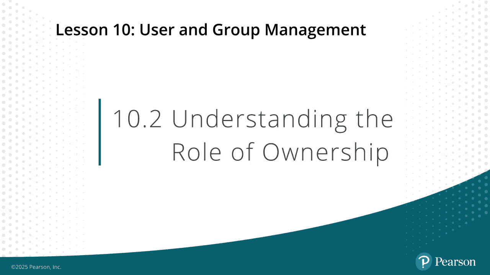
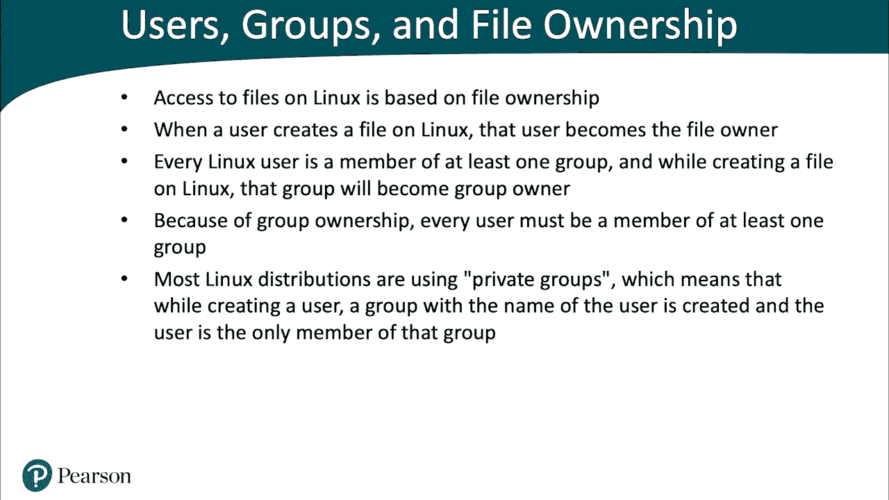
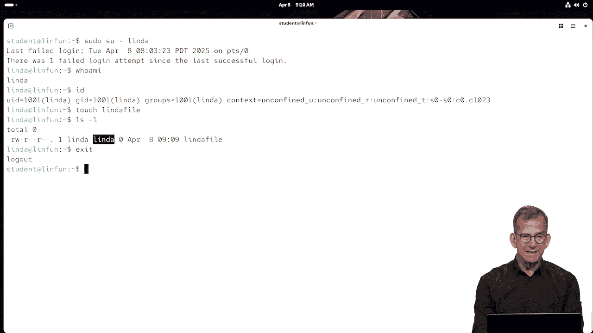

# CompTIA Linux+ V8：101.102：理解所有权的作用 📁




在本节课中我们将要学习 Linux 系统里文件所有权的基本作用。我们会先聊聊为什么 Linux 需要所有权机制，再看看用户和组怎么参与文件访问控制，最后通过几条常用命令，亲眼看看文件创建后是谁的、归哪个组所有。内容会尽量用大白话讲解，哪怕你是第一次接触 Linux 也能看懂。


Linux 决定用户能不能读取、修改或者运行一个文件，首先会看这个文件的所有权。简单来说，所有权就是告诉系统，这个文件属于哪个用户，又属于哪个组。有了这个基础，系统之后才能再细化设置读写执行权限。


在 Linux 中，文件所有权可以用下面的公式来描述：

文件所有权 = 用户所有者 + 组所有者


当你在 Linux 里创建一个文件的时候，创建这个文件的人会自动变成这个文件的用户所有者。也就是说，文件默认归创建者所有，创建者对文件拥有最初的控制权。


每个 Linux 用户至少属于一个组。当文件被创建时，Linux 会把用户当前所属的主组设置为这个文件的组所有者。这个主组，我们专门称它为 primary group。


以下是组所有权的核心规则：

- 每个用户必须至少是一个组的成员
- 大多数 Linux 发行版会为主组使用私有组机制
- 创建用户时，系统会自动建立一个和用户同名的组，而且这个用户是该组里唯一的成员

这种做法乍看之下好像不太有用，但主要是为了满足“用户必须属于一个组”这个要求，同时也希望组成员关系尽可能安全。下面我来演示一下。


接下来我们通过实际操作来看看这些概念是怎么工作的。我会切换到名为 linda 的用户，然后查看她的身份信息，再创建一个文件看看所有权情况。


使用以下命令切换到 linda 用户：

```bash
su - linda
```

进入 linda 的 shell 之后，可以用 whoami 命令确认当前是谁：



```bash
whoami
```

然后用 id 命令查看详细的用户和组配置：

```bash
id
```

在输出信息里，你可以看到用户 ID 1001 对应的名字是 linda，主组 ID 1001 也是名为 linda 的组，另外 groups 会列出 linda 用户所属的所有组。在默认情况下，新创建的用户会成为同名组的成员。


现在创建一个测试文件：

```bash
touch linda_file
```

接着用 ls -l 查看文件的详细信息：

```bash
ls -l linda_file
```

你会看到这个文件由用户 linda 所有，同时由组 linda 所拥有。这就是文件创建时所有权的默认表现。


演示做完以后，退出 linda 用户的 shell：

```bash
exit
```

以上就是文件所有权的基本流程。后续视频里我们会继续深入讲解所有权和权限的更多内容。




在本节课中我们一起学习了 Linux 文件所有权的作用。我们了解了文件访问控制是建立在所有权之上的，创建者会成为用户所有者，每个用户至少属于一个组，主组会成为组所有者，并且通过 su、whoami、id、touch 和 ls -l 等命令亲手验证了文件创建后的所有权情况。希望这些内容能帮你建立起对 Linux 所有权的直观认识。
