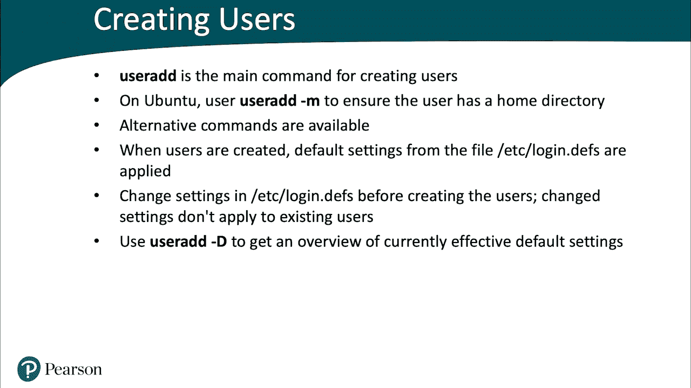
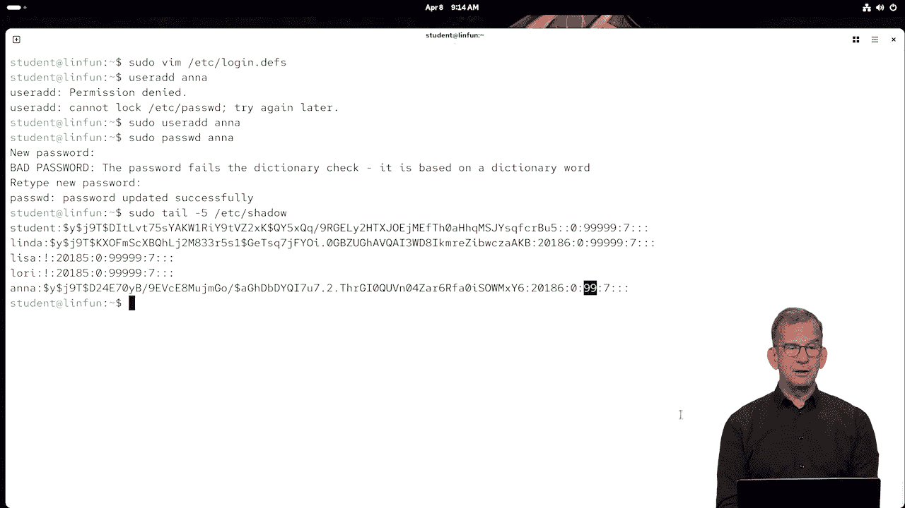

# 🐧 CompTIA Linux+ V8：102.103：使用 useradd 创建用户


## 📖 课程概述

在本节课中，我们将一起学习如何在 Linux 系统中创建用户。课程会从最基础的 useradd 命令讲起，重点说明在 Ubuntu 系统上为什么必须加上 -m 选项，然后介绍系统默认配置文件 /etc/login.defs 的作用，教你如何查看和修改默认设置。最后，我们会通过创建用户 Anna 的完整示例，演示如何设置密码，并验证配置是否真正生效。


## 🛠️ useradd 命令基础

在了解了课程目标之后，我们先来看看创建用户的主命令。创建用户的主命令是 useradd。如果你使用的是 Ubuntu 系统，使用这个命令时非常重要的一点是，必须加上 -m 选项。原因在于 Ubuntu 系统创建用户时，默认不会自动创建家庭目录，而家庭目录对普通用户非常重要，用于存放个人文件、配置文件和桌面环境等数据。没有家庭目录，用户登录后可能连个人配置文件都没有地方保存，使用体验会很不好。所以在 Ubuntu 上执行 useradd 时，千万不要漏掉 -m 选项，否则新用户可能没有家庭目录，导致各种意外问题。


## 🔄 关于 adduser 替代命令

刚刚介绍完 useradd 命令，你可能会好奇系统里还有没有其他类似的工具。事实上，除了 useradd，系统中还提供了 adduser 命令，这两个命令的功能大体相同，都可以用来创建新用户。不过我建议你只专注于学习其中一个命令，没必要同时去研究两个作用完全一样的工具，那样只会增加学习负担，浪费时间，而且在实际工作中，掌握一个稳定好用的命令就足够了。


## ⚙️ 系统默认设置文件 /etc/login.defs

学完命令本身之后，我们还需要知道系统在创建用户时会参考哪些默认设置。当新用户被创建时，系统会从 /etc/login.defs 文件中读取并应用默认设置。这个文件非常重要，建议你在创建用户之前，先检查并调整其中的配置项。之所以要在创建之前修改，是因为一旦你修改了该文件，新设置只会对之后新建的用户生效，已经存在的用户不会受到影响，不会自动应用新的配置，这也是很多新手容易忽略的一点。




## 🔍 查看当前默认设置

了解了 /etc/login.defs 的重要性之后，你可能想知道当前系统到底使用哪些默认值。你可以使用 useradd -D 命令，查看系统当前生效的默认设置概览。这个命令会输出一些默认参数，帮助你了解新用户会继承哪些初始配置，比如默认的组 ID、登录 Shell、骨架目录位置等等。骨架目录里面的内容会被复制到新用户的家庭目录中，作为用户的初始配置。


## 📝 /etc/login.defs 文件详解

虽然 useradd -D 可以显示一些默认值，但更重要的还是直接查看 /etc/login.defs 文件的具体内容。在这个文件中，你会看到很多参数被标记为 "not supported"，也就是不支持。这是因为在 useradd 配置的背后，还有一个名为 PAM 的更高级系统在处理相关功能，当 PAM 接管这些功能后，它们就从 /etc/login.defs 中移除了。所以你会看到大量标记为不支持的选项，但如果你向下滚动一点，仍然能找到一些重要的参数，这些参数才是我们真正需要关注的。


## 🔐 密码有效期设置示例

在浏览完 /etc/login.defs 之后，我们重点来看看密码安全相关的设置。其中 PASS_MAX_DAYS 参数尤其重要，它定义了用户密码的最大有效天数，公式可以简单理解为：密码有效期 = PASS_MAX_DAYS 天。默认情况下，这个值通常是 99999 天，换算成年份大约是 272 年，显然太长了，不够安全。建议将其改为 99 天，这样可以让系统更加安全，迫使用户定期更新密码。

文件中还有其他参数，例如 UID_MAX、GID_MAX、UID_MIN 和 GID_MIN，这些参数用来确定用户 ID 和组 ID 应该从哪个数值开始分配。用户 ID 的分配范围可以用简单的代码逻辑理解：UID_MIN <= 新用户 UID <= UID_MAX。在本示例中，我们暂时保持这些默认值不变，不做修改，先专注于创建用户本身。


## 👤 实际创建用户演示

讲完理论知识之后，我们进入实操环节。下面是创建用户的具体步骤。因为创建用户需要超级用户权限，所以所有命令都需要使用 sudo 来执行，否则系统会拒绝操作。


以下是创建新用户的命令示例：

```bash
sudo useradd Anna
```


执行完成后，系统就会创建名为 Anna 的用户，并且 /etc/login.defs 中相关的默认值也会被应用到这个新用户身上。接下来，我们需要为 Anna 设置密码，否则新用户无法登录系统：


```bash
sudo passwd Anna
```


系统会提示你输入两次新密码，完成确认后，密码就会被加密保存到系统中。然后我们可以查看 /etc/shadow 文件，确认密码信息已经正确存储，这个文件专门用来保存用户的加密密码和密码过期信息：


```bash
sudo tail -5 /etc/shadow
```


通过查看结果可以发现，之前创建的 Linda 用户，其密码最大有效期仍然是 99999 天，而新创建的 Anna 用户，密码最大有效期变成了 99 天。这正是我们刚才在 /etc/login.defs 中修改 PASS_MAX_DAYS 参数后的效果，说明配置已经成功生效。


## 📚 课程总结



本节课中，我们一起学习了如何使用 useradd 命令创建 Linux 用户，了解了 Ubuntu 系统下 -m 选项的必要性，认识了 /etc/login.defs 默认配置文件的作用，学习了如何使用 useradd -D 查看默认设置，重点掌握了 PASS_MAX_DAYS 等安全相关参数的修改方法，并通过创建用户 Anna 的完整示例，验证了新配置是否生效。


