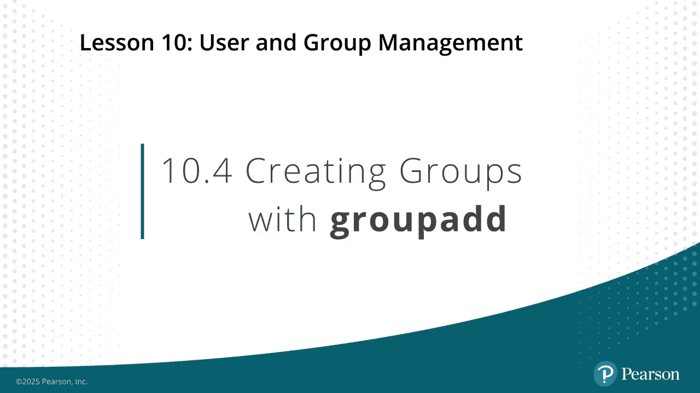
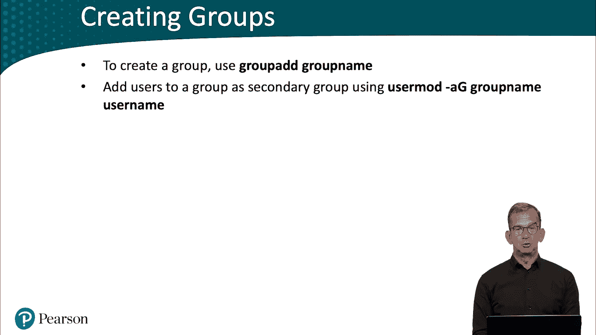
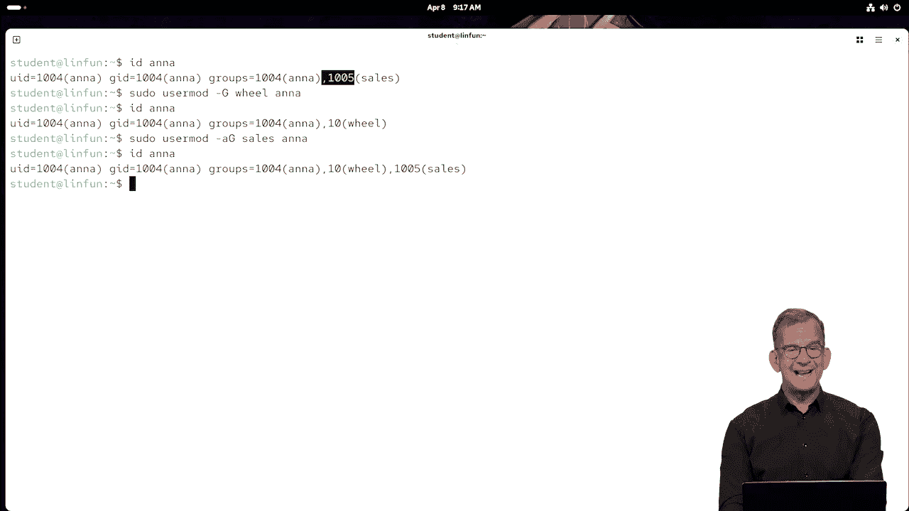

# Oreilly - CompTIA Linux+ V8：03：使用groupadd创建组 🐧


在本节课中我们将要学习Linux系统中如何创建用户组，以及如何把用户加入到已有的组里面。这是Linux系统管理中非常基础也非常重要的一部分，因为几乎所有的文件权限控制都跟用户组有关。我们会先讲创建组的命令，再讲怎么把用户加到组里，最后重点说明一个很容易搞错的命令参数区别，避免你不小心把用户从其他组里踢出去。内容会比较详细，适合刚接触Linux的初学者慢慢看，建议跟着操作一遍，这样印象会更深刻。


## 创建新组的方法 📋


上一节我们介绍了用户管理的基本概念，本节中我们来看看如何在Linux系统里创建新的用户组。创建组其实不需要复杂的操作，整个过程就一条命令就能搞定，不需要你去编辑任何配置文件，也不需要重启系统，命令执行完之后组就立刻可用了。

以下是创建新组的步骤：



- 使用 `groupadd` 命令后面加上你想要的组名
- 系统会自动为新组分配一个组ID
- 新组创建完成后就可以直接使用了

核心命令如下：

```bash
groupadd 组名
```

比如你想创建一个名为 sales 的组，直接输入 `groupadd sales` 就可以了。命令执行完之后通常不会有任何输出，这在Linux里是正常现象，代表命令成功执行了。你可以用 `getent group sales` 或者查看 `/etc/group` 文件来确认组是否真的创建好了，万一输出为空就说明创建失败，需要检查是否有权限问题。


## 将用户添加到附加组 👥

刚才我们学会了怎么创建组，但创建完组之后，通常还需要把用户加进去，这样用户才能拥有这个组的权限。如果你想把某个用户添加到一个附加组里面，也就是该用户的次要组，这时候就需要用到 `usermod` 命令了，而不能随便用其他命令，否则容易搞错参数。

以下是添加用户到附加组的正确做法：

- 先确认目标用户已经存在
- 确认目标组也已经创建好了
- 使用带有 `-aG` 参数的 `usermod` 命令进行添加

核心命令如下：

```bash
usermod -aG 组名 用户名
```

这里的 `-a` 代表 append，也就是追加，`-G` 代表 secondary groups，也就是附加组。两个字母一起用，意思是把用户追加到指定的附加组里面，而不是把用户原来的组全部删掉再重新加。这是很多初学者容易混淆的地方，我们后面会专门讲讲为什么不能少了那个 `a`，少了之后后果可能很麻烦。


## -G 和 -aG 的关键区别 ⚠️

在介绍完添加用户的正确命令后，我们必须要弄清楚 `usermod -G` 和 `usermod -aG` 到底有什么不同，因为这一个字母的差别会导致完全不同的结果，搞反了可能会让用户丢掉原有的权限。

`usermod -G` 命令的行为如下：

- 它要求你指定一个附加组列表
- 这个列表会完全覆盖用户当前的所有附加组
- 也就是说，用户原来属于的其他附加组都会被移除

核心命令如下：

```bash
usermod -G 组名 用户名
```

如果你只想让用户加入一个新的附加组，同时保留用户已经在的其他附加组，就不能用 `-G`，必须用 `-aG`。

```bash
usermod -aG 组名 用户名
```

加上 `a` 之后，系统就会在不改变用户现有附加组的前提下，把新组加进去。这就像是在原有清单上增加一项，而不是把整张清单撕掉重新写一遍。在实际工作中，几乎所有场景下我们都需要保留用户原来的组，所以 `-aG` 才是我们应该默认使用的参数组合，千万不要漏掉。




## 实际操作演示 🖥️

理论讲完了，接下来我们来看一个具体的例子，看看命令在真实终端里是怎么运行的。假设现在有一个用户叫 Enna，我们先看看他现在的组情况，然后再把他加入到 sales 组里，最后验证一下结果是否符合预期。

以下是演示的操作步骤：

- 使用 `id` 命令查看用户 Enna 当前的组成员情况
- 创建一个名为 sales 的新组
- 使用 `usermod -aG` 把 Enna 加入 sales 组
- 再次使用 `id` 命令确认变更结果

第一步，查看用户当前的组信息：

```bash
id Enna
```

你会看到类似下面的输出，说明 Enna 是 1004 号组的成员，这通常是他的私有组：

```
uid=1004(Enna) gid=1004(Enna) groups=1004(Enna)
```

第二步，使用 root 权限创建 sales 组：

```bash
sudo groupadd sales
```

第三步，把用户 Enna 添加到 sales 组：

```bash
sudo usermod -aG sales Enna
```

第四步，再次查看用户的组信息：

```bash
id Enna
```

现在输出里应该会多出 sales 组，说明用户同时属于自己的私有组和 sales 组了。这时候 Enna 就可以访问 sales 组有权限访问的文件和目录了，权限生效不需要重新登录，通常立即可用。


## 错误做法对比 ❌

为了让你更直观地理解为什么必须加上 `a` 参数，我们来看看如果不加 `a` 会发生什么。这是一个很容易踩的坑，很多新手在刚学 `usermod` 时都会不小心犯错，后果就是用户莫名其妙丢掉了原本的组权限。

以下是错误做法的操作步骤：

- 使用 `usermod -G` 把用户加入 wheel 组
- 再次使用 `id` 命令查看用户的组信息
- 观察用户是否还保留原来的 sales 组成员身份

错误命令如下：

```bash
sudo usermod -G wheel Enna
```

执行完这个命令之后，再次运行 `id Enna`，你会发现 Enna 不再是 sales 组的成员了，只剩下 wheel 组和他自己的私有组。这是因为 `-G` 参数会把用户所有的附加组全部替换成你指定的这个列表，原来的 sales 组就被覆盖掉了，用户也就失去了 sales 组对应的文件访问权限。

这就是为什么在添加附加组时，我们一定要使用 `-aG` 而不是单独使用 `-G`。加上 `a` 之后，系统只会追加新组，绝对不会动用户已经在的其他附加组。这样才能保证用户被安全地加入到目标组，而不会丢失任何已有的组成员关系，避免不必要的故障排查。




## 本节总结 📚

本节课中我们一起学习了如何在Linux系统中使用 `groupadd` 创建新用户组，以及如何使用 `usermod` 把用户添加到附加组。我们重点掌握了 `usermod -aG 组名 用户名` 这个正确的写法，并且明白为什么不能使用 `usermod -G 组名 用户名`，因为后者会覆盖掉用户所有现有的附加组。希望通过本节的讲解和演示，你能够放心地在自己的Linux系统里管理用户组，不会再因为参数漏写而不小心把用户从重要的组里移除出去，为后续的权限管理打下坚实基础。
