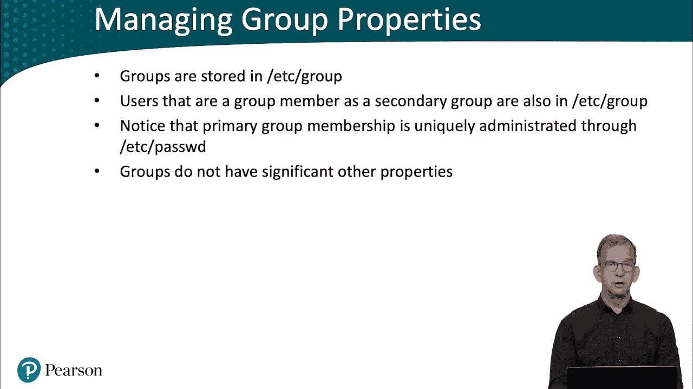

# 🐧 CompTIA Linux+：04：管理用户和组属性

在本节课中，我们将一起学习 Linux 系统里用户和组的相关属性。这些属性决定了用户是谁，能访问什么文件，登录后会看到什么界面。我们会把看起来复杂的配置文件讲成大白话，让初学者也能一看就明白，不用担心背景不足。

---

首先，我们来看看当你在 Linux 里创建一个用户时，系统到底记录了哪些信息。用户的基本资料主要保存在一个名为 /etc/passwd 的文本文件里。你可以把它想象成一本用户名录，每一行代表一个用户，每一行又被冒号分成几个字段，分别记录不同的属性。

核心概念可以用下面这行代码来描述：

```text
用户名:密码占位符:用户 ID:主组 ID:描述信息:家目录:默认 Shell
```

每个字段的具体含义我们一一来看。第一个字段是用户名，就是你登录时输入的名字。第三个字段是用户 ID，也就是 UID，系统内部用来区分用户的唯一数字，每个用户都有自己的号码，不会重复。第四个字段是主组 ID，也就是 GID，表示这个用户所属的主要组的编号。需要注意的是，在 /etc/passwd 里只能记录一个组，那就是主组。第五个字段是描述信息，原文里称作 Gecos，这是一个从 1970 年代流传下来的古老定义，今天我们通常把它当成备注栏，可以随便写点关于这个用户的说明。第六个字段是家目录，指的是用户登录后默认会停留的地方，也是用户拥有完整权限的私人空间。第七个字段是默认 Shell，登录后系统会自动启动的程序，也就是你用来输入命令的界面。

以下是 /etc/passwd 中每个字段的简单说明：

- 字段1：用户名。
- 字段3：用户 ID。
- 字段4：主组 ID。
- 字段5：描述信息。
- 字段6：家目录。
- 字段7：默认 Shell。

---

上一节我们介绍了 /etc/passwd 里记录了哪些内容，本节中我们来看看如何把这些信息读出来。如果你想查看某个用户当前的属性，有好几种办法。最简单的方法是使用 grep 命令，在 /etc/passwd 里搜索用户名。另一种方法是使用 getent 命令，它同样能打印出这些属性。

常用的命令如下所示：

```bash
grep 用户名 /etc/passwd
getent passwd 用户名
```

这里需要注意一点，用户的真实密码并不保存在 /etc/passwd 里，而是保存在 /etc/shadow 文件中。我们后面会专门讲密码文件，这里只需要知道密码不在 passwd 里就行，不要误以为 passwd 里存了明文密码。

以下是查看用户属性的常用命令：

- grep 用户名 /etc/passwd：直接在文本文件里搜。
- getent passwd 用户名：通过系统数据库查询，功能更全面。

getent 还有一个比较厉害的地方。如果你的用户不是存在本地，而是保存在外部系统里，比如 LDAP 服务器，使用 getent passwd 也能把外部系统的用户信息读出来。所以在某些公司环境中，getent 是非常有用的工具，不仅限于读取本地的 passwd 文件。

---

知道了怎么查看用户信息，接下来我们来看看怎么改这些信息。如果要修改用户的通用属性，比如家目录、Shell 或描述信息，使用 usermod 命令。如果要修改密码，使用 passwd 命令。密码的修改结果会写入 /etc/shadow，而不是 /etc/passwd，这一点很重要。

修改用户属性的常用命令如下：

```bash
usermod -d /home/新目录 用户名
passwd 用户名
```

以下是修改用户属性时常用的工具：

- usermod：修改 /etc/passwd 里的通用属性。
- passwd：修改用户密码，结果保存在 /etc/shadow。

---

前面几节我们都在聊单个用户，现在我们要把视角扩大，看看组是怎么管理的。组的信息保存在 /etc/group 文件里。如果一个用户属于多个组，除了主组之外的其他组叫次要组，这些次要组的成员关系也记录在 /etc/group 中。这是因为 /etc/passwd 里只能写一个组，也就是主组，所以完整的组信息需要从两个文件里拼凑出来。

组文件与用户文件的关系可以这样概括：

```text
/etc/passwd：只能记录主组
/etc/group：记录所有组及其次要组成员
```

管理组其实很简单，因为组本身没有太多其他属性，最重要的是搞清楚某个用户到底是哪些组的成员。你可以用 id 命令来查看。

以下是关于组文件的关键点：

- 组信息保存在 /etc/group。
- 次要组成员关系也在 /etc/group 里维护。
- 需要结合 /etc/passwd 和 /etc/group 才能得到完整画像。

---



本节课中，我们一起学习了 Linux 中用户和组属性的基本管理方法。我们了解了 /etc/passwd 里每个字段的含义，学会了用 grep 和 getent 查看用户信息，掌握了用 usermod 和 passwd 修改属性，还认识了 /etc/group 以及如何用 id 命令查看用户的组成员关系。希望这些内容能帮你打好基础，之后遇到用户管理问题时能从容应对。

