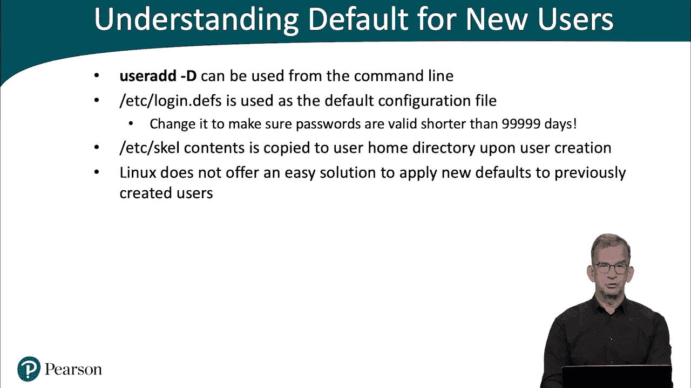
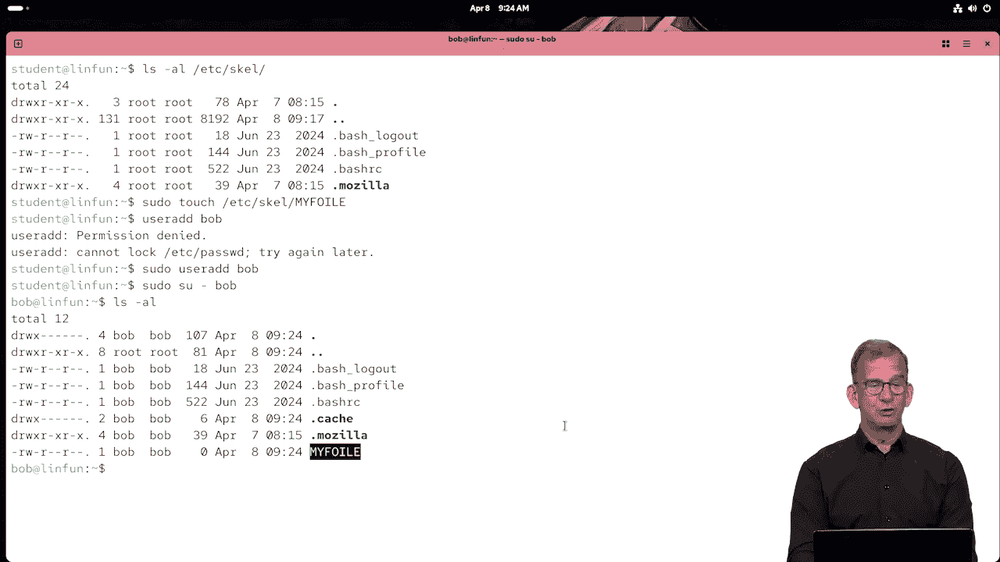

CompTIA Linux+：第5节：配置新用户的默认设置 🐧


在本节教程中，我们将学习如何为新创建的用户设置默认配置。具体来说，会介绍命令行工具、登录定义文件以及骨架目录的作用。我们还会通过一个实际演示，看看这些默认文件是如何被复制到新用户主目录中的。最后，会说明如何对已经存在的用户应用这些设置。


## 一、使用 useradd 命令查看默认值


在创建新用户之前，系统需要一组默认参数作为参考。这些参数决定了新用户的初始状态，比如密码有效期、主目录位置等等。在命令行中，可以使用 useradd 命令搭配 -D 选项来查看或修改这些默认设置。

以下是该命令的基本使用格式：

```bash
useradd -D
```

执行这个命令后，系统会显示当前为新用户预设的一些配置项。管理员可以根据需要，直接在这些默认值的基础上进行调整，从而保证之后创建的所有新用户都能继承同样的初始设置。


## 二、修改 /etc/login.defs 文件


除了命令行工具，Linux 还把一部分默认配置保存在系统配置文件里。其中最重要的一个文件就是 /etc/login.defs。这个文件里包含了很多与用户登录和密码策略相关的设置。

在之前的内容中，我们已经看过这个文件，特别是需要修改的某个数值，目的是确保密码的有效期设置短于 99999 天。这个限制主要是为了避免密码过期时间设置得过短，导致用户频繁修改密码带来不必要的麻烦。

以下是该配置文件的路径：

```bash
/etc/login.defs
```

管理员需要打开这个文件，找到与密码有效期相关的行，然后根据实际需求进行修改。修改完成后保存文件，之后创建的新用户就会按照新的规则来设置密码有效期。


## 三、了解 /etc/skel 骨架目录


当系统创建一个新用户时，除了分配用户 ID 和主目录之外，还需要把一些初始化文件放到用户的主目录里。这些初始化文件存放在一个特殊的目录中，这个目录就是 /etc/skel。skel 这个词可以理解为“骨架”的意思，因为它提供了新用户主目录的基本框架。

/etc/skel 目录里的内容，会在用户被创建时自动复制到该用户的家目录中。也就是说，如果你在这个目录里放置某些配置文件或者脚本，那么之后每一个新建用户的家目录里，都会出现同样的文件副本。

需要注意的是，Linux 并没有提供一个简单直接的办法，把这些默认设置应用到已经创建好的旧用户身上。如果你想让老用户也拥有这些新的默认文件，通常需要在创建之后，再通过其他命令逐个处理。

以下命令可以用来查看骨架目录的内容：



```bash
ls -A /etc/skel
```

这个命令会列出 /etc/skel 目录下所有的文件，包括隐藏文件。这些文件就是每个新用户主目录里会被复制过去的内容。


## 四、实际演示：复制默认文件


为了更直观地理解骨架目录的工作方式，我们可以做一个简单的实验。首先在 /etc/skel 目录里创建一个测试文件，然后新建一个用户，最后切换到这个新用户的 shell，查看测试文件是否被复制过去了。

以下是演示所需的命令：

```bash
sudo touch /etc/skel/myfile
sudo useradd bob
sudo su - bob
```

第一条命令是在骨架目录里新建一个名为 myfile 的空文件。这里故意拼写错误也没关系，因为我们只是想验证文件复制机制。

第二条命令是创建一个名为 bob 的新用户。

第三条命令使用 sudo 结合 su 来以 bob 用户的身份打开一个 shell。之所以这样组合使用，是因为可以避免输入密码，同时也不在乎 bob 用户本身是否设置了密码。

执行完这些命令后，你会发现 myfile 文件，连同其中的拼写错误，都已经出现在 bob 用户的家目录里了。这就是骨架目录的工作原理：目录里放什么，新用户的主目录里就会复制什么。


## 五、对已有用户应用默认设置


前面提到过，Linux 不会自动把骨架目录里的新内容应用到已经存在的用户身上。如果管理员修改了 /etc/skel，希望旧用户也能同步这些默认文件，就需要在之后手动处理。

比较实用的做法是，使用 usermod 命令或者 passwd 命令来修改相关参数。如果需要对大量用户进行批量操作，可以把这些命令放在一个循环里，逐个处理每个用户。

以下命令常用于修改已有用户的参数：

```bash
usermod
passwd -w
```

usermod 命令可以用来改变用户的各种属性，而 passwd -w 则用于设置密码过期前的警告天数。通过在脚本或循环里调用这些命令，管理员可以把新的默认设置推送给已经创建好的用户账户。


## 六、总结




在本节教程中，我们一起学习了如何配置新用户的默认设置。首先介绍了 useradd -D 命令，用于查看和修改命令行层面的默认参数。接着说明了 /etc/login.defs 文件的作用，特别是如何调整密码有效期限制。然后重点讲解了 /etc/skel 骨架目录，说明里面的文件会被复制到每个新用户的主目录中。通过实际演示，验证了文件会随新用户一同被复制过去。最后也说明了，针对已经存在的用户，需要借助 usermod 和 passwd 等命令，配合循环来批量应用默认设置。希望这些内容能帮助你更好地管理 Linux 系统中的用户账户。
