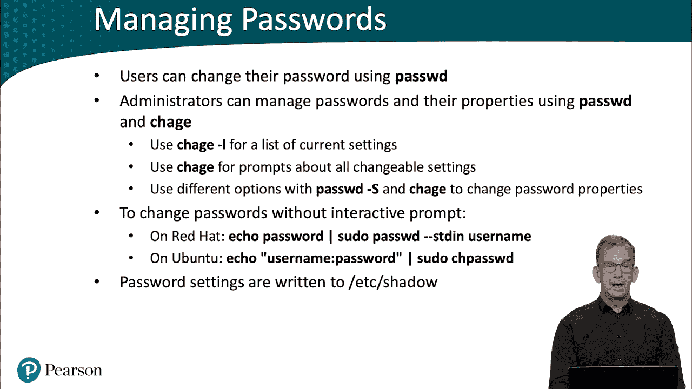
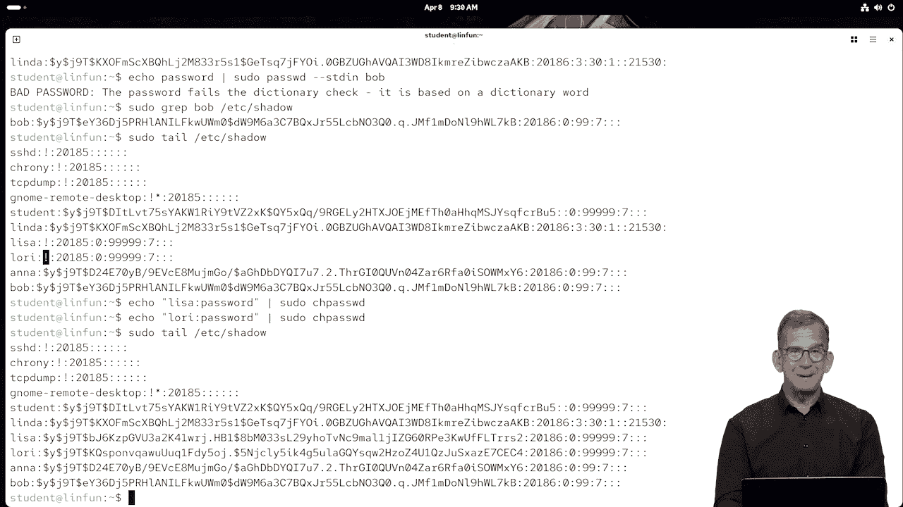

# CompTIA Linux+ V8：106-107：管理密码属性 🔐

在本节课中我们将要学习 Linux 系统中密码属性的管理方法。密码是保护用户账户安全的最基本手段，作为系统管理员，你不仅要知道怎么修改密码，还要知道密码过期、账户锁定这些设置是怎么控制的。我们会先介绍普通用户和管理员可以使用哪些命令，然后重点看看 chage 命令怎么进行交互式设置，接着讲解在不用弹出提示窗口的情况下如何批量修改密码，最后我们会打开 /etc/shadow 文件，看看密码信息到底是怎么存储在硬盘里的。内容比较基础，但非常实用，建议初学者仔细看完。

接下来我们先来看看修改密码最基础的命令。普通用户可以使用 passwd 命令来修改自己的密码，而系统管理员则可以使用 passwd 和 chage 命令来管理其他用户的密码及其属性。这里的 chage 是 change aging 的缩写，专门用来修改密码老化信息，也就是密码的有效期相关设置。如果你想查看当前的密码配置，可以使用 chage -l 命令列出所有当前设置。

然后我们重点看看 chage 命令的交互式使用方法。chage 命令有一个很好的特点，就是运行之后它会提示你修改所有可更改的设置。这意味着你只需要在用户名后面运行 chage，系统就会逐一询问你每个适用的设置项，比如最小密码使用天数、最大密码使用天数、上次修改日期等等。虽然 passwd -S 也能查看密码状态，但我强烈建议你使用 chage，而不是 passwd -S，因为交互式界面真的非常方便，你不需要去记复杂的参数，按照提示一步步填写就可以了。

除了交互式修改，有时候我们也需要在不弹出任何提示窗口的情况下修改密码，比如写脚本自动化操作时。在 Red Hat 系系统上，你可以使用 echo 命令输出密码，然后通过管道符把 echo 命令的输出传给 passwd --stdin 命令，后面跟上目标用户名。在 Ubuntu 上稍微有点不同，你需要使用 chpasswd 命令，具体格式是 echo 用户名:密码 通过管道传给 sudo chpasswd。有趣的是，chpasswd 在 Red Hat 上也已经存在，但 passwd --stdin 这个选项在 Ubuntu 上是没有的，所以如果你想写兼容性好的脚本，最好还是优先使用 chpasswd。

以下是两种系统常用的非交互式修改密码命令：

- Red Hat 系系统：echo "password" | sudo passwd --stdin username
- Ubuntu 系统：echo "username:password" | sudo chpasswd

修改完密码之后，我们来看看这些设置到底保存在哪里。所有的密码设置其实都写在 /etc/shadow 文件里面。我们可以先用 sudo chage -l Linda 来查看用户 Linda 的密码属性，这时候系统会显示各项设置，比如最短密码使用天数、最长密码使用天数、上次密码修改日期（这是系统设置，不建议随意修改）、密码过期前的警告天数、账户过期日期等等。如果你想查看修改后的具体数值，可以使用 sudo grep Linda /etc/shadow 命令。这时候你会看到一长串字符，第一部分是加密后的密码哈希值，接着是从 1970 年 1 月 1 日开始算的用户创建天数，然后是最小密码使用天数、最大密码使用天数、过期日期，以及账户过期日期，这些日期同样都是以 1970 年 1 月 1 日为基准的天数计算出来的。

密码存储的核心格式可以简单理解为：

/etc/shadow 中每一行 = 用户名 : 加密密码哈希 : 创建天数 : 最小使用天数 : 最大使用天数 : 过期天数 : 账户过期天数

接下来我们演示一下不用交互式提示就能修改密码的方法，同时也看看系统对弱密码的处理。比如我们尝试给用户 Bob 修改密码，命令是 echo password 通过管道传给 sudo passwd --stdin Bob。这时候你可能会看到一个错误提示，说密码没有通过字典检查，因为 password 这个词太简单，属于字典里的常见单词。不过不要担心，即使出现了警告，使用 sudo 超级用户权限后，密码还是会被修改成功。你可以用 sudo grep Bob /etc/shadow 验证一下，会发现密码确实已经改过了。这告诉我们，当你使用管理员权限时，系统会给出弱密码警告，但由于你拥有超级用户权限，它最终还是会执行修改操作。

最后我们看看 Ubuntu 系统上有什么替代方案，以及如何检查还没有设置密码的用户。首先，我们可以用 sudo tail 查看 /etc/shadow 文件，寻找第二个字段是感叹号的用户，感叹号表示该用户尚未设置密码。经过检查，发现 Lisa 和 Lori 这两个用户还没有设置密码。然后你可以使用 echo Lisa:password 通过管道传给 sudo chpasswd 来为它们设置密码，同样的方法也可以处理 Lori。这样一来，目前为止系统里的所有用户都有密码了。

如我之前提到，chpasswd 在 Red Hat 和 Ubuntu 上都存在，而 passwd --stdin 只在 Red Hat 上存在，所以在日常工作中你最好还是优先使用 chpasswd，这样不管在哪个发行版上都能用。

本节课中我们一起学习了 Linux 中密码属性的管理方法。我们介绍了 passwd 和 chage 命令的基本用法，学习了如何通过 chage 的交互式界面修改密码过期设置，也掌握了在 Red Hat 和 Ubuntu 上非交互式修改密码的不同方法。最后，我们查看了 /etc/shadow 文件中密码信息的底层存储结构，了解了加密哈希值和基于 1970 年 1 月 1 日的天数计算方式。希望这些内容能帮助你更好地管理 Linux 系统中的用户密码安全。

