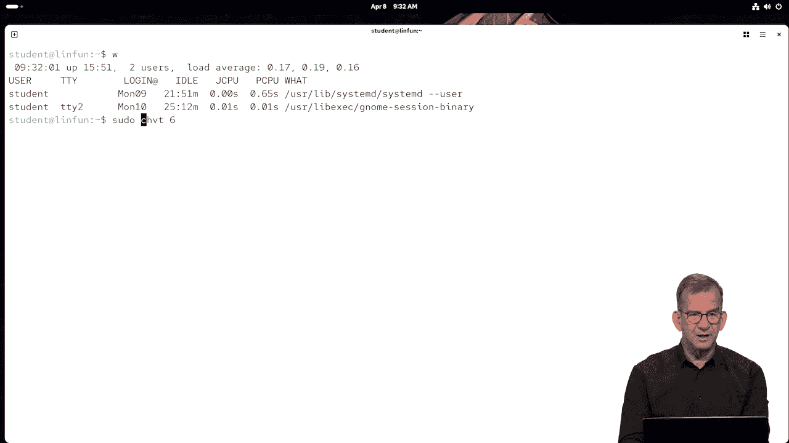
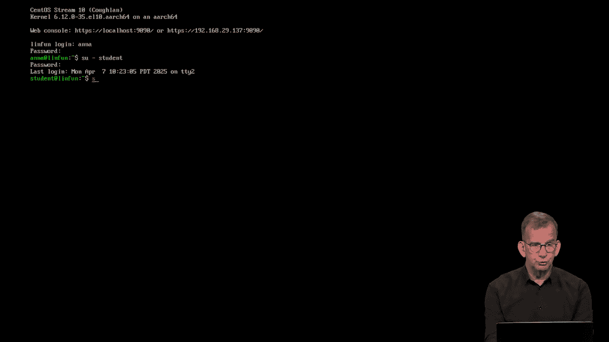
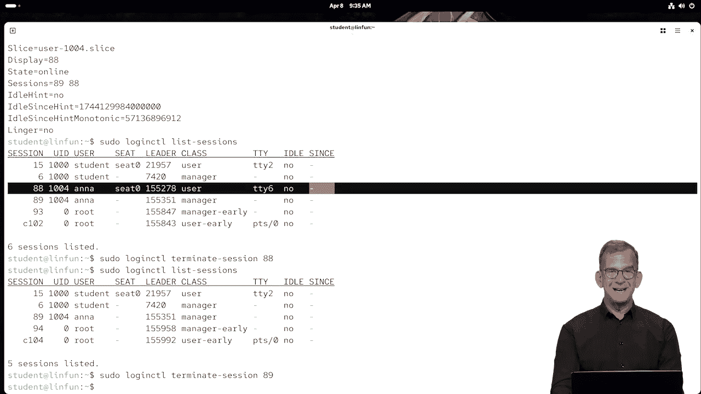

# CompTIA Linux+ V8：07：管理当前用户会话 🖥️


在本节课中我们将要学习Linux系统中关于用户会话管理的基础知识。会话这个词听起来可能有点抽象，你可以把它理解为用户登录进系统之后，系统为他打开的一个工作空间。作为系统管理员，日常工作中经常需要回答这样一些问题：现在系统里有哪些人在线？他们每个人正在操作什么？如果发现一个陌生用户或者一个行为不正常的用户，该怎么把他踢下线？本节课就是要围绕这些问题来展开。我们会先从最简单的两个命令who和w开始讲解，然后再介绍功能更全面的loginctl工具，最后通过一个完整的操作例子，让你明白在真实的服务器上该如何一步步查看和管理当前的用户会话。


首先，我们来认识Linux里最老牌的两个查看用户命令，也就是who和w。这两个命令的作用都是帮助管理员了解当前系统上线了哪些用户，但它们提供的信息量不一样。who命令比较简单直接，它只会列出当前登录用户的基本信息，比如用户名、登录所在的终端设备，以及登录的时间点。如果你只需要快速确认谁在系统里，who命令就足够了。而w命令虽然只有一个字母，但在Linux系统里其实是一个非常实用的工具。它不仅能显示who命令能看到的那些基本信息，还会额外告诉你每个在线用户当前正在执行什么操作，也就是他们的实时活动状态。换句话说，who只告诉你‘谁来了’，而w还会告诉你‘他在干什么’。


以下是这两个命令的主要区别：
- who：仅显示登录用户的基本信息，包括用户名、终端和登录时间。
- w：显示登录用户的基本信息，并且额外显示他们当前正在执行的操作。


```bash
who
w
```


有了who和w的基础之后，我们可以进一步了解系统里另一个更专业的会话管理工具，它叫做loginctl。loginctl是systemd系统组件的一部分，专门用来管理当前的用户会话。相较于who和w只能‘看’的功能，loginctl不仅能让你查看所有活跃会话，还能查看某个特定会话的详细信息，查看某个用户的当前设置，甚至在必要时直接终止一个你不想让它继续运行的会话。不过这里有一点需要注意，loginctl依赖于systemd，所以如果你的系统里没有安装systemd，或者systemctl命令不可用，那么loginctl大概率也无法使用。如果你的环境里恰好有这个命令，那它会是一个非常方便的助手。




loginctl中与会话管理最相关的命令如下：
- `loginctl list sessions`：列出当前系统中所有处于活跃状态的会话。
- `loginctl show session <SESSION_ID>`：显示某个会话ID的详细信息。
- `loginctl show user <USER_NAME>`：显示某个用户的当前会话设置和信息。
- `loginctl terminate session <SESSION_ID>`：立即终止指定的会话，让对应用户立刻断开连接。


```bash
loginctl list sessions
loginctl show session 88
loginctl show user anna
loginctl terminate session 88
```




光看命令的定义可能还是比较抽象，所以接下来我们通过一个实际操作场景，看看这些命令在真实操作中是怎么配合使用的。假设你现在是一名系统管理员，需要检查服务器上的用户活动情况。首先，我们在当前终端运行w命令，看看现在谁在线。然后，我们切换到另一个虚拟终端，也就是第六个虚拟终端，以用户anna的身份登录进去。登录成功之后，我们用su命令切换到student用户，再使用chvt命令切换回第二个虚拟终端。这时候我们再次运行w命令，你就会发现屏幕上多出了一条anna在tty6上的登录记录。


这个演示的具体步骤可以总结如下：
1. 运行`w`命令，查看当前在线用户及其活动。
2. 切换到虚拟终端6，以用户anna登录。
3. 使用`su - student`切换到student用户。
4. 使用`chvt 2`返回虚拟终端2。
5. 再次运行`w`命令，确认anna的登录信息已经显示。


```bash
w
# 切换到虚拟终端6
chvt 6
# 以用户anna登录（此处需输入密码）
# 切换到student用户
su - student
# 返回虚拟终端2
chvt 2
# 再次查看在线用户
w
```


查看完谁在线之后，如果你发现有一个你不认识的用户，或者某个用户的行为看起来不正常，你就可以用loginctl来进一步排查和处理。首先，使用`sudo loginctl list sessions`来查看系统里现在都有哪些活跃会话。你也可以按Tab键进行命令补全，看看loginctl还提供了哪些子命令，比如`list users`可以列出当前系统里的用户。如果你想了解某个具体用户的情况，比如用户anna，就可以运行`sudo loginctl show user anna`，这时你会看到anna当前的各种会话设置和信息。假设你发现anna不应该出现在系统里，那么你可以先用`loginctl list sessions`看看她开了哪些会话，比如会话88和会话89。再通过会话列表确认会话88对应的是tty6终端，这就是你需要重点处理的目标。接下来，使用`sudo loginctl terminate session 88`来强制结束会话88。执行之后，会话88就会被移除，而会话89可能还保留着。如果你完全不清楚这个用户在系统里做什么，为了保险起见，也可以把剩下的会话一并终止。


处理可疑会话的典型操作流程如下：
- 查看当前活跃会话：`sudo loginctl list sessions`
- 查看特定用户信息：`sudo loginctl show user anna`
- 终止指定会话：`sudo loginctl terminate session 88`


```bash
sudo loginctl list sessions
sudo loginctl show user anna
sudo loginctl terminate session 88
```




本节课中我们一起学习了如何在Linux系统中管理当前用户会话。首先介绍了who和w两个基础命令，who用于快速查看在线用户名单，w则可以额外查看用户的当前活动。接着讲解了loginctl工具，它属于systemd的一部分，支持列出活跃会话、查看会话详情、查看用户信息以及终止指定会话。最后通过一个从切换虚拟终端到查看、终止会话的完整例子，把这些命令的实际使用流程串联了起来。希望这些内容能帮助你在日常系统管理工作中更好地掌控用户会话。
