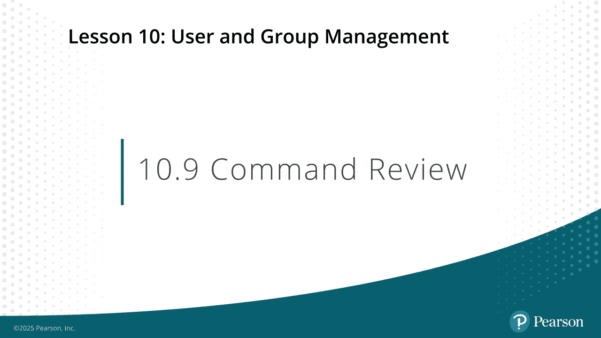
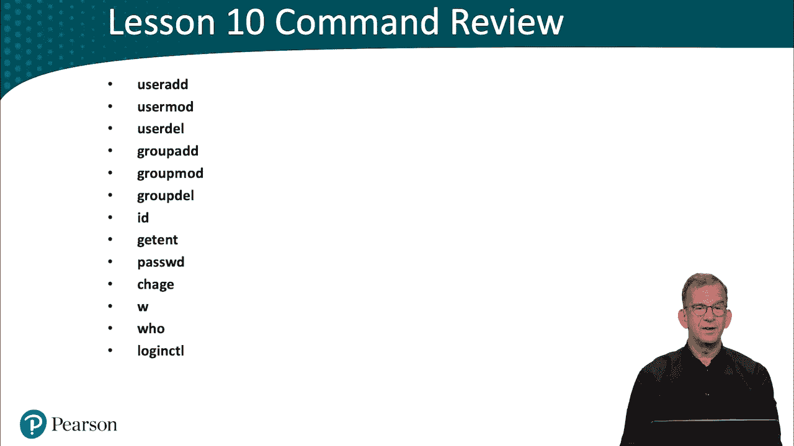

# 🐧 Linux用户与组管理命令复习：108-109：命令回顾

在本节课中我们将要学习本课前面讲过的那些 Linux 命令。这些命令主要用来管理系统上的用户账户、用户组、密码设置以及当前登录会话，是日常系统维护中最基础也最常用的一组工具。即使你只是刚开始接触 Linux，也能通过这节课把之前学过的内容梳理一遍，加深印象，为后续的系统管理工作打下坚实基础。

### 用户管理命令

现在我们来回顾一下用于添加、修改和删除用户的命令。以下是具体的用户管理命令：

- `useradd`：用于创建一个新用户账户，把这个人加入到系统里。
- `usermod`：用于修改已经存在的用户信息，比如更改用户的主目录、所属组或者登录 shell。
- `userdel`：用于删除一个用户账户，把这个人从系统里移除。

这三条命令分别对应用户生命周期中的“增、改、删”，掌握它们之后，你就可以独立完成普通用户的日常维护工作了。

### 组管理命令

上一节我们介绍了如何管理单个用户，本节中我们来看看如何管理用户组。Linux 中的用户通常会被组织到不同的组里，方便统一控制文件权限和资源访问。以下是组管理命令：

- `groupadd`：用于创建一个新的用户组。
- `groupmod`：用于修改已经存在的组信息，例如更改组名或者组 ID。
- `groupdel`：用于删除一个不再需要的用户组。

组管理的逻辑和用户管理非常相似，无非也是添加、修改和删除，只不过操作的对象从“用户”变成了“用户组”。

### 查询用户和组信息命令

接着我们介绍用于查询用户和组信息的命令。在实际工作中，你经常需要确认某个用户属于哪些组，或者从系统数据库里读取用户记录。以下是两个比较实用的查询命令：

- `id`：这个命令很方便，直接显示指定用户的用户 ID、组 ID 以及所属的所有组信息，一目了然。
- `getent`：它可以从本地 `/etc/passwd` 文件，也可以从集中式认证系统（比如 LDAP）中获取用户和组的管理信息，适用范围更广。

有了这两个命令，你就不需要手动去翻阅配置文件，就能快速知道用户的身份和归属情况。

### 密码与账户老化命令

上一节我们介绍了怎么查用户和组，本节中我们来看看怎么处理密码和账户有效期。系统管理员不仅要创建用户，还要设置密码规则，控制账户什么时候过期。以下是两个关键命令：

- `passwd`：用于设置用户的密码属性，比如修改密码、锁定账户或者强制用户下次登录时修改密码。
- `chage`：专门关注用户的账户老化信息，可以查看和修改密码最后修改时间、账户过期日期等内容。

这两个命令配合使用，能够帮助你加强系统的安全性，防止长期不用的账户成为安全隐患。

### 查看当前登录用户与会话命令

最后我们来看看如何查看当前系统里有哪些用户，以及他们正在做什么。有时候你需要知道谁正在占用终端，或者要强制结束某个用户的会话。以下是常用命令：

- `w`：以老式风格显示当前登录用户的信息，包括登录终端、登录时间以及正在运行的命令。
- `who`：列出当前登录到系统的用户名单。
- `loginctl`：这是 Systemd 提供的会话控制接口，可以获取当前用户及其活动会话的信息，甚至可以用来终止某个会话，非常实用。

例如，当你发现某个用户长期挂起会话占用资源时，就可以用 `loginctl` 把相关会话终止掉。

### 本节总结

本节课中我们一起学习了 Linux 系统中用于管理用户和组的核心命令。包括添加、修改和删除用户的 `useradd`、`usermod`、`userdel`；管理用户组的 `groupadd`、`groupmod`、`groupdel`；查询身份信息的 `id` 和 `getent`；处理密码与账户老化的 `passwd` 和 `chage`；以及查看当前登录用户和会话的 `w`、`who` 和 `loginctl`。希望你能把这些命令牢牢记住，在实际操作中多加练习。
