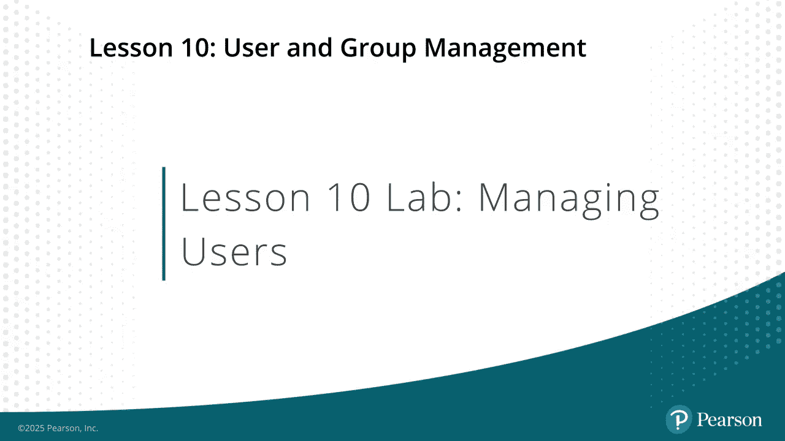
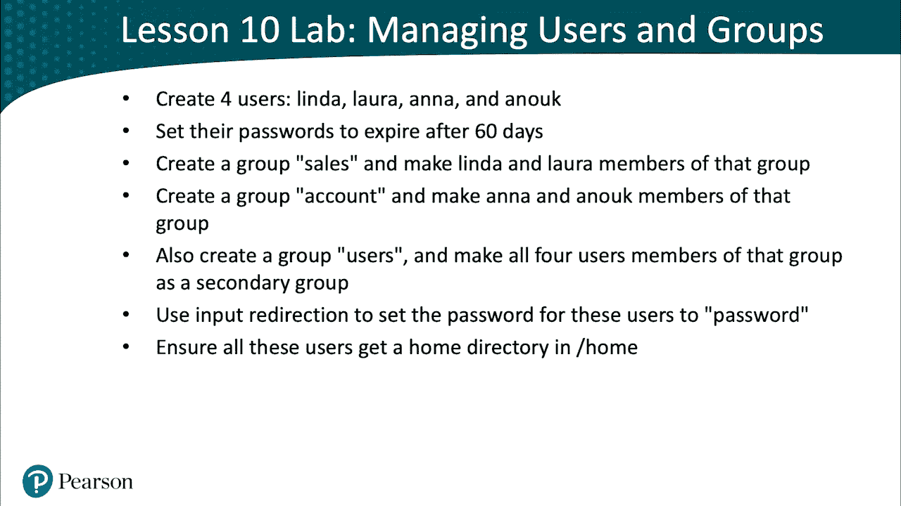

# CompTIA Linux+ V8：10：👥 用户管理实验

## 概述

在本节课中我们将要学习 Linux 系统中的用户管理操作。具体内容包括创建用户账号、设置密码过期时间、建立用户组、把用户加入不同的用户组，以及使用输入重定向来批量设置密码。本实验属于 CompTIA Linux+ V8 课程的第 10 课，是学习用户与权限管理的重要实践环节，祝你实验顺利。

在开始动手之前，我们先把本实验需要完成的任务整理一下，这样可以在操作时心里有数，不会遗漏任何一步。

以下是本实验的主要任务清单：


- 创建四个用户，分别是 Linda、Laura、Anna 和 Annoook。
- 把这四个用户的密码设置为 60 天后过期。
- 创建名为 saless 的用户组，并把 Linda 和 Laura 加入这个组。
- 创建名为 account 的用户组，并把 Anna 和 Annoook 加入这个组。
- 创建名为 users 的用户组，并把这四个用户全部作为附加组加入这个组。
- 使用输入重定向的方法，为这些用户设置统一密码 password。
- 确保每个用户在 /home 目录下都有自己的家目录。

## 步骤一：创建用户并设置密码过期时间



上一节我们介绍了 Linux 用户账号的基本概念，本节中我们来看看如何在实际系统中创建用户，并且控制密码的有效期。

创建用户最常用的命令是 useradd。为了让用户拥有自己的私人空间，系统通常会在 /home 目录下为每个用户创建一个同名的家目录。关于密码过期时间，我们可以用下面的公式来理解：

```text
密码过期日期 = 当前日期 + 60 天
```

在命令行中，这通常对应于给用户设置最大密码使用期限为 60 天，相关的操作命令示例如下：

```bash
chage -M 60 用户名
```

以下是本实验需要创建的用户名单：

- Linda
- Laura
- Anna
- Annoook

在执行创建命令时，要注意加上创建家目录的参数，这样每个用户完成创建后，都能在 /home 目录下找到对应的个人目录，用来存放自己的文件和配置信息。

## 步骤二：创建用户组并管理组成员

刚才我们完成了用户账号的创建，本节中我们来看看如何把这些用户组织到不同的用户组里面。

用户组的作用是让多个用户共享相同的权限和资源。在 Linux 中，一个用户可以有一个主组，也可以同时属于多个附加组。用户与组的关系可以用下面的伪代码来描述：

```text
用户 = 主组 + {附加组1, 附加组2, ...}
```

以下是本实验需要创建的用户组以及对应的成员：

| 用户组名称 | 组成员 |
|-----------|--------|
| saless | Linda、Laura |
| account | Anna、Annoook |
| users | Linda、Laura、Anna、Annoook |

需要注意的是，users 组明确要求作为这四个用户的附加组。这意味着这些用户在保留原有主组的同时，还能通过 users 组获得额外的访问权限。在实际操作时，要分清楚哪些组是主组，哪些组是附加组，避免设置错误。

## 步骤三：使用输入重定向设置密码

上一节我们介绍了用户组的创建方法，本节中我们来看看如何快速地为多个用户设置相同的密码。

通常使用 passwd 命令设置密码时，系统会以交互方式提示输入密码，不适合批量操作。为了在实验中自动化完成，可以使用输入重定向，直接把密码传递给命令。输入重定向的核心思路可以用下面的代码片段表示：

```bash
echo "password" | passwd --stdin 用户名
```

或者使用重定向符号，从文件中读取密码：

```bash
passwd 用户名 < 密码文件
```

以下是需要设置密码的用户名单：

- Linda
- Laura
- Anna
- Annoook

为这些用户设置的统一密码是 password。设置完成之后，结合之前设置的 60 天过期时间，系统会在适当的时候提示用户修改密码。

## 步骤四：验证家目录是否创建成功

在完成用户、用户组和密码的设置之后，本节中我们来看看如何确认每个用户是否都拥有家目录。

在 Linux 系统中，用户的家目录通常位于 /home 目录下，目录名和用户名一致。检查家目录是否存在，可以直接查看 /home 目录下的内容，也可以尝试进入每个用户的家目录。

以下是需要验证的用户家目录路径：

- /home/Linda
- /home/Laura
- /home/Anna
- /home/Annoook



如果发现某个用户没有家目录，可能是创建用户时漏掉了创建家目录的参数，这时需要重新创建用户，或者手动创建目录并设置正确的所有者和权限。

## 总结

本节课中我们一起学习了如何在 Linux 中创建多个用户、设置密码过期时间、创建不同的用户组并管理组成员关系，以及使用输入重定向批量设置密码。希望你能通过这个实验，熟练掌握用户管理的基本命令和操作流程，为后续学习系统权限打下基础。

