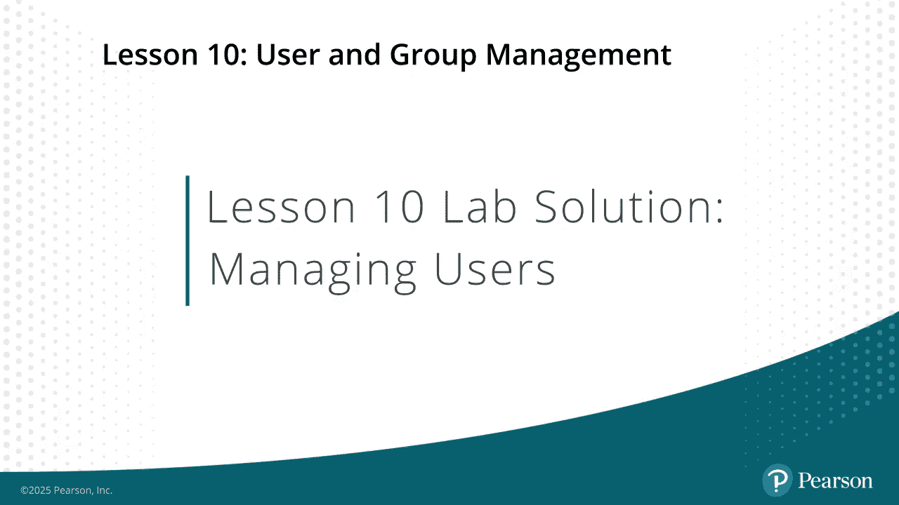
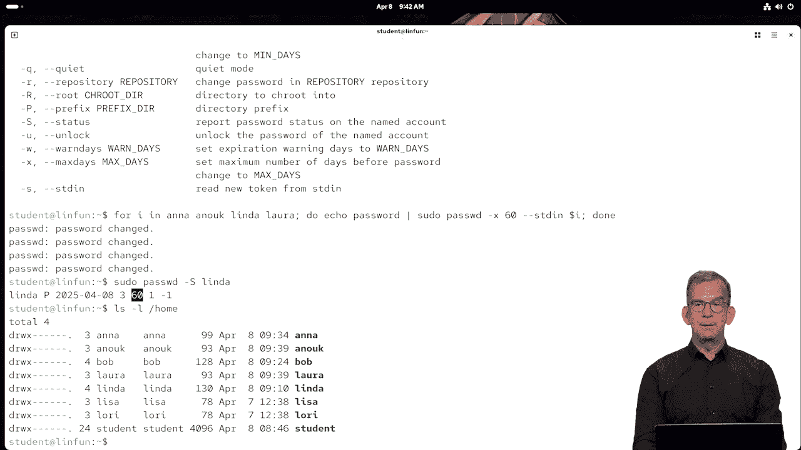

# CompTIA Linux+：10：管理用户实验解答 👥




在本节课中我们将要学习如何在 Linux 系统中创建用户组、添加用户并将用户加入指定组，同时还会设置密码过期时间，并验证用户家目录是否正确创建。整个实验围绕用户与组的日常管理展开，适合初学者了解 Linux 账户管理的基本操作。


## 创建所需的用户组 🏷️

首先我们要准备好实验需要的用户组，因为用户加入组之前，组必须先存在。在正式创建用户之前，我们先确认环境中已经包含所需的组，然后依次创建几个常用组。

以下是创建组所使用的命令：

```bash
groupadd sales
groupadd account
groupadd users
```

第一条命令是 groupadd sales，用来创建名为 sales 的组，如果系统提示组已经存在，我们可以直接忽略，因为后面还会用到这个组。第二条命令 groupadd account 用来创建 account 组，这一步通常会成功创建一个新组。第三条命令 groupadd users 用来创建 users 组，同样如果已经存在也不需要担心，这不影响后续操作。


## 创建用户并添加到组 👤

上一节我们介绍了如何创建用户组，本节中我们来看看如何创建用户，并把用户添加到刚才建好的组里面。创建用户时要注意，如果用户已经存在，就不要重复创建，以免覆盖已有的设置。

以下是用户管理相关的操作命令：

```bash
id Linda
useradd -G sales,users Laura
useradd -G account,users Anna
id Anna
```

对于用户 Linda，系统显示该用户已经存在，所以我们不需要再次执行创建命令。Linda 需要同时成为 sales 组和 users 组的成员，我们可以执行 id Linda 命令来快速检查，输出结果会列出 Linda 当前所属的全部组，如果看到 sales 和 users，就说明组成员身份已经设置成功。

接下来处理用户 Laura，因为系统里还没有这个用户，所以不存在覆盖任何已有组成员身份的风险，直接使用 useradd -G sales,users Laura 把她加入 sales 和 users 两个组就足够了。这里讲话人不小心说成了 user Mo，实际上是指 useradd 命令。

然后是用户 Anna，Anna 也是一个尚未存在的用户，执行 useradd -G account,users Anna，把她加入 account 组和 users 组。随后还要确认 Anna 是否需要成为 account 组和 users 组的成员，并且不要使用当前的组赋值设置。执行完这些命令之后，用 id Anna 命令查看 Anna 目前是哪些组的成员，输出结果会列出她所属的全部组。


## 批量设置密码过期时间 🔐

上一节我们介绍了如何创建用户并添加到组，本节中我们来看看如何为用户设置密码，并且让这些密码在指定天数后过期。在 Linux 中，密码策略是账户安全的重要部分，合理设置过期时间可以提醒用户定期更换密码。

我们先查看 passwd 命令的帮助信息，看看有没有让密码过期的选项：

```bash
passwd --help
```

在帮助信息中，我们发现 -x 选项可以用来设置密码过期天数，所以接下来需要用到 -x 60，同时还要给用户设置实际的密码。

为了给多个用户批量设置密码，我们可以使用一段简单的 shell 脚本，避免一个一个地手动输入。以下是具体的循环脚本：

```bash
for i in Anna Linda Laura
do
  echo password | sudo passwd --stdin -x 60 $i
done
```

脚本的工作流程是这样的：首先遍历一个用户列表，包括 Anna、Linda 和 Laura。在每次循环里，把当前的用户名存到名为 i 的变量中，然后执行 do 关键字后面的所有操作。具体做法是使用 echo 输出密码字符串，通过管道符号传给 sudo passwd --stdin 命令，同时加上 -x 60 选项，表示密码在 60 天后过期，并且 --stdin 表示 passwd 从标准输入读取密码。

注意这里必须在 passwd 前面加上 sudo，因为普通用户没有权限修改其他用户的密码，如果不加 sudo，系统会报错说只有 root 用户才能通过标准输入设置密码。加上 sudo 之后，命令就能正常执行，所有指定用户的密码都会被修改成功，并且过期时间会被正确设置。


## 验证密码过期设置和家目录 📁

上一节我们介绍了如何批量设置密码过期时间，本节中我们来看看如何验证这些设置是否生效，并确认用户是否拥有家目录。验证步骤能帮助我们确保实验配置没有遗漏。

首先检查密码过期设置是否成功，执行以下命令：

```bash
sudo passwd -S Linda
```

输出内容可能看起来不太容易阅读，但我们可以重点关注其中的数字 60，这就是我们要找的内容，表示已经为用户 Linda 设置好了密码过期时间。

最后，我们还需要确认用户是否拥有家目录。在大多数 Linux 发行版中，使用 useradd 创建用户时，家目录会默认自动创建。不过如果你是在 Ubuntu 上操作，就需要显式加上 -m 选项，即 useradd -m，否则创建的用户就不会有家目录了。如果没有加 -m，用户登录后就没有个人主目录可用，这会带来不少麻烦。

以下是在 Ubuntu 上创建带家目录用户的命令示例：

```bash
useradd -m username
```




本节课中我们一起学习了如何创建用户组，如何把用户添加到指定组，如何使用 shell 脚本批量设置密码并让密码在 60 天后过期，以及如何确认用户家目录是否正确创建。这些是 Linux 系统管理员日常维护用户账户的基础技能，希望对你有所帮助。
