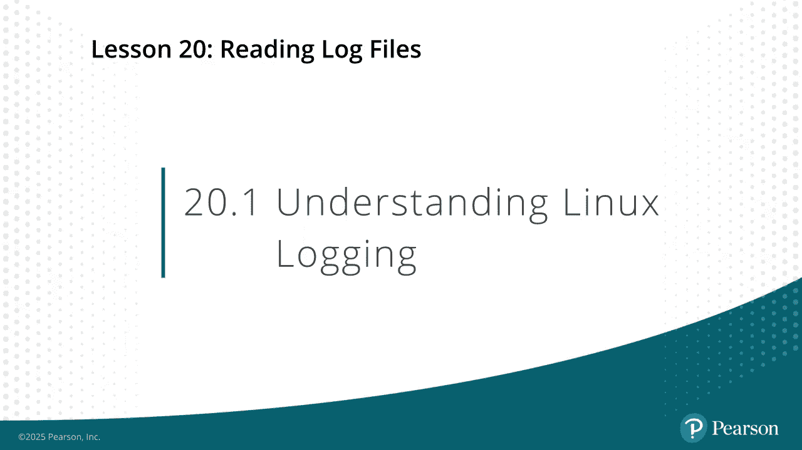
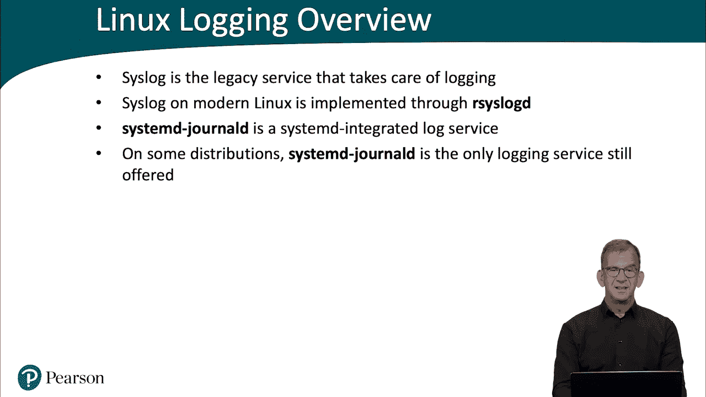

# 🐧 CompTIA Linux+ V8：第1节：理解Linux日志

在本节课中，我们将学习Linux系统上的日志记录机制。主要目的是让你了解Linux上有哪些日志方案，这些方案是怎么演变过来的，以及现在的系统是如何把日志保存下来的。所有内容都会用最直白的语言来解释，即使你是完全的初学者，也能跟上节奏。

在Linux系统中，你会发现存在多种不同的日志记录方案，接下来我们尝试一起理解这些方案。

以下是Linux上常见的日志记录方案：

- 老旧的系统日志服务，用于处理最基础的日志任务。
- 现代Linux中常用的日志守护进程，负责把日志写入磁盘。
- 随systemd一起提供的集成日志服务，现在被很多发行版采用。

一切都起源于`syslog`。`syslog`是负责处理日志的旧式服务。

它最初是在Unix系统的早期就被实现出来的。所以说，`syslog`已经存在了非常长的时间，可以说是日志领域的老前辈了。

上一节我们介绍了`syslog`这个早期的日志服务，本节中我们来看看现代Linux是如何实现日志功能的。

在现代Linux系统中，日志功能是通过`rsyslogd`实现的。你可以把`rsyslogd`理解为`syslog`的升级版本。

我们也见过一些其他的替代方案，但是`rsyslogd`确实是比较成熟的版本。它的主要工作就是把日志事件写入到`/var/log`目录中的文件里。

这里，`/var/log`就是系统存放日志文件的默认文件夹。

接着出现了`systemd`，`systemd`负责管理系统的方方面面，几乎无所不包。

所以`systemd`也自带了自己的日志服务，名字叫做`systemd-journald`。在某些Linux发行版中，`systemd-journald`是目前仍然提供的唯一日志服务。

不过为了找到合适的日志信息，你需要知道关于`systemd-journald`的几个要点。

以下是关于`systemd-journald`需要了解的关键点：

- 它是systemd的一部分，专门负责收集内核和各种应用程序产生的日志。
- 在部分发行版中，它可能是系统中仅剩的日志记录方式，取代了传统的`syslog`服务。
- 使用它查看日志时，需要掌握相应的命令和查询方法，这样才能快速定位到你想要的信息。

本节课中，我们一起学习了Linux日志系统的基础知识。我们介绍了最早的`syslog`服务，讲解了现代Linux中通过`rsyslogd`将日志写入`/var/log`目录的方式，还了解了`systemd-journald`作为`systemd`自带日志服务的角色。希望这些内容能帮你建立起对Linux日志的初步认识，为后续的学习打下基础。

