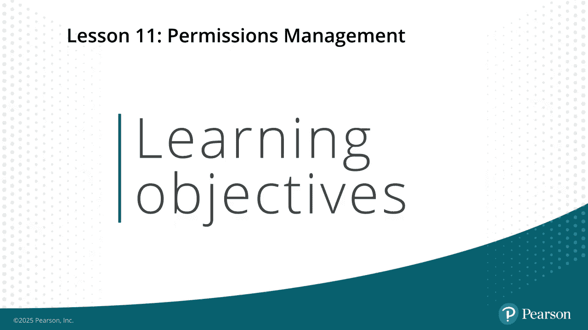
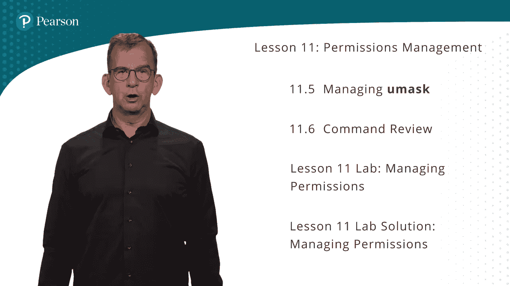

🔐 CompTIA Linux+ V8：111：学习目标

欢迎来到权限管理课程。在本节课中我们将要学习怎么通过设置权限来管理用户对文件的访问。这节课的内容比较基础，非常适合刚接触 Linux 的新手。课程会先从一个视频开始，把基本权限讲清楚。接着会教你怎么把这些基本权限实际应用上去。然后我们会聊高级权限，再讲怎么用 UMask 来设置默认权限。最后会有一个小案例实验，我会把实验的解答演示给你看。整个流程是由浅入深的，跟着视频一步步做就行。



首先，我们来看看最基础的部分。课程会从一段视频开始，这段视频专门用来解释基本权限是什么。基本权限其实就是操作系统用来决定谁能读文件、谁能改文件、谁能运行文件的一套规则。了解这些规则之后，你就能明白 Linux 里文件访问控制的最简单形式了，以后学复杂的内容也会有基础。

以下是基本权限说明视频里会覆盖的主要内容：
- 基本权限的定义和作用
- 权限如何影响用户访问文件
- 基本权限在日常系统管理中的常见场景

上一节我们介绍了基本权限的概念，本节中我们来看看怎么把这些权限用起来。光知道权限是什么还不够，你还需要知道怎么去设置，怎么去修改，怎么让权限真正生效。应用基本权限是 Linux 系统管理里最常见的操作之一，几乎每天都会用到，所以这一部分一定要多练习。

以下是应用基本权限时需要掌握的具体操作：
- 使用命令行工具修改文件或目录的权限
- 检查当前文件的权限设置是否符合要求
- 验证普通用户是否获得了预期的访问能力

学完了基本权限的应用，我们再进一步了解高级权限。接下来的内容是让你理解高级权限以及如何把它们应用到实际系统中。高级权限比基本权限多了一些特殊的设置，通常用于处理更复杂的访问控制需求，比如让普通用户暂时获得管理员权限来运行某个程序，或者控制共享目录里的文件删除权限。

以下是高级权限的常见类型和作用：
- 设置用户ID（SUID）权限，允许文件以文件所有者的身份运行
- 设置组ID（SGID）权限，允许文件以文件所属组的身份运行
- 粘滞位（Sticky Bit），常用于共享目录防止用户删除他人的文件

掌握了高级权限之后，我们还需要知道系统默认会给新建文件什么权限。之后我会告诉你如何使用 UMask 来配置默认权限。UMask 就像一个过滤器，它决定了新建文件或目录时默认要去掉哪些权限位。合理设置 UMask 可以避免新文件权限过大带来的安全隐患，是系统加固的重要一环。

以下是 UMask 配置默认权限的核心公式：
```text
最终权限 = 基础权限 & (~UMask)
```

以下是设置 UMask 的常见命令示例：
```bash
umask 022
```

理论学习差不多了，最后我们通过一个实实在在的例子来练手。在本节实验课的最后，你将完成一个小型案例场景，我会向你展示实验解答。这个案例会把前面学到的基本权限、高级权限和默认权限都串联起来，让你在实际操作中加深印象，不用只看理论不动手。



本节课中我们一起学习了权限管理的相关知识点。具体包括基本权限的说明、如何应用基本权限、高级权限的理解与应用，以及使用 UMask 配置默认权限。最后还通过一个小案例实验演示了具体的解答方法。希望你能把这些内容都掌握好，为后续的系统管理打下坚实的基础。
