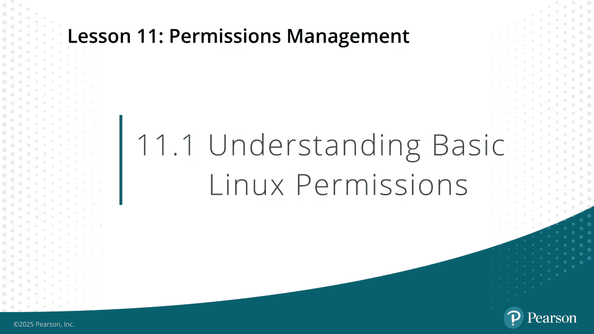
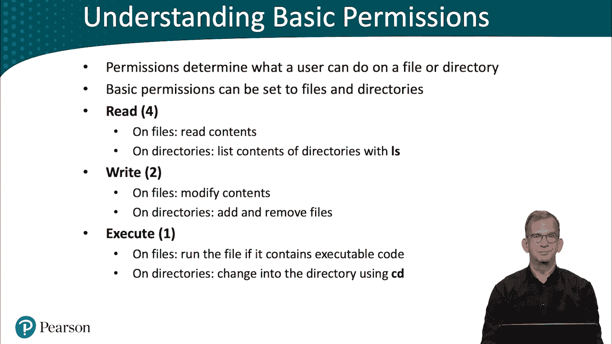

# CompTIA Linux+ V8：112：理解基本Linux权限 🔐

## 课程概述


在本节课中我们将要学习 Linux 的基础权限。Linux 的权限分成三组不同的集合，其中基础权限是最重要的一组，所以你一定要理解清楚。除了基础权限之外，还有高级权限和访问控制列表，它们相对不那么重要，本节课我们先不深入展开。基础权限决定了用户可以对文件执行什么操作，你可以把这些权限设置在文件上，也可以设置在目录上，通常在目录上设置会更有意义。接下来我们会依次介绍读、写、执行这三种基本权限，并说明它们的八进制数值，这些数值在后续使用 chmod 命令时会用到。



## 基础权限的三组分类

上一节我们简单接触过 Linux 文件系统，本节中我们来看看权限的具体结构。

以下是 Linux 权限的三组分类：

- 基础权限：最为重要，必须重点掌握。
- 高级权限：相对不那么重要。
- 访问控制列表：相对不那么重要。

基础权限决定了用户可以对文件执行什么操作。你可以把这些权限设置在文件上，也可以设置在目录上，不过通常在目录上设置会更有意义。

## 读权限（Read）

接着我们来看看第一种基础权限，也就是读权限。

读权限的八进制数值如下：

```text
read = 4
```

八进制数值由三位组成，你可以从 0 编址到 7，这些数值稍后会在 chmod 命令中用来处理权限。读权限对应数值 4。

以下是读权限在文件和目录上的具体含义：

- 文件上：有读权限就可以读取文件内容，也就是打开文件查看。
- 目录上：有读权限可以使用 ls 命令列出目录里的内容。

## 写权限（Write）

读权限介绍完毕，接下来我们看看第二种基础权限，也就是写权限。

写权限允许你修改文件的内容。如果是在目录上，写权限允许你添加和删除文件。

以下是写权限的作用范围：

- 文件上：修改文件内容。
- 目录上：添加和删除文件。

## 执行权限（Execute）

写权限介绍完毕，现在轮到第三种基础权限，也就是执行权限。

执行权限的八进制数值如下：

```text
execute = 1
```

如果文件包含可执行代码，执行权限是运行该文件所必需的。如果是在目录上，执行权限允许你使用 cd 命令进入该目录。

关于目录上的执行权限，有个地方可能听起来有点奇怪，但只需要记住这一点：在目录上你始终需要执行权限，没有执行权限你在目录里什么都做不了。所以仅仅有目录的读权限是不够的，读和执行权限通常需要一起拥有。

以下是执行权限的作用范围：

- 文件上：运行包含可执行代码的文件。
- 目录上：使用 cd 命令进入目录。

## 课程总结



本节课中我们一起学习了 Linux 的基础权限。我们了解了权限分为三组，其中基础权限最为重要；读权限的八进制数值是 4，允许读取文件内容或在目录上使用 ls 命令；写权限允许修改文件内容，在目录上允许添加和删除文件；执行权限的八进制数值是 1，允许运行可执行文件，在目录上允许使用 cd 命令进入，而且在目录上必须拥有执行权限才能进行任何操作。下个视频我会演示如何实际操作这些权限。
