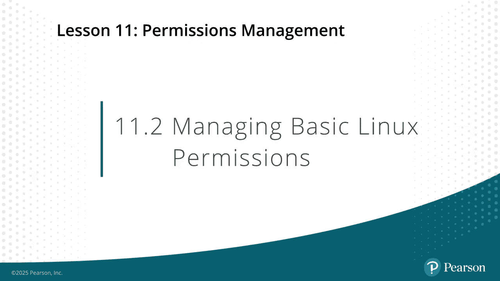
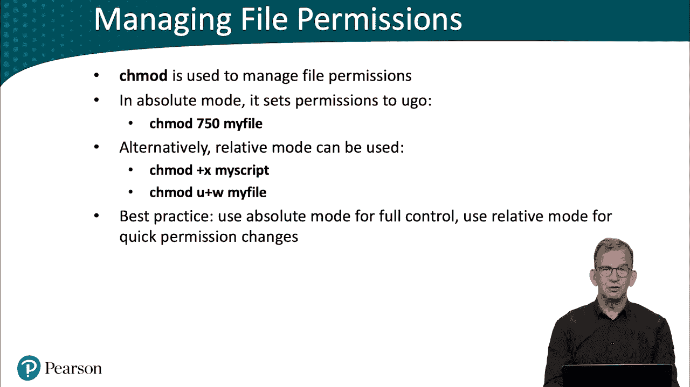
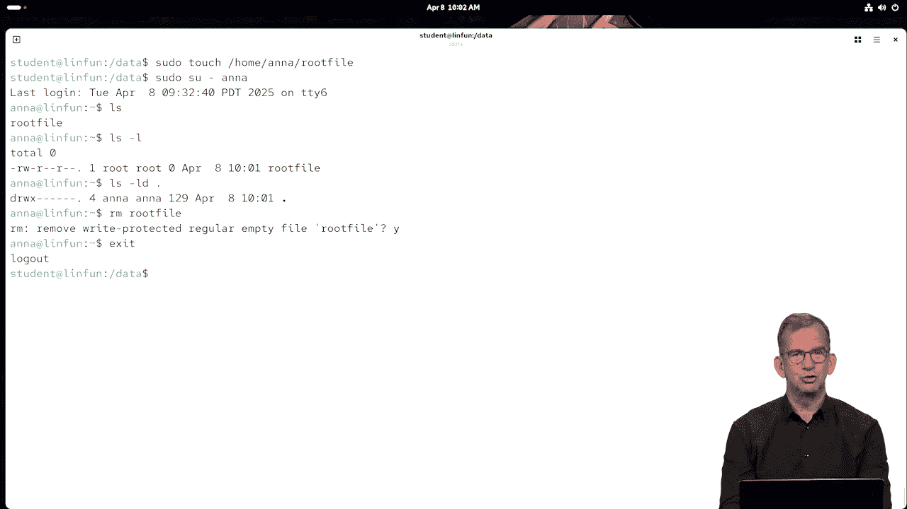

# 🔐 CompTIA Linux+ V8：113：管理基本 Linux 权限

在本节课中，我们将要学习 Linux 系统中最基础的权限管理知识。你会了解文件是如何归属于用户和群组的，怎么修改文件的所有者，怎么设置读写执行权限，以及删除文件时容易忽略的目录权限规则。内容会尽量用大白话解释，适合初学者从零开始理解，不需要任何 Linux 基础也能看懂。

## 1. 理解文件所有权

Linux 中每个文件都有明确的归属，权限是按照三类对象来分配的。这三类对象分别是文件的用户所有者、群组所有者，以及其他所有用户。这种模式通常被称为 UGO，也就是 User、Group 和 Others 的缩写。默认情况下，谁创建了文件，谁就成为这个文件的用户所有者，而创建者所属的主群组则成为文件的群组所有者，除此之外的所有人都属于 Others 类别。这是 Linux 标准权限机制的核心设计，也是后续所有权限操作的基础，必须先搞清楚才能往下学习。

每个文件只能有一个用户所有者和一个群组所有者，不能同时有多个用户作为所有者。这个限制非常重要，因为它决定了权限检查的优先顺序，也影响到后面修改所有权和权限模式的操作方式。

以下是文件所有权的三类对象：
- **用户所有者**：文件的创建者，默认拥有对文件的控制权。
- **群组所有者**：创建者所属的主群组，群组内成员可以共享一定的文件权限。
- **其他用户**：除了用户所有者和群组所有者之外的所有系统用户。

## 2. 修改文件所有权

在处理基本权限时，第一步总是先确定所有权，然后再处理权限模式。想要修改用户所有者，可以使用 chown 命令，它允许你一次性指定用户和群组。如果只需要修改群组所有者，那么应该使用 chgrp 命令，它只改变群组归属而不触碰用户所有者。掌握这两个命令的区别，能帮你在实际工作中更精确地控制文件归属。

以下是常用的所有权修改命令：
- `chown 用户:群组 文件名`：同时修改用户所有者和群组所有者。
- `chgrp 群组 文件名`：只修改群组所有者，用户所有者保持不变。

## 3. 修改文件权限模式

确定好所有权之后，接下来就是设置文件的权限模式了。这时需要用到 chmod 命令。chmod 有两种工作方式，一种是绝对模式，另一种是相对模式。两种方式各有优势，选择哪一种取决于你是想要完全控制权限，还是只想快速调整某一项。

绝对模式使用八进制数值来设置 UGO 的权限。每个权限都有对应的数值：读取是 4，写入是 2，执行是 1。把不同权限的数值相加，就得到了该身份对应的完整权限数字。比如 7 等于 4 加 2 加 1，表示读取、写入和执行权限全部开启。而 5 等于 4 加 1，表示只有读取和执行权限。0 表示没有任何权限。

以下是绝对模式的示例：
- `chmod 750 文件名`：用户拥有读写执行权限，群组拥有读执行权限，其他用户没有任何权限。

相对模式则是在当前权限基础上进行增减，不需要关心原有的完整数值。比如 `chmod +x` 可以给文件添加执行权限，常用于让脚本可以运行；`chmod u+w` 则是给用户所有者添加写入权限，不管之前是什么设置都会在原有基础上追加。

作为最佳实践，建议在需要完全掌控权限时使用绝对模式，而在只需要快速调整某一项权限时使用相对模式，这样效率更高。

## 4. 实际操作演示

为了让你更清楚这些命令在真实系统中的表现，下面是一个完整的演示流程。首先创建目录结构，如果父目录不存在，直接使用 mkdir 会报错，这时候需要加上 -p 参数来递归创建目录。进入目录后，使用 ls -l 查看当前的所有者和权限信息，确认修改是否生效。

以下是演示中使用的命令：
- `mkdir -p /data/sales`：创建多级目录，即使父目录不存在也能成功。
- `ls -l`：查看文件和目录的详细权限与所有者信息。
- `chgrp sales /data/sales`：将目录的群组所有者改为 sales。
- `chmod g+w /data/sales`：使用相对模式给群组添加写入权限。
- `chmod 770 /data/sales`：使用绝对模式设置用户和群组都有读写执行权限，其他用户无权限。

## 5. 删除文件的权限规则

还有一个初学者非常容易混淆的点，那就是删除文件到底需要什么权限。很多人的直觉是只要对文件本身有权限就能删除，但实际上情况并非如此。删除一个文件，需要的是对该文件所在目录的写入权限，而不是对文件本身的权限。这个规则是 Linux 权限体系中非常关键的一点，理解之后能避免很多权限排查时的误区。

举个具体的例子。假设用户 Anna 的家目录是 /home/anna，里面有一个名为 root_file 的文件，这个文件的所有者是 root。即便 Anna 对这个文件本身没有任何权限，她依然可以删除它，因为 Anna 对自己家目录 /home/anna 拥有写入权限。家目录的本质就是让用户在自己的目录下拥有完全的创建和删除控制权。当 Anna 执行 rm 命令时，系统检查的是 /home/anna 这个目录是否允许写入，而不是检查 root_file 文件本身的权限。这就是管理基本 Linux 权限时必须记住的核心原则。

## 总结

本节课中，我们一起学习了 Linux 基本权限管理的核心内容。首先明确了文件所有权分为用户所有者、群组所有者和其他用户三类，即 UGO 模型。接着介绍了如何使用 chown 和 chgrp 来修改所有权，强调了先处理所有权再处理权限模式的顺序。然后讲解了 chmod 的绝对模式和相对模式，并给出了八进制数值的计算方法，比如 7 等于 4 加 2 加 1。最后通过实际命令演示和删除文件的案例，说明了目录写入权限对删除操作的决定性作用。希望这些知识能帮助你建立起对 Linux 权限的直观理解，为后续学习打下坚实基础。

