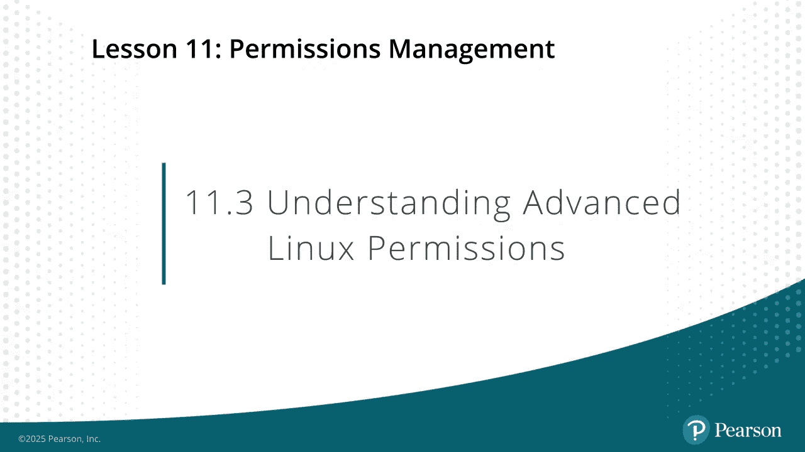
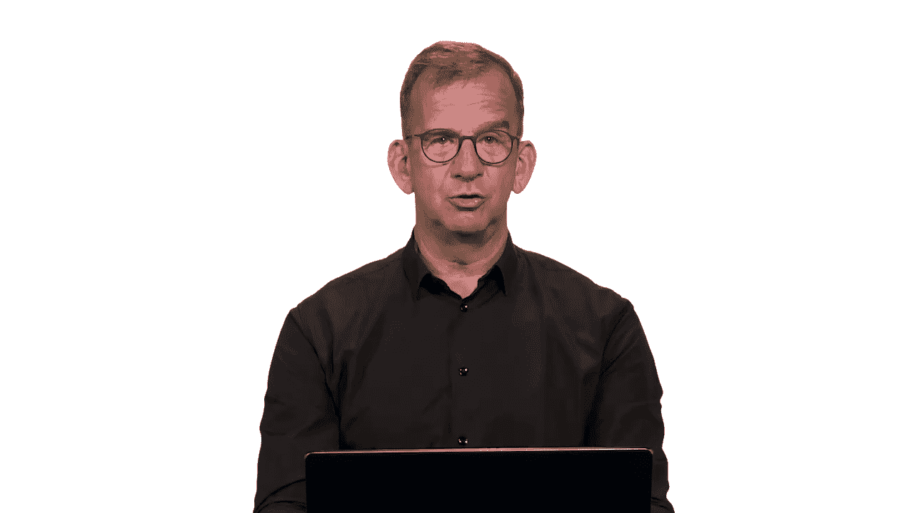
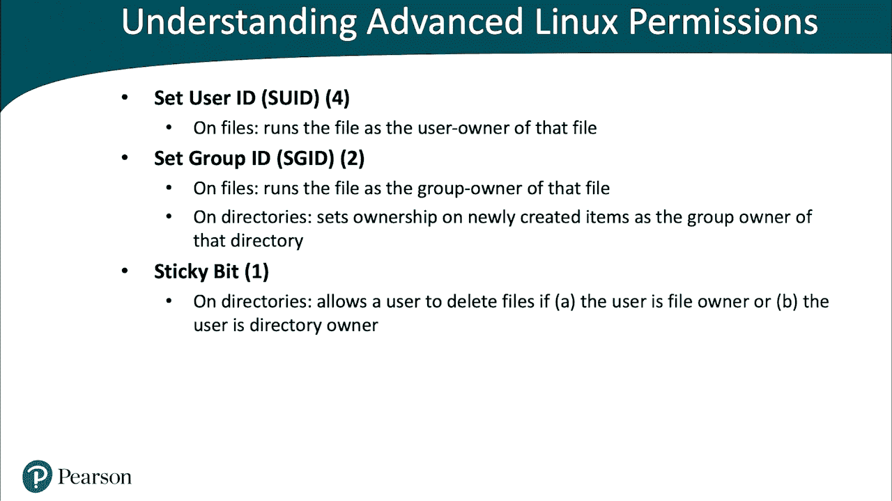

# CompTIA Linux+ V8：113：理解高级Linux权限 🔐

在本节课中，我们将要学习Linux高级权限的相关知识。你会了解到什么是高级权限，以及在实际使用中是否真的需要接触它们。这部分内容属于特殊情况权限，很多时候你可能根本用不到，但作为Linux学习者，了解它的工作原理仍然很重要。

## 一、高级权限的基本概述 📋

上一节我们介绍了基础的Linux权限概念，本节中我们来看看高级权限到底是怎么回事。

在很多实际场景中，你可能永远不会用到高级Linux权限。所以说，这部分内容更多是针对特殊情况而设计的权限机制。

## 二、SUID权限（Set User ID） 👤

接下来我们来看第一种高级权限，也就是Set User ID，常见的拼写也有SUID，它对应的八进制数值是4。这种权限只在文件上有意义，在文件上才有效果。

它的含义是：当你运行这个文件时，实际是以该文件的所有者身份来执行的。这是一个比较危险的权限，稍后我会给你演示为什么它有风险。

以下是SUID权限的核心特征：

- 权限名称：Set User ID
- 简称：SUID
- 八进制值：4
- 作用对象：仅在文件上有意义
- 执行效果：以文件所有者的身份运行文件

从代码层面来看，SUID可以用简单的公式来描述：

`运行身份 = 文件所有者`

当你拥有SUID权限的文件时，系统不会以当前登录用户的身份去运行它，而是直接切换到文件所有者的身份。

## 三、SGID权限（Set Group ID） 👥

刚才我们学习了SUID权限，本节中我们来看看第二种高级权限，也就是Set Group ID，有时也写作SGID，它对应的八进制数值是2。

在文件系统中，这意味着你将以该文件的所属组身份来运行这个文件，这种情况比较少见。但是，如果作用于目录，它会将新创建的项目的所有权设置为该目录的所属组。

下面我来解释为什么这种设计在目录上很有意义。

以下是SGID权限的核心特征：

- 权限名称：Set Group ID
- 简称：SGID
- 八进制值：2
- 作用于文件时：以文件所属组身份运行，较为少见
- 作用于目录时：新建项目的所有者组自动继承目录所属组

从代码层面来看，SGID也可以用公式表示：

`运行身份组 = 文件所属组`

在目录上开启SGID后，任何用户在这个目录里新建文件，新文件的组所有权都会变成该目录的组所有权，而不是新建者自己的主组。

## 四、粘滞位权限（Sticky Bit） 🧻

接着刚才的SGID内容，本节中我们来看看第三种高级权限，也就是粘滞位，它对应的八进制数值是1。

粘滞位只作用于目录。它的规则是：用户只能删除自己拥有的文件，或者删除自己拥有的目录里的文件。也就是说，如果你是文件所有者，或者你是目录所有者，你才有权删除相关文件。

下一节视频中我会进行实际演示。

以下是粘滞位的核心特征：

- 权限名称：粘滞位
- 简称：Sticky Bit
- 八进制值：1
- 作用对象：仅在目录上有意义
- 删除规则：只有文件所有者或目录所有者可以删除文件

从代码层面来看，粘滞位的逻辑可以简化为：

`可删除 = (当前用户 == 文件所有者) 或 (当前用户 == 目录所有者)`

这种机制通常用于公共目录，比如/tmp，防止用户误删或恶意删除他人的文件。

## 五、总结 📚

本节课中我们一起学习了Linux的高级权限。我们了解了三种特殊情况权限：第一种是SUID，八进制值为4，以文件所有者身份运行文件，具有一定危险性；第二种是SGID，八进制值为2，在文件上以所属组身份运行，在目录上让新建项目继承目录所属组；第三种是粘滞位，八进制值为1，只作用于目录，限制只有文件所有者或目录所有者才能删除文件。

在大多数日常场景中，你可能不会用到这些高级权限，但掌握它们的原理能帮助你更好地理解Linux系统的权限模型。

