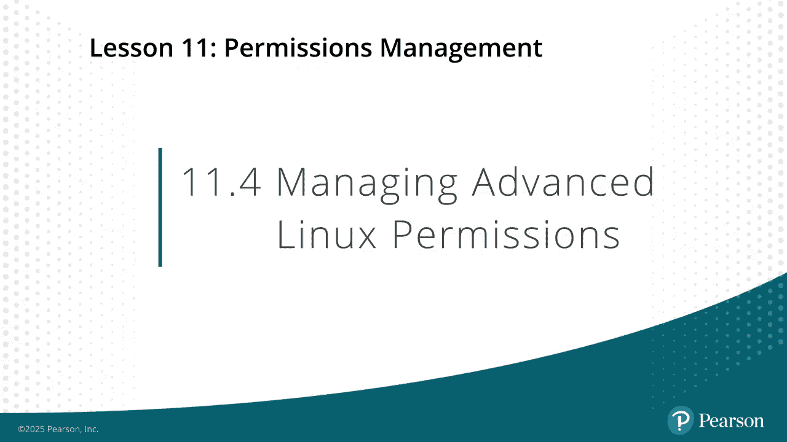
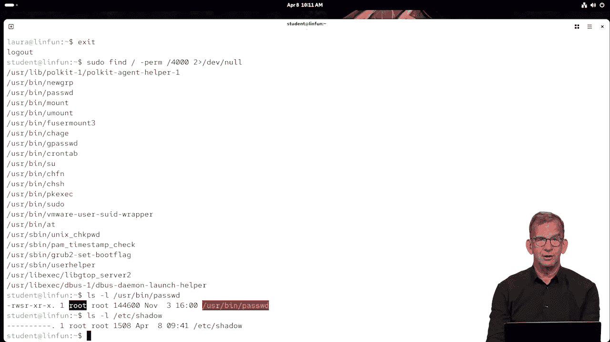

Oreilly CompTIA Linux+ V8：115：管理高级Linux权限 🔐

在本节课中我们将要学习Linux中的高级权限管理，主要包括设置组ID、粘滞位以及文件权限的特殊表示方法，让你了解在共享组环境中如何合理控制文件的访问和删除。

上一节我们介绍了基本的Linux文件权限，本节中我们来看看超越普通读写执行权限的特殊权限，这些权限在多用户协作的场景中非常有用。

## 特殊权限演示与设置组ID 📂

我们先回顾一下之前的操作，使用 `ls -ld /data/sales` 查看 sales 目录，可以看到该目录由 sales 组拥有，组权限为读写执行。接下来通过 `/etc/group` 文件确认组成员，Anna、Linda 和 Laura 都是 sales 组的次要组成员。

以下是常见的组成员查看命令：

```bash
getent group sales
```

当以 Linda 的身份打开终端，并进入 `/data/sales` 目录时，她可以使用 `touch` 命令创建文件。此时用 `ls -l` 查看，会发现新建文件的用户所有者是 Linda，组所有者也是 Linda。在共享组环境中，这并不总是方便，因为更理想的情况是新文件自动继承父目录的组所有者，也就是 sales 组。

以下是实现这一目标的方法，使用 `chmod` 命令为目录设置组ID，通常简称为 setgid：

```bash
sudo chmod g+s /data/sales
```

设置完成后，再次使用 `ls -ld /data/sales` 查看目录权限，你会发现组权限位从 `rwx` 变成了 `rws`。这里的 `s` 表示 setgid 位已生效，意味着在该目录下新建的所有文件，其组所有者将自动设置为目录的组所有者，即 sales 组。

为了验证效果，我们以 Linda 身份再次创建几个文件，命名为 Linda4、Linda5 和 Linda6。然后用 `ls -l /data/sales` 查看，可以清楚地看到这些新文件的组所有者已经变成了 sales 组，而不是 Linda 个人的组。

## 粘滞位与删除权限控制 🛡️

在共享组环境中，还有一个问题需要注意。因为 sales 目录对组有写权限，所以组内的其他成员，比如 Laura，也可以删除 Linda 创建的文件。删除文件只需要对目录拥有写权限，而 Laura 作为 sales 组成员正好满足这个条件。

以下是 Laura 尝试删除文件时可能遇到的情况：

```bash
su - Laura
rm /data/sales/Linda1
```

如果你不希望这种情况发生，就需要启用粘滞位，也就是 sticky bit。粘滞位设置后，即使目录对组有写权限，用户也只能删除或重命名自己创建的文件，而不能删除他人的文件。

以下是设置粘滞位的命令：

```bash
sudo chmod +t /data/sales
```

或者使用相对模式同时设置 setgid 和粘滞位。设置完成后，再次用 `ls -ld /data/sales` 查看，权限输出中会出现一个大写的 `T`，这表示粘滞位已经生效。

此时我们再次以 Laura 身份尝试删除 `/data/sales` 下的所有文件，系统会返回 "operation not permitted"，说明粘滞位成功阻止了跨用户删除操作。粘滞位和 setgid 在共享组环境中是非常实用的两种权限。

## 权限符号的含义 🔤

在 `ls -l` 的输出中，特殊权限并没有独立的显示位置，而是借用了通常用于执行权限 `x` 的位置来显示。这就是为什么你会看到小写的 `s` 或大写的 `T`。

以下是常见符号的含义对照：

- 组权限位显示 `s`：表示 setgid 生效，且组拥有执行权限。
- 组权限位显示 `S`：表示 setgid 生效，但组没有执行权限。
- 其他权限位显示 `t`：表示粘滞位生效，且其他用户拥有执行权限。
- 其他权限位显示 `T`：表示粘滞位生效，但其他用户没有执行权限。

在我们刚才的 sales 目录示例中，看到大写 `T` 是因为其他用户没有任何权限，而看到小写 `s` 是因为组也拥有执行权限。

## Set User ID 权限 🔑

还有一个重要的特殊权限叫做 Set User ID，通常简称为 setuid。我们可以使用 `find` 命令来查找系统中设置了 setuid 位的文件，权限掩码通常是 `4000`。

以下是查找 setuid 文件的示例命令：

```bash
sudo find / -perm -4000
```

执行后确保没有错误信息输出。一个典型的 setuid 文件示例是 `/usr/bin/passwd`。使用 `ls -l /usr/bin/passwd` 查看，你会发现文件权限中有一个 `s` 标记，且出现在用户所有者的执行权限位置，说明该二进制文件拥有 setuid 权限。

那么 setuid 到底有什么作用呢？当普通用户运行 passwd 命令修改密码时，系统会启动一个子shell，在这个子shell 中用户暂时变成了文件的所有者，也就是 root。这样普通用户才有权限去修改 `/etc/shadow` 文件，因为普通用户本身是没有权限写入该文件的，而 root 可以。

setuid 对某些系统命令是必需的，你可以在自己的系统上查看这些命令的列表。但在所有其他情况下，setuid 都非常危险，应该始终避免使用，以免带来安全风险。

## 本节总结 📝



本节课中我们一起学习了管理高级Linux权限的几个核心知识点。首先介绍了如何为共享目录设置组ID，使新建文件自动继承父目录的组所有者；接着讲解了粘滞位的作用，防止组内成员删除他人文件；然后解释了 `ls -l` 输出中 `s` 和 `T` 等特殊符号的含义；最后介绍了 Set User ID 权限，说明它如何让普通用户暂时获得文件所有者的身份以执行特定操作，同时也提醒了 setuid 的安全风险。希望这些内容能帮助你更好地理解和掌握Linux的高级权限管理。

