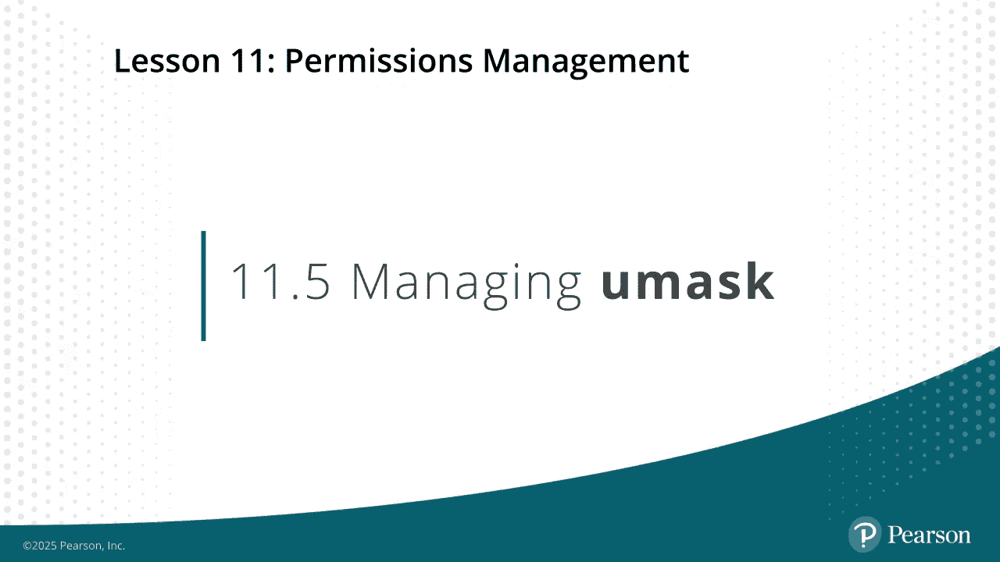
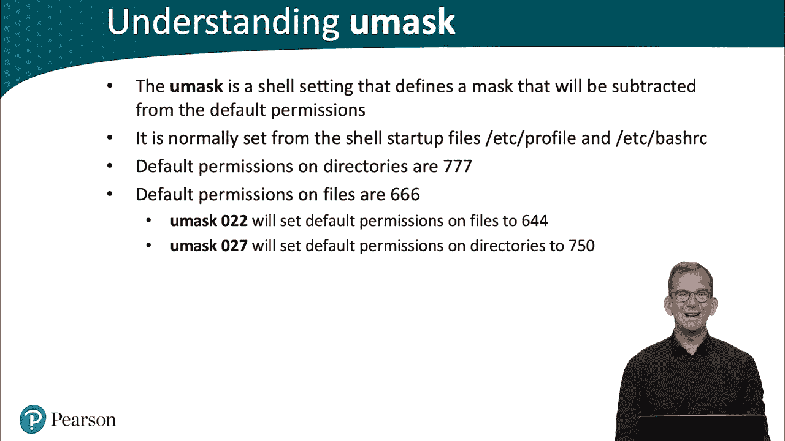
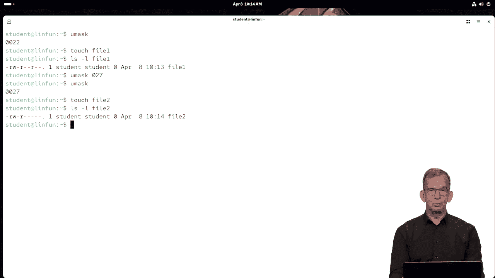

# Linux权限管理：第115节：管理umask 🛡️

在本节课中，我们将要学习Linux系统中的umask机制。umask是一个用来控制新建文件和目录默认权限的Shell设置。通过本节课，你将了解umask的定义、默认权限是如何计算的、常见umask值的作用，以及在实际操作中如何查看和验证它。我们会用大白话把每一步都讲清楚，确保初学者也能轻松上手，并且在最后给出一些实用的建议，帮你避免不必要的权限问题。

## umask是什么意思 🤔

umask的全称是User file-creation Mode mask，中文可以理解为用户文件创建权限掩码。它是Shell中的一个设置，用来定义一个掩码，这个掩码会从默认权限中减去相应的权限位，从而决定新创建文件或目录的最终权限。简单来说，当你新建一个文件或目录时，系统会先给它一个默认权限，然后umask在这个基础上“减掉”某些权限，剩下的就是实际生效的权限。这个减法过程可以用下面的公式来表示：

最终权限 = 默认权限 - umask值

## 默认权限是多少 📂

在Linux系统中，不同类型的对象有不同的默认权限。对于目录，默认权限通常是777，也就是说所有用户都可以读、写和进入。对于普通文件，默认权限通常是666，也就是说所有用户都可以读和写，但默认不带执行权限。之所以文件默认没有执行权限，是出于安全考虑，因为绝大多数新建文件不需要直接运行，只有在明确需要时才会手动添加执行位。

## umask值如何影响权限 🔢

当你设置一个umask值后，它会从上面的默认权限中扣除对应的权限位。最常见的umask值是022。如果umask设为022，那么新建文件的默认权限会变成644，新建目录的默认权限会变成755。另一个比较常见的值是027，如果umask设为027，新建目录的默认权限会变成750，新建文件的默认权限会变成640，这意味着“其他用户”组将失去所有权限。

以下是常见umask值对应的默认权限结果：

- umask 022：文件权限为644，目录权限为755
- umask 027：文件权限为640，目录权限为750

## 实际操作演示 🖥️

接下来我们通过一个简单的例子来看看umask在真实终端里是如何工作的。假设你现在输入命令`umask`来查看当前的掩码值，系统可能会显示四位数字0022。这里的第一个数字是专门针对特殊权限的，比如设置用户ID或设置组ID位。你通常不应该通过umask来修改特殊权限，因为这没有实际意义，所以可以直接忽略第一位，把它当作不存在。

当前umask是0022时，如果你使用`touch file1`创建一个名为file1的文件，然后用`ls -l file1`查看它的权限，你会看到权限模式显示为644。

如果你把umask改成027，可以再次使用`umask`命令验证当前值已经变为027。接着使用`touch file2`创建file2，再用`ls -l file2`查看，你会发现“其他用户”已经没有任何权限了。

## umask在哪里设置 ⚙️

如果你希望umask的设置在重启后依然有效，需要把它写入Shell的启动文件中。通常这些文件包括/etc/profile和/etc/bashrc，不同的发行版可能略有不同。在修改这些文件之前，你需要格外小心。比如如果你把umask设成027，意味着其他用户在任何情况下都将无法再读取文件，这可能会严重影响系统中某些程序或服务的正常运行，导致一些原本能正常工作的功能突然无法访问。

## 我的建议 💬

基于以上原因，我的建议是：不要随意修改你的umask值。大多数Linux发行版已经以合理的方式配置好了umask，保持默认设置通常是最安全的选择。如果你擅自更改它，可能会给自己带来不必要的麻烦，以后排查权限问题会花费很多时间。所以，请让umask保持原样，不要轻易去动它。

## 本节小结 📚

本节课中，我们一起学习了umask的基本概念，了解了目录默认权限777和文件默认权限666的由来，掌握了umask 022和027等常见值对权限的影响，还通过`touch`和`ls -l`命令演示了如何查看和验证umask的效果。最后，我们讨论了umask通常在哪些Shell启动文件中设置，以及为什么在大多数情况下建议保持默认umask不变。希望这节课能帮你建立起对Linux文件权限掩码的直观认识，在实际操作中更加从容地处理权限问题。

