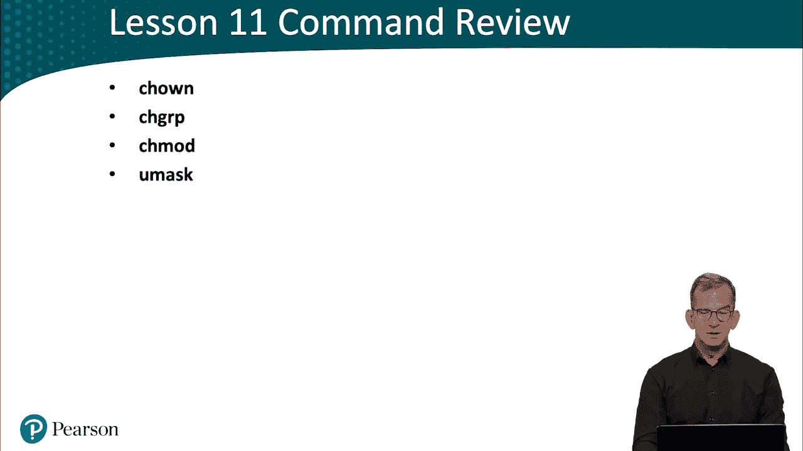

# 🐧 CompTIA Linux+ V8：17：文件所有权与权限命令复述

在本节课中，我们将一起学习 Linux 系统中最常见的几个文件管理命令。这些命令用来决定谁可以使用文件，谁可以修改文件，以及新建文件时默认拥有什么样的权限。即使你是刚接触 Linux 的初学者，也不用担心，下面会用最直白的方式把每一个命令都讲清楚。

首先我们来看看改变文件所有者的命令。在 Linux 中，每个文件或目录都有一个专属的用户所有者，如果你想把这个所有者改成别人，就需要用到下面这个命令。

以下是 chown 命令的基本作用：

- chown：修改文件或目录的用户所有者，这是设置文件权限的第一步。

```bash
chown 用户名 文件名
```

除了用户所有者之外，每个文件还有一个群组所有者。如果你想修改这个群组，那么就需要用到另一个配套命令。

以下是 chgrp 命令的基本作用：

- chgrp：修改文件或目录的群组所有者，功能和 chown 类似，只不过针对的是群组而不是单个用户。

```bash
chgrp 群组名 文件名
```

有了所有者和群组所有者之后，还需要控制具体的读写执行权限。这时就要用到权限模式修改命令了，它是整个 Linux 权限体系中非常重要的一环。

以下是 chmod 命令的基本作用：

- chmod：修改文件或目录的权限模式，用来规定哪些用户可以对文件执行读、写、执行等操作。

```bash
chmod 权限代码 文件名
```

最后，当你新建一个文件时，系统会自动给它一组默认权限。如果你想改变这个默认设置，就需要用到下面这个机制。

以下是 umask 的基本作用：



- umask：操作新建文件的默认权限掩码，决定新文件一开始会拥有什么样的读写执行限制。


```bash
umask 掩码值
```

到此为止，我们已经把 Linux 中最常见的文件所有者与权限命令都过了一遍。本节课中我们一起学习了 chown、chgrp、chmod 和 umask，它们分别负责修改用户所有者、群组所有者、文件权限模式以及默认权限掩码。希望这些内容能帮助你更好地理解 Linux 的文件权限管理。
