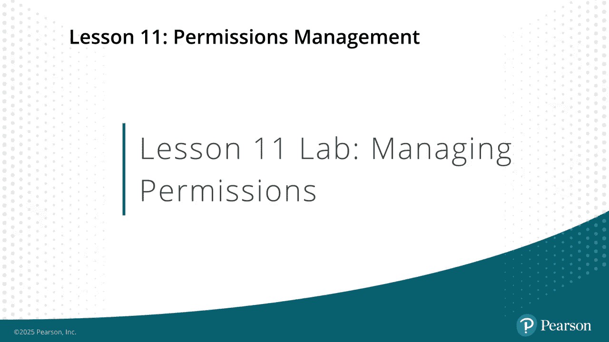
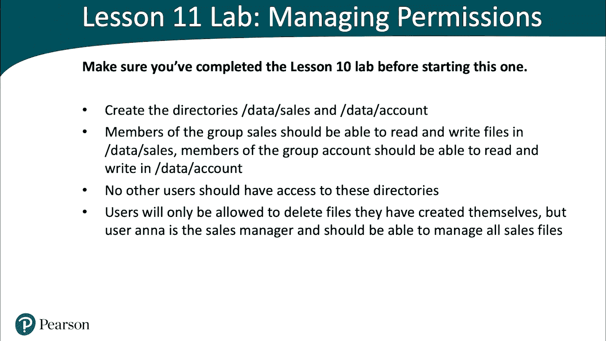

# CompTIA Linux+ V8：Lesson 11：Lab 管理权限 🔐



在本节课中，我们将一起学习如何在 Linux 系统中管理文件和目录的访问权限。通过本节的实验，你将掌握如何创建目录、为不同的用户组分配读写权限、限制其他用户的访问，以及设置特殊管理员的权限范围。这节课的内容非常实用，尤其是当你需要在多人共享的服务器上保护敏感数据时，这些知识都能直接派上用场。无论你是刚接触 Linux 的新手，还是已经有一些基础的学习者，掌握权限管理都是成为合格系统管理员的重要一步。

在开始本节实验之前，你需要先确认自己已经完成了 Lesson 10 的实验。这是因为 Lesson 11 的实验是建立在 Lesson 10 的基础之上的，可以说 Lesson 10 是本节课的前置依赖。如果没有完成 Lesson 10，你很可能无法顺利进行本节的操作，因为很多环境准备和基础配置都依赖于上一节的内容。所以请务必先检查一下之前的实验是否已经做完，确保系统状态符合本节课的要求，这样才能避免在操作过程中出现不必要的错误。

上一节我们主要介绍了基础的用户和组管理概念，本节中我们来看看如何把这些知识应用到实际的目录权限设置中。以下是本节实验需要完成的具体任务：

- 创建两个目录，分别是 `data/sales` 和 `data/account`。
- `sales` 组的成员应该能够在 `data/sales` 目录中读取和写入文件。
- `account` 组的成员应该能够在 `data/account` 目录中读取和写入文件。
- 除了上述组成员之外，其他用户不得访问这两个目录。
- 普通用户只能删除自己创建的文件，不能删除他人的文件。
- 用户 `enter` 是销售经理，应该能够管理 `data/sales` 目录中的所有文件。

关于目录权限的核心概念，可以用下面的公式来简单理解：


```text
目录访问权限 = 所有者权限 + 所属组权限 + 其他用户权限
```

在 Linux 中，读写权限通常用 `r`、`w`、`x` 来表示，其中 `r` 代表读取，`w` 代表写入，`x` 代表执行或进入目录。对于目录来说，拥有读取权限可以列出目录里的内容，拥有写入权限才能在目录中创建新文件或删除文件。执行权限对目录来说则意味着可以进入该目录。这些权限组合在一起，就决定了谁能对目录里的文件做什么操作。

接着我们来看针对不同用户组的详细权限设置要求，具体如下：

- `sales` 组：对 `data/sales` 拥有读写权限。
- `account` 组：对 `data/account` 拥有读写权限。
- 其他用户：对 `data/sales` 和 `data/account` 均无任何访问权限。

关于“用户只能删除自己创建的文件”这一要求，在 Linux 中通常可以通过设置目录的粘滞位（Sticky Bit）来实现。粘滞位的作用是，即使多个用户对同一个目录拥有写入权限，也只有文件的所有者、目录的所有者或者 root 用户才能删除或重命名目录中的文件。这可以防止用户误删或恶意删除别人的文件。你可以用下面的命令来设置粘滞位：

```bash
chmod +t /path/to/directory
```

如果你习惯用数字表示权限，也可以写成这样：

```bash
chmod 1770 /path/to/directory
```

在这里，最高位的 `1` 就是粘滞位标志，`770` 表示所有者和所属组拥有全部权限，其他用户没有任何权限。

最后，关于特殊用户 `enter` 的设置，他被指定为销售经理，需要能够管理 `data/sales` 目录中的所有文件。这意味着他不仅要是 `sales` 组的成员，还需要拥有超越普通组成员的管理能力，例如能够修改其他人的文件或者调整文件权限。在实际操作中，通常可以通过将他添加到相应的用户组，并赋予适当的文件所有权或管理权限来实现，具体做法取决于你的实验环境是如何配置的。



本节课中我们一起学习了如何管理 Linux 文件和目录权限，包括创建共享目录、为特定用户组分配读写权限、限制其他用户访问、设置粘滞位防止误删他人文件，以及为销售经理用户配置特殊管理权限。希望你能通过动手实验，加深对 Linux 权限模型的理解，并在实际工作中灵活运用这些知识。

