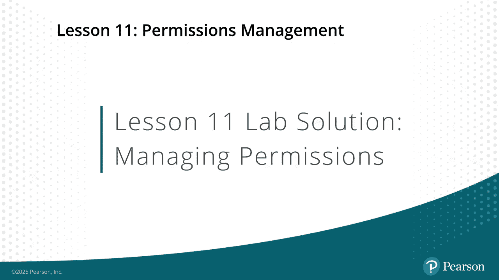
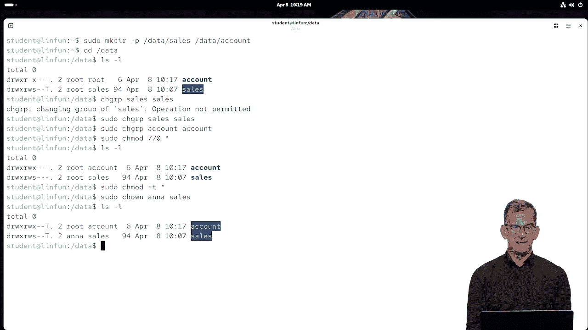

# Linux权限管理：11：管理权限实验室解答 🔐

在本节课中，我们将要学习如何通过实验室的方式来管理 Linux 文件和目录的权限。具体来说，我们会看到怎样给不同的小组设置访问权限，怎样限制用户删除文件的行为，以及怎样让指定的管理人员拥有更大的控制权。内容比较基础，适合刚开始接触 Linux 权限的初学者，大家跟着步骤一步步操作即可。


实验环境准备



上一节我们介绍了 Linux 权限的基本概念，本节中我们来看看如何在实验环境中把这些概念应用到实际的目录和文件上。

在开始操作之前，我们需要先进入数据目录，这样才能直接访问文件，看清楚当前的状态。执行进入目录的命令后，可能会遇到系统提示某些内容已经配置完成的消息，这时候不需要理会，直接继续接下来的步骤就可以了。

以下是进入目录的示例命令：

```bash
cd data
```


设置组所有权

接下来我们要处理两个目录，分别是 sales 和 account。我们的目标是让 sales 组的成员能够读写 sales 目录里的文件，同时让 account 组的成员也能读写 account 目录里的文件。

要实现这一点，首先要把 sales 目录的组所有者改为 sales，再把 account 目录的组所有者改为 account。下面是具体的操作命令：

```bash
sudo chgrp sales sales
sudo chgrp account account
```

执行完这两条命令之后，两个目录就分别归属于对应的组了，这样不同的小组成员才能在自己的目录里进行协作，而不会互相干扰。


设置文件权限模式

完成组所有者的设置后，我们还需要给目录里的文件设置合适的权限模式。这里的意思是，我们希望目录里的所有文件都只拥有所有者和组所有者的读写权限，而不给其他人任何权限，这样可以保证数据的安全性。

可以使用 chmod 命令配合数字模式来完成，具体命令如下：

```bash
sudo chmod 770 *
```

这时候用 ls -l 查看文件列表，会发现权限已经设置得比较理想了。此时普通用户只能删除自己创建的文件，而不能随意删除别人的文件，这种机制正好对应我们后面要讲到的粘滞位。


设置粘滞位

前面提到用户只能删除自己创建的文件，这其实就是粘滞位（sticky bit）在起作用。粘滞位是一种特殊的权限位，设置之后可以进一步限制文件的删除行为，避免用户误删或者恶意删除他人的重要数据。

我们需要对目录里的所有内容启用粘滞位，命令如下：

```bash
sudo chmod +t *
```

启用粘滞位之后，删除文件的规则变成了下面这样：

```
允许删除 = (用户是文件所有者) 或 (用户是包含该文件的目录所有者)
```

换句话说，如果一个用户既不是文件的创建者，也不是目录的所有者，那么他就没有权限删除这个文件。这样可以有效防止共享目录里的文件被随意删除。


配置特殊管理员权限

现在到了本节实验中稍微具有挑战性的部分。假设 Anna 是销售部门的经理，她需要能够管理 sales 目录下的所有文件，而不仅仅是自己创建的那些文件。

由于粘滞位已经启用，普通成员只能删除自己的文件，但目录的所有者例外。所以如果我们把 sales 目录的所有者改为 Anna，她就可以删除该目录里的任何文件了。操作命令如下：

```bash
sudo chown Anna sales
```

执行完成之后，Anna 作为 sales 目录的所有者，就拥有了在该目录下删除所有文件的权限，这也正好满足销售经理管理全部销售文件的需求。


总结



本节课中，我们一起学习了如何在 Linux 中管理文件和目录的权限。具体包括：如何进入数据目录并忽略已配置提示，如何使用 chgrp 设置组所有权，如何使用 chmod 770 设置权限模式，如何使用 chmod +t 启用粘滞位来限制文件删除，以及如何使用 chown 让指定用户成为目录所有者从而获得更高的管理权限。希望大家通过这个实验，能够更直观地理解 Linux 权限系统是如何工作的。
