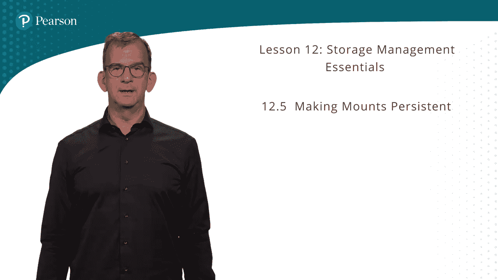

# 💾 Linux 存储管理基础：第 1 节：存储管理基础学习目标

在本节课中，我们将一起学习 Linux 存储管理的基础知识。本节课属于“存储管理基础”课程的第一部分，主要面向没有太多 Linux 经验的初学者。我们会先从 Linux 存储解决方案的整体概述开始，了解存储在系统中的基本角色；然后学习如何在你的 Linux 电脑上列出所有可用的存储设备；接下来，讲解如何基于分区来设置一个简单的存储配置，并介绍让分区可以正常使用的文件系统。因为可用的文件系统种类比较多，我们需要先把它们的基本概念讲清楚，再演示如何创建文件系统、挂载它们，以及确保它们在系统重启后依然保持挂载状态。课程最后的实验环节，你可以动手练习本节学到的存储操作技能。

## 存储管理基础概览

在完成课程的整体介绍之后，本节中我们来看看 Linux 存储管理的核心概念。存储管理是 Linux 系统管理中非常重要的一环，因为无论是操作系统文件还是用户的个人数据，最终都需要写入磁盘或其他存储设备。在 Linux 系统中，常见的存储设备包括机械硬盘、固态硬盘、USB 闪存盘以及网络存储等等。在对这些设备进行分区或格式化之前，我们首先需要理解它们在系统中是如何被识别和管理的，这样才能避免误操作导致数据丢失。

以下是本节课要重点覆盖的几个知识模块：
- Linux 存储解决方案的整体概述
- 如何在 Linux 电脑上列出可用的存储设备
- 基于分区的简单存储配置方法
- 让分区变得可用的文件系统类型
- 创建文件系统并进行挂载的步骤
- 实现持久化挂载的方法，确保重启后数据依然可用
- 课程末尾的实践实验环节

## 查看 Linux 上的可用存储

在了解了存储管理的基本概念之后，我们接下来学习如何查看系统中已有的存储资源。在 Linux 中，你通常无法像在桌面操作系统中那样直接通过图形界面看到所有磁盘的详细信息，而是需要使用命令行工具来完成。常用的命令包括用于列出块设备的 `lsblk`，以及用于显示磁盘空间使用情况的 `df -h`。执行这些命令后，你可以确认哪些硬盘已经连接到系统，哪些分区已经存在，还有多少存储空间可以使用。这是后续进行分区和格式化操作的必要前提，因为你必须明确要操作的设备到底是哪一个。

以下是常用的查看存储命令示例：

```bash
lsblk
df -h
```

这两条命令输出的内容通常包括设备名称、分区名称、挂载点、总容量和已用容量等信息。通过这些输出，你可以初步判断系统当前的存储布局，并为下一步的分区操作选择合适的目标磁盘。

## 基于分区的存储配置

在列出可用存储设备之后，本节中我们来看看如何基于分区来组织存储空间。分区的作用是将一块物理硬盘切分成多个独立的逻辑区域，每个区域可以被系统独立识别和使用。这样做的好处是，你可以将操作系统文件和用户数据分开存放，或者为不同的应用场景分配不同大小的空间，从而提高存储资源的管理灵活性。

设置基于分区的存储配置通常遵循以下基本流程：

$存储可用性 = 分区 + 文件系统 + 挂载$

```text
选择物理磁盘 → 创建分区 → 格式化文件系统 → 挂载到目录
```

在实际操作中，你会先使用 `fdisk` 或 `parted` 等工具在磁盘上划分分区，并确定每个分区的大小与类型。完成分区之后，该分区仍然不能直接用于存放文件，因为它还没有文件系统，必须经过格式化之后才能正常读写数据。

## 文件系统基础

在完成分区之后，我们必须了解文件系统，因为文件系统才是让分区真正变得可用的关键。Linux 支持多种不同的文件系统，常见的包括 ext4、XFS、Btrfs 等等。每种文件系统在性能、稳定性和功能支持上都有差异，例如有些文件系统更适合存储大文件，有些则更适合处理大量小文件的读写操作。了解这些差异有助于你根据实际需求选择最合适的文件系统类型。

以下是几种常见的 Linux 文件系统及其主要特点：
- ext4：最通用的 Linux 文件系统，兼容性好，稳定可靠，适合大多数场景
- XFS：适合处理大文件和大容量存储，读写性能较高
- Btrfs：支持快照、自我修复等高级功能，适合需要数据保护的场景

因为可用的文件系统种类比较多，我们需要先把这些基本概念讲清楚，再进入实际创建文件系统的步骤。

## 创建、挂载与持久化挂载

在了解了文件系统的类型之后，接下来我们学习如何在分区上实际创建文件系统，并将其挂载到系统中。挂载的意思是把一个分区关联到某个目录，这样你就可以通过访问这个目录来读写分区里面的数据。创建文件系统常用的命令是 `mkfs`，挂载分区常用的命令是 `mount`。

```bash
mkfs.ext4 /dev/sdb1
mount /dev/sdb1 /mnt/data
```

不过，如果你只是使用 `mount` 命令进行临时挂载，那么在系统重启之后挂载信息就会丢失，分区将不再自动可用。为了让分区在每次开机时都能自动挂载，你需要将挂载信息写入 `/etc/fstab` 文件中。这个过程被称为持久化挂载，是确保存储设备在重启后依然可以正常使用的重要步骤。

## 课程实践实验



在完成所有理论讲解之后，课程末尾的实验环节将给你动手练习的机会。在这个实验中，你可以尝试列出存储设备、创建分区、格式化文件系统，并配置持久化挂载。通过实际操作，你能够更好地掌握存储管理的各个步骤，并在真实系统中降低误操作的风险。

建议在实验中重点练习以下内容：
- 使用 `lsblk` 查看系统中的块设备
- 使用分区工具在磁盘上创建新分区
- 使用 `mkfs` 为分区创建文件系统
- 使用 `mount` 将分区挂载到指定目录
- 修改 `/etc/fstab` 文件实现持久化挂载


## 本节总结

本节课中，我们一起学习了 Linux 存储管理的基础知识。首先，我们了解了 Linux 存储解决方案的整体概述；接着，学习了如何在 Linux 电脑上列出可用的存储设备；然后，讲解了如何基于分区设置简单的存储配置，并介绍了让分区可用的文件系统。最后，我们演示了如何创建文件系统、挂载它们，以及确保它们在系统重启后依然保持挂载状态。希望你能通过本节课的内容和末尾的实验，熟练掌握 Linux 存储操作的基本技能。

