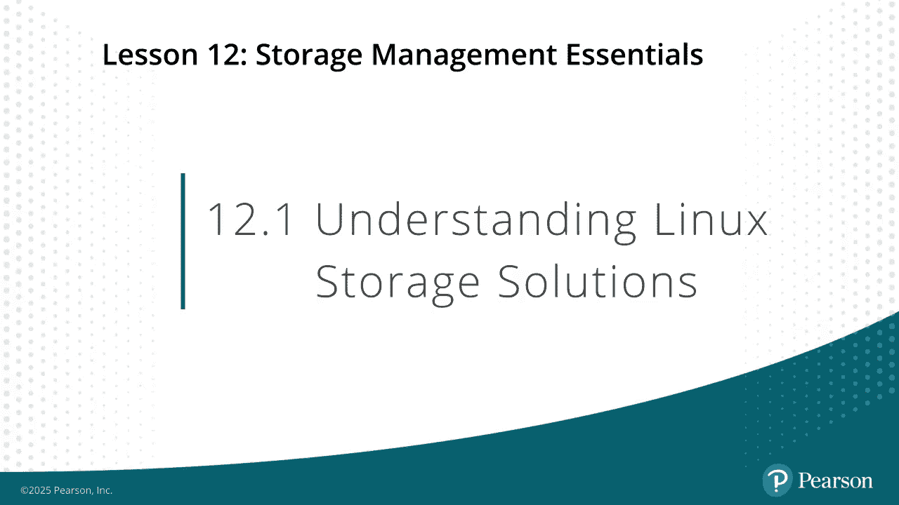
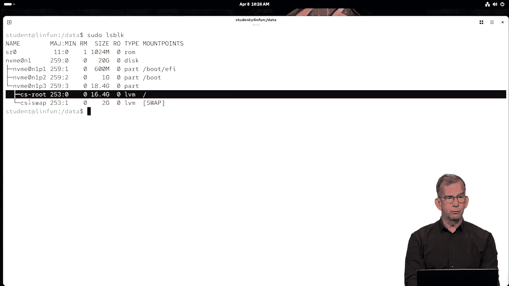

# CompTIA Linux+ 存储基础：01：理解Linux存储解决方案 💾




在本节课中，我们将一起学习Linux系统是如何处理存储的。我们会从计算机和硬盘的最基本关系说起，然后了解分区是什么，接着看看比分区更灵活的逻辑卷是怎么工作的，之后还会聊聊外部存储和网络存储，最后会教你如何用一条命令查看系统里所有的存储设备。如果你是刚接触Linux存储的新手，不用担心，所有内容都会用大白话来讲解，让你一步步看清楚。


## 硬盘与分区的基础关系 🖥️


上面我们说了本节课的大概内容，现在我们先从最简单的计算机和硬盘开始说起。

在你的计算机里，有一块硬盘。你可以把计算机想象成一个方块，把硬盘想象成一个圆圈。硬盘是用来存放数据的地方，而我们在硬盘上最基本的操作，就是创建分区。分区的作用，是为了把你要放进硬盘里的文件，在逻辑上划分成不同的区域，这样管理起来会更有条理。不过分区也有一个缺点，它不够灵活，一旦划分好了，之后想要调整大小会比较麻烦。这就是为什么我们在分区之外，还需要更灵活的存储方案。


## 从物理卷到逻辑卷的灵活存储 🔄


上一小节我们介绍了分区的基础概念，本节中我们来看看如何用逻辑卷来提升存储的灵活性。

为了让存储更灵活，Linux引入了逻辑卷管理的思路。你可以先把分区当作物理卷，然后把多个物理卷放进一个存储池里，这个存储池就是卷组。在卷组之上，你可以定义出一个或者多个逻辑卷，比如Lv1、Lv2、Lv3。逻辑卷最大的好处，就是你可以很容易地改变它们的大小，不需要像传统分区那样小心翼翼。在Linux系统里，分区和逻辑卷都是非常重要的存储概念，掌握它们能让你对系统存储有更深的理解。

```text
分区 = 物理卷
物理卷 -> 卷组 -> 逻辑卷 (Lv1, Lv2, Lv3)
```

以下是逻辑卷存储的层级关系：
- 物理卷：也就是你在硬盘上创建的分区，是最底层的存储单元。
- 卷组：把多个物理卷汇集在一起形成的存储池。
- 逻辑卷：从卷组里划分出来的可调整大小的存储空间。


## 外部存储与网络存储协议 🌐


上一小节我们讲完了逻辑卷，本节中我们来看看除了本地硬盘之外，Linux还能怎么使用外部存储。

除了自己电脑里的硬盘，Linux也支持使用外部存储设备。你可以通过存储协议，比如iSCSI或者光纤通道，连接到外部的存储阵列。这些外部磁盘在你的Linux服务器里，会显示成普通的磁盘，你可以像使用本地硬盘一样去读写它们。常见的外部存储方式包括SAN和NAS，它们能让多台服务器共享同一组磁盘资源，这在企业环境中非常常见。

以下是常见的外部存储协议及其用途：
- iSCSI：通过网络把块设备传输到服务器，让远程磁盘看起来像本地磁盘。
- 光纤通道：一种高速的存储网络技术，常用于企业级存储环境。
- SAN/NAS：分别是存储区域网络和网络附加存储，用于提供共享存储空间。


## Linux常见块设备设备名 📋


上一小节我们介绍了外部存储，本节中我们来看看Linux系统里，不同类型的硬盘分别对应什么设备名。

在Linux里，每一块存储设备都有一个设备文件名，用来在系统里标识它。最常见的是/dev/sd，代表SCSI或SATA硬盘，比如/dev/sda是第一块硬盘，/dev/sdb是第二块硬盘，依此类推。如果是KVM虚拟化环境下的硬盘，通常用/dev/vd表示。如果是NVMe固态硬盘，设备名会是/dev/nvme0n1这样的格式，nvme0代表总线0，n1代表第一个节点，也就是第一块盘，n2就是第二块盘，以此类推。另外，光驱设备通常会显示为/dev/sr0。

以下是几种常见的块设备设备名及其含义：
- /dev/sd：SCSI或SATA硬盘，字母A、B代表第一块、第二块磁盘。
- /dev/vd：KVM虚拟化环境常用的硬盘设备名。
- /dev/nvme：NVMe固态硬盘，后面跟总线号和节点号，如nvme0n1。
- /dev/sr0：光驱设备。


## 使用lsblk查看块设备 🔍


上一小节我们认识了各种设备名，本节中我们来看看如何用命令把它们都列出来。

要查看系统里所有的块设备，最常用的命令是lsblk，也就是list block devices的缩写。运行这个命令后，你可以看到系统里挂载了哪些存储设备，包括硬盘、分区、逻辑卷以及光驱。在接下来的几节课里，我们会继续学习如何操作这些分区和逻辑卷，所以现在先掌握怎么查看它们，会对你很有帮助。

```bash
lsblk
```

```
NAME   MAJ:MIN RM  SIZE RO TYPE MOUNTPOINTS
sr0     11:0    1  1024M  0 rom
nvme0n1 259:0   0   50G  0 disk
├─nvme0n1p1 259:1   0   50G  0 part /
```

以下是运行lsblk后可能看到的典型设备类型：
- SR0：光驱设备。
- NVME0和NVME1：NVMe固态硬盘。
- 分区：硬盘上划分出的独立区域。
- LVM逻辑卷：从卷组里创建出来的灵活存储卷。


## 本节课总结





本节课中，我们一起学习了Linux存储解决方案的基础知识。我们了解了计算机和硬盘的关系，学习了分区的作用和局限性，掌握了物理卷、卷组和逻辑卷的灵活存储模型，还认识了外部存储协议以及常见的块设备设备名，最后学会了用lsblk命令查看系统里的所有存储设备。希望这些内容能帮你建立起对Linux存储的初步认识。
