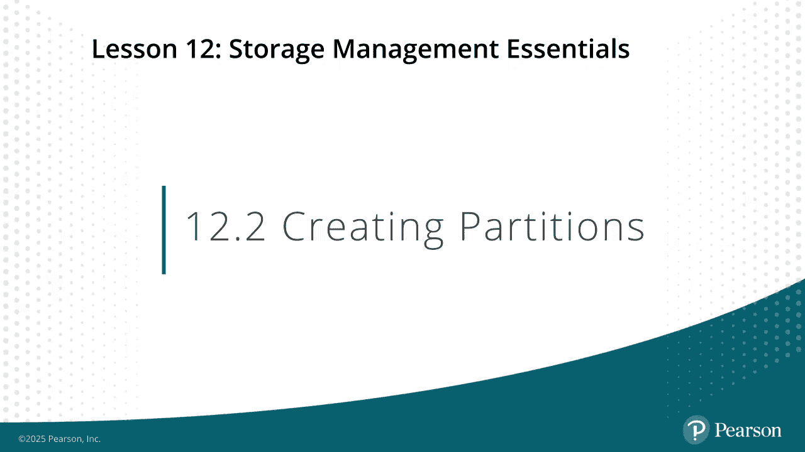
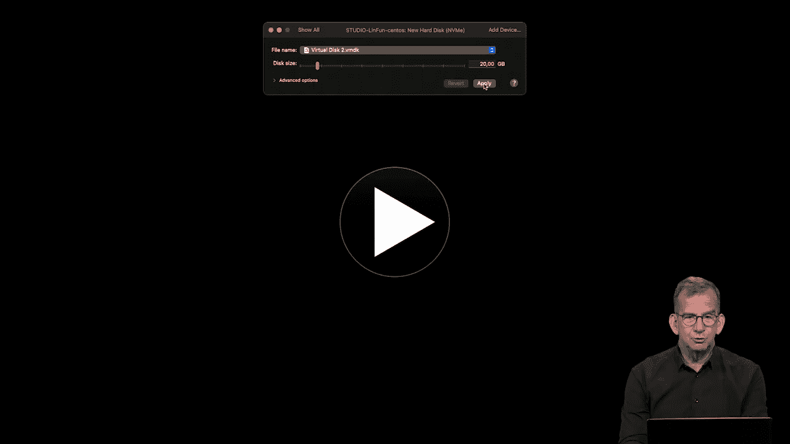
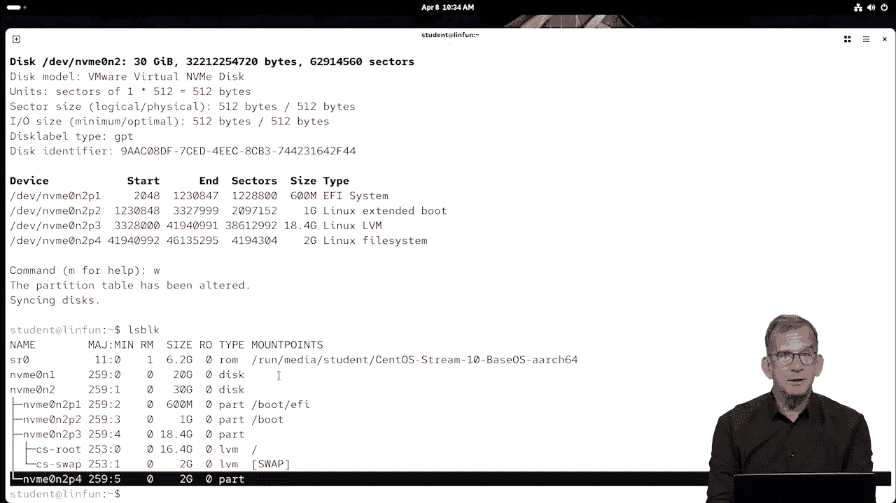

# 💾 CompTIA Linux+ V8：122：创建分区

在本节课中，我们将学习如何在 Linux 系统中创建磁盘分区。创建分区的前提是磁盘上有足够的空闲空间，因此我们会先调整虚拟机的硬盘大小，再进入系统使用 fdisk 工具来划分新分区，最后验证分区是否已经成功创建。整个过程适合初学者，不需要深厚的 Linux 基础，只需要跟着步骤操作即可。

## 第一步：调整虚拟机磁盘大小

在开始创建分区之前，必须确保磁盘上有可用的未分配空间。如果磁盘已经满了，就无法划分出新的分区，所以第一件事就是给虚拟机扩容。

以下是调整虚拟机磁盘大小的具体操作步骤：

1. 关闭虚拟机电源，确保系统没有在运行。
2. 打开虚拟机设置界面，不同的虚拟化软件界面可能略有差异，但大致位置相似。
3. 找到可移动设备选项，查看当前挂载的硬盘信息。
4. 将现有的 20 GB 硬盘调整为 30 GB，增加 10 GB 的可用空间。
5. 点击应用按钮，虚拟化软件会提示变更无误，确认后保存设置。
6. 新增一块 20 GB 的硬盘，这块新硬盘也会被系统识别。
7. 启动虚拟机，让操作系统重新扫描并识别新增的存储空间。

**磁盘容量调整公式：**
`新磁盘大小 = 原磁盘大小 + 扩展空间`

示例：20 GB 调整为 30 GB，相当于扩展了 10 GB 的空间，这些空间之后可以用来创建新分区。

## 第二步：选择分区工具

调整完磁盘大小之后，我们需要进入系统选择合适的分区工具。Linux 中有多种工具可以用来创建分区，而 fdisk 是其中最经典、功能最强大的工具之一。它灵活、高级、功能齐全，几乎可以完成你对存储设备的所有操作。

既然一个工具就能搞定所有事情，就没有必要浪费时间去学习多个分区工具。本节我们将使用 fdisk 来操作 `/dev/nvme0n1`，这是刚才从 20 GB 调整到 30 GB 的主分区设备。

**核心命令：**
`fdisk /dev/nvme0n1`

这条命令的意思是，对指定的块设备启动 fdisk 交互界面，之后就可以在里面进行分区规划。

## 第三步：进入 fdisk 并检查分区表

启动 fdisk 后，会进入一个交互式命令界面。此时你可能会看到提示设备未识别分区表，这种情况看起来有点奇怪，但不必过于紧张。

**常用退出与查看命令：**
- 按 `q` 退出 fdisk 界面
- 执行 `lsblk` 查看块设备和分区信息

通过 `lsblk` 命令，你可以看到 `/dev/nvme0n2` 是已有分区的磁盘，还有一块新加入的磁盘。设备命名看起来可能有点奇怪，但系统已经成功启动，说明硬件没有问题。我们要操作的是刚才调整过大小的磁盘，即 `/dev/nvme0n2`，因此需要重新进入 fdisk 对它进行操作。

## 第四步：处理 fdisk 的警告信息

重新进入 fdisk 时，可能会出现两条看起来很吓人的警告信息，初学者容易在这里产生疑惑，但实际上都可以忽略。

以下是这两条警告信息的含义：

1. 第一条是 GPT PMBR 大小不匹配。这表示系统原本期待的是 20 GB 磁盘，现在突然变成了 30 GB，属于正常现象，无需惊慌。
2. 第二条提示磁盘当前正在使用，分区操作可能有风险。这是在警告你正在做一件可能比较危险的事情，但我们可以忽略它，继续后续操作。

**警告信息示例：**
`GPT PMBR size mismatch`
`Disk /dev/nvme0n2 is currently in use`

看到这些信息后，直接忽略并进入下一步即可。

## 第五步：使用 fdisk 交互菜单

在 fdisk 中按 `m` 可以查看帮助菜单。其实这个帮助更像是一个选项列表，而不是真正的帮助文档，里面列出了所有可用的单字母命令。

以下是你需要关注的选项，其他选项暂时可以忽略：

- `p`：打印当前分区表，查看磁盘上的分区情况
- `n`：新建分区，用于创建新的分区条目
- `w`：写入更改并退出，保存刚才的分区设置

保持简单，只记住这三个命令就足够了，其他高级选项在后续学习中再逐步接触。

**命令对照表：**
| 命令 | 作用 |
|------|------|
| `p` | 显示当前分区表 |
| `n` | 创建新分区 |
| `w` | 保存更改并退出 |

## 第六步：创建新分区

使用 `p` 命令查看当前的分区表，确认磁盘上已经存在哪些分区，避免重复创建。

接下来创建新分区，分区编号设为 4。第一个扇区是磁盘上的物理起始位置，直接按回车键接受默认值即可，不需要手动指定。

**分区大小设置示例：**
`+2G`

注意：这里的 `G` 必须是大写，fdisk 对大小写非常敏感，如果写成小写 `g` 可能会报错或被误解。通过这种方式，我们创建了一个 2 GB 的 Linux 文件系统分区。

使用 `p` 再次打印分区表，验证新分区是否已经出现在列表中。

## 第七步：保存并验证

确认分区表无误后，使用 `w` 命令将更改写入磁盘并退出 fdisk。此时 fdisk 会把刚才的所有设置真正保存下来。

至此，我们学习了以下核心命令：

- `p`：打印分区表，用于查看当前状态
- `n`：新建分区，用于创建新分区条目
- `w`：写入更改，保存并退出

要验证操作结果，可以再次运行 `lsblk`。你会看到新出现的 4 号分区，这个分区将在下一节课中进行进一步配置，比如格式化和挂载。

## 总结

本节课中我们一起学习了如何调整虚拟机磁盘大小，如何使用 fdisk 工具创建新分区，以及如何处理常见的警告信息。我们成功创建了一个 2 GB 的 4 号分区，并验证了它的存在。下一节课我们将学习如何对这个分区进行格式化和挂载，使其可以正常使用。
