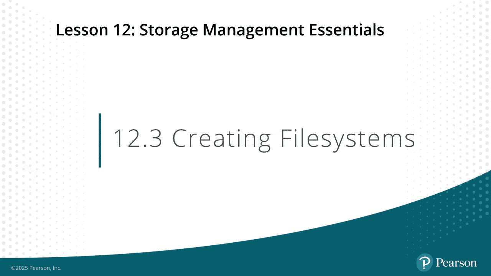
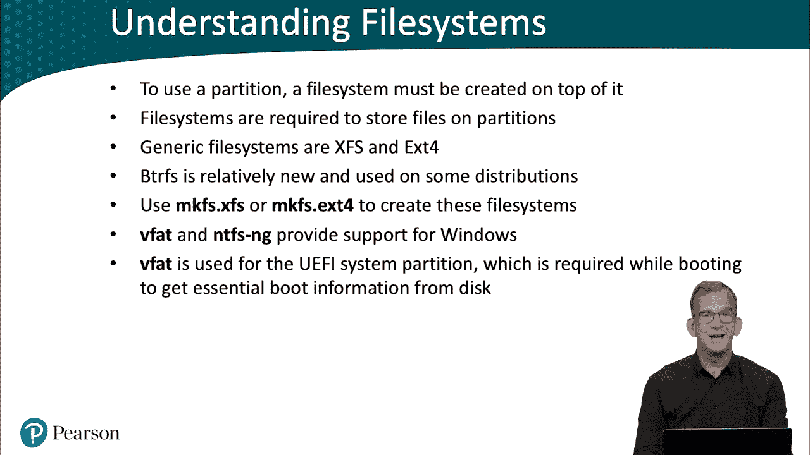
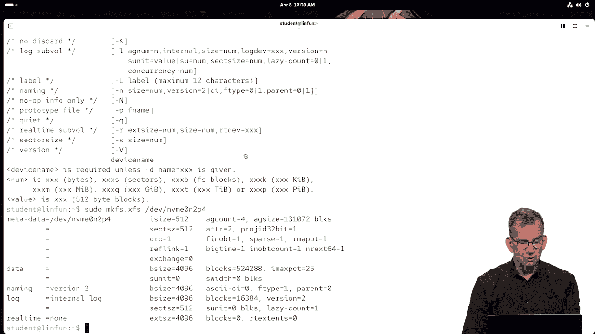

# CompTIA Linux+ V8：123：Creating Filesystems 📂


在本节课中我们将要学习如何在Linux系统中创建文件系统。你可能已经知道怎么划分一个分区，但分区创建好之后，它还不能直接用来存文件。这时候就需要在分区上面格式化一个文件系统。本节课会用大白话告诉你什么是文件系统，Linux里常用哪几种，以及怎么用命令行工具把一个空分区变成能存数据的地方。我们还会顺便聊聊UEFI启动分区为什么要用特殊的格式，最后通过实际操作演示，看看怎么查看系统里已有的文件系统，又怎么在新分区上格式化出XFS文件系统。那我们正式开始。




## 1. 什么是文件系统 📁


上一节我们介绍了如何创建分区，本节中我们来看看分区创建好之后该做什么。其实光有一个分区还不够，你没法直接往里面存东西。这就好比你盖好了一个房间的框架，但还没有铺地板、刷墙面，家具没法放进去。文件系统就像是这个房间的装修，它决定了文件怎么放、怎么找、怎么管理。

没有文件系统，分区只是一块未格式化的磁盘空间，操作系统不知道该往哪里写数据，也找不到已经写进去的数据。所以，在你想用分区保存任何文件之前，必须先在分区之上创建文件系统。


文件系统的作用可以简单总结为：

- 把分区变成能存文件的地方
- 管理文件的位置、名称和元数据
- 让操作系统能读写分区上的数据


在Linux系统中，创建文件系统是分区之后的必选步骤，没有它，分区就像一张白纸，什么都记不下。


## 2. Linux 常用文件系统类型 🐧


刚才我们聊了为什么需要文件系统，本节中我们来看看Linux里常用哪几种。Linux支持很多种文件系统，但日常工作中你最常接触到的，主要是下面这两个。

以下是Linux主流发行版常用的文件系统：

- XFS：Red Hat系列系统的默认文件系统，适合大文件和大容量场景。
- EXT4：Ubuntu及很多Debian系列系统的默认文件系统，兼容性好，稳定性高。


```text
Red Hat 系统默认文件系统 = XFS
Ubuntu 系统默认文件系统 = EXT4
```


你可能也会听说Btrfs，写作BTRFS，读作"Better FS"。它是个比较新的文件系统，某些发行版支持，但主要发行版现在还是以XFS和EXT4为主。为了不把内容搞得太复杂，本节课我们不再展开讲Btrfs。

如果你需要同时支持Windows和Linux，还有exFAT和FAT等选项，不过普通的Linux系统安装里，我们一般不会去用它们。先记住XFS和EXT4这两个名字就够了。


## 3. 创建文件系统的命令工具 🛠️


知道了常用的文件系统类型，本节中我们来看看怎么实际创建它们。在Linux里，创建文件系统的主要工具是mkfs，也就是"make file system"的缩写。根据你想创建的类型不同，会用到不同的子命令。

以下是常用的mkfs命令形式：

```bash
mkfs.xfs /dev/sdX1   # 创建 XFS 文件系统
mkfs.ext4 /dev/sdX1  # 创建 EXT4 文件系统
```


这里的`/dev/sdX1`需要换成你实际要格式化的分区设备名，比如`/dev/nvme0n1p4`。

如果你想做多操作系统支持，可能会看到vfat和exFAT这两个选项，它们是为了Windows兼容而存在的。不过在一台纯Linux系统上，你通常不需要考虑它们，可以先放一边不管。

有一个例外情况要注意：vfat并不是完全无用。因为vfat用于UEFI系统分区，而UEFI系统分区在电脑启动时是必须的，系统需要从磁盘读取关键的引导信息。


## 4. UEFI 分区与 VFAT 格式 🔌


聊完普通的数据分区，本节中我们来看看启动分区的特殊情况。现代电脑自2010年起普遍使用GPT分区表标准，GPT下启动通常依赖UEFI系统分区。这个分区里存放着系统启动所需的关键信息，必须能被不同操作系统识别。

所以UEFI系统分区会被格式化为VFAT格式，这样Linux、macOS和Windows都能读取。这是一个业界标准，如果你的系统用UEFI启动，就必须要有这个VFAT分区。


```text
UEFI 系统分区格式 = VFAT
作用 = 存储引导信息，供 Linux / macOS / Windows 读取
```


在实际操作中，你也会看到这个分区出现在系统里，不用惊讶，它就是用来保证电脑能正常启动的。


## 5. 查看系统中当前的文件系统 🔍


理论部分讲完了，本节中我们来看看怎么在实际系统中查看已经存在的文件系统。要想知道当前哪些分区被挂载、使用了什么文件系统，可以组合使用mount命令和grep命令。



以下是查看命令示例：

```bash
sudo mount | grep /
```


这条命令的意思是：列出所有挂载信息，然后筛选出以斜杠开头的条目，也就是通常代表根文件系统和各种挂载点的部分。

执行后你可能会看到类似下面的输出：

- 一个LVM逻辑卷，格式是XFS
- 挂载在/boot上的分区，格式也是XFS
- 挂载为VFAT的EFI分区，也就是分区1


这些就是系统里已经在用的文件系统了。


## 6. 在新分区上创建文件系统 ⚙️


查看完现有文件系统，本节中我们来看看怎么在刚创建的新分区上格式化文件系统。假设你刚才已经划分出了一个新分区，设备名可能是`/dev/nvme0n1p4`，那么创建XFS文件系统的命令就是：

```bash
mkfs.xfs /dev/nvme0n1p4
```


不过在实际演示中，可能会遇到设备名变化的情况。比如你原本预期的设备是`nvme0n1`，结果系统里变成了`nvme0n2`，这时候mkfs会报错说找不到设备或设备不正确。这是因为Linux里的磁盘设备名不是固定不变的，重启或者插拔硬盘后可能会变。

如果遇到这种情况，你需要先确认新分区的正确设备名，然后把命令里的设备名改成实际的那个，比如改成`/dev/nvme0n2`下的对应分区号。

执行成功后，该分区上就已经有了文件系统，可以用来存数据了。

关于磁盘设备名可能会变化这件事，我们会在下一节课制作持久挂载时仔细讨论，这里先留个印象即可。


## 总结 📝


本节课中我们一起学习了以下内容：

- 什么是文件系统，以及为什么分区创建后必须格式化才能使用
- Linux中常用的XFS和EXT4文件系统，以及它们分别对应的默认发行版
- 使用mkfs.xfs和mkfs.ext4创建文件系统的方法
- UEFI系统分区为什么需要用VFAT格式，以及它在启动中的作用
- 如何用`sudo mount | grep /`查看系统中已有的文件系统
- 如何在新分区上执行`mkfs.xfs`创建文件系统，以及设备名可能变化需要注意的地方




希望这节课能帮你建立起对Linux文件系统的直观认识。下一节课我们会继续探讨挂载和持久化配置的内容。

