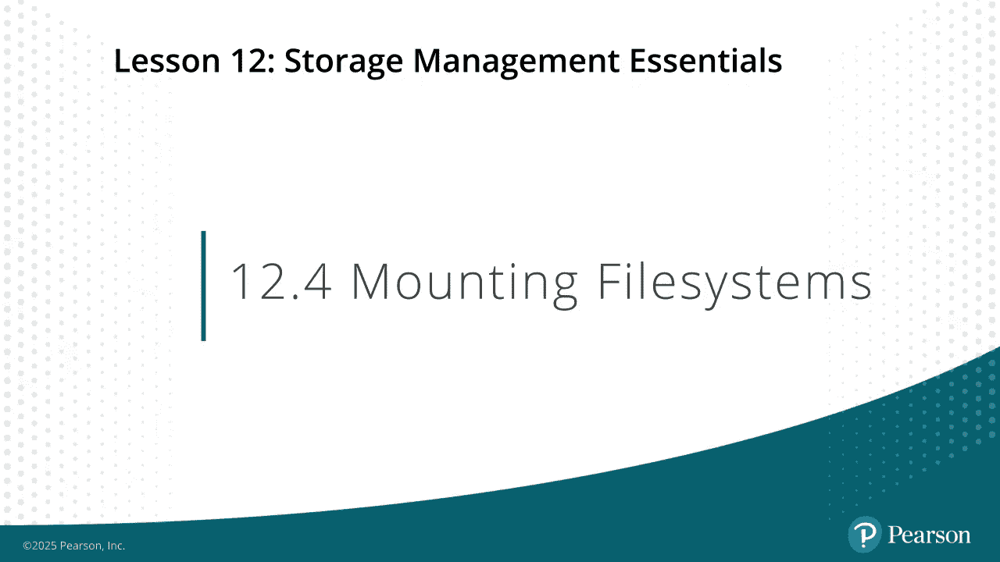
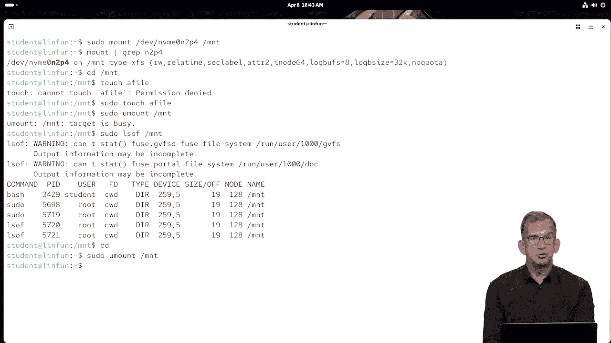
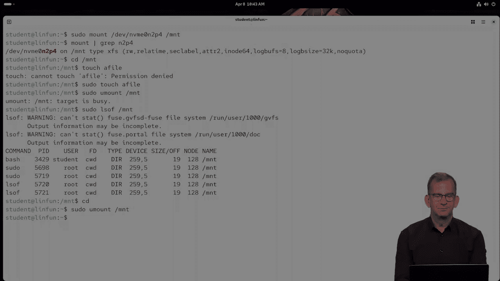

# Oreilly - CompTIA Linux+ V8 - Pearson Cert Prep (Video)：124：挂载文件系统 📂



## 课程概述

在本节课中我们将要学习如何在 Linux 系统中挂载文件系统。挂载就是把存储设备连接到系统目录树上的一个过程。我们会先解释挂载的基本原理，然后展示如何使用命令行手动挂载设备，接着介绍如何查看当前已经挂载的设备，最后讲解如何安全地卸载设备，以及遇到设备忙错误时该怎么处理。


## 挂载的基本概念

挂载的核心思想可以用下面这个简单的关系式来理解：

```text
设备路径 --mount--> 挂载点目录
```

什么是挂载点呢？挂载点就是一个普通的文件夹，当你把一个分区或者存储设备挂载到这个文件夹上以后，往这个文件夹里写入的所有数据，实际上都会被直接写到那个设备里面去。反过来，如果你把设备卸载了，之前写进去的文件在这个目录里就看不见了。

在 Linux 里，挂载不仅仅是给硬盘分区用的，U 盘、光驱这类可移动设备，访问里面的文件也必须先挂载。上一节课我们刚刚创建好了一个文件系统，本节课紧接着就来看看怎么把它挂载到系统里使用。

## 手动挂载设备

既然知道了挂载是什么，那么具体该怎么操作呢？在 Linux 命令行里，挂载设备主要靠 mount 命令完成。

以下是手动挂载设备的基本命令格式：

```bash
sudo mount 设备路径 挂载点目录
```

比如，如果你要把一个设备挂载到 /mnt 目录下，命令长这样：

```bash
sudo mount /dev/nvme0n2p4 /mnt
```

这里需要注意几个细节。/mnt 目录通常用于临时挂载，如果你打算长期使用某个设备，最好给它单独建一个目录，不要都挤在 /mnt 里。挂载完成之后，你就可以像操作普通文件夹一样操作这个设备里的文件了。

## 查看当前挂载情况

设备挂上去之后，我们需要知道它到底挂成功了没有，以及系统里现在一共有哪些设备被挂载了。

以下是几个常用的查看命令，你可以根据需要选择使用：

- mount：直接列出当前所有挂载点，输出内容比较多。
- lsblk：以树状结构展示块设备及其挂载点，简洁直观。
- df -h：以易读方式显示磁盘空间使用情况，同时也能看出挂载点。
- findmnt：专门用来查找和显示挂载信息，输出清晰。

如果你只想确认某个特定设备是否已经挂载，可以把 mount 的输出通过管道传给 grep 来过滤，命令如下：

```bash
mount | grep n2p4
```

这样只要输出里有对应的设备名，就说明挂载成功了。

## 卸载设备与处理设备忙错误

用完设备之后，当然要知道怎么把它安全地卸载下来，避免数据丢失或者文件系统损坏。

在 Linux 里，卸载设备使用的命令是 umount，注意拼写是 u-mount，不是 unmount。基本用法如下：

```bash
sudo umount 挂载点目录
```

不过实际操作中，经常会遇到一个比较麻烦的情况，系统提示目标正在被占用，无法卸载。这时候通常是因为你当前所在的终端工作目录就在挂载点里面，或者有其他进程正在访问这个设备。

你可以使用 lsof 命令来找出到底是哪些进程在占用这个挂载点：

```bash
sudo lsof +路径
```

拿到进程信息之后，你有两种选择：一种是关闭这些占用进程，另一种是先切换到别的目录，让终端离开挂载点，然后再重新执行 umount 命令，通常就能成功卸载了。

## 实操演示：完整的挂载与卸载流程

光看命令格式可能还不够直观，下面我们把一个完整的挂载、验证、写入文件、再卸载的过程走一遍，你就能清楚整个流程是怎么回事了。

首先，我们用 sudo 和 mount 命令把设备挂载到 /mnt：

```bash
sudo mount /dev/nvme0n2p4 /mnt
```

然后用 mount 结合 grep 验证挂载是否生效：

```bash
mount | grep n2p4
```

如果在输出里看到了对应的设备信息，就说明挂载成功。接下来进入挂载目录，尝试创建一个测试文件：

```bash
cd /mnt
sudo touch testfile
```

这里为什么要加 sudo 呢？因为普通用户通常没有权限直接在挂载点里写文件，需要提权才能操作。

当你想要卸载设备时，如果直接运行：

```bash
sudo umount /mnt
```

可能会报错说目标忙。这时候先退出 /mnt 目录，回到家目录或者其他地方，再执行一次 umount，通常就能成功了。如果还是报错，就用 lsof 检查一下有没有进程在占用，把那些进程处理掉再试。



## 本节总结



在本节课中我们一起学习了挂载文件系统的基本概念，掌握了如何使用 mount 命令手动挂载设备，学会了用 mount、lsblk、df -h 和 findmnt 查看当前挂载情况，也了解了使用 umount 卸载设备时遇到设备忙错误的解决方法。挂载是 Linux 系统管理存储设备的基础操作，掌握它之后你就可以方便地访问硬盘分区、U 盘和光驱里的文件了。

