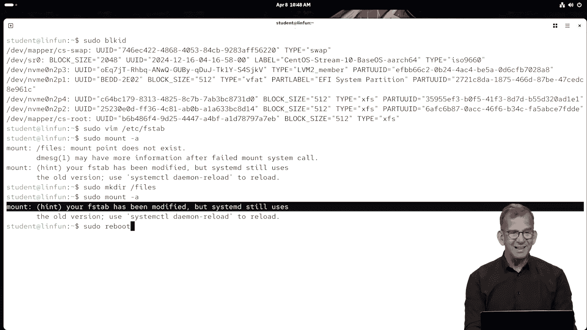
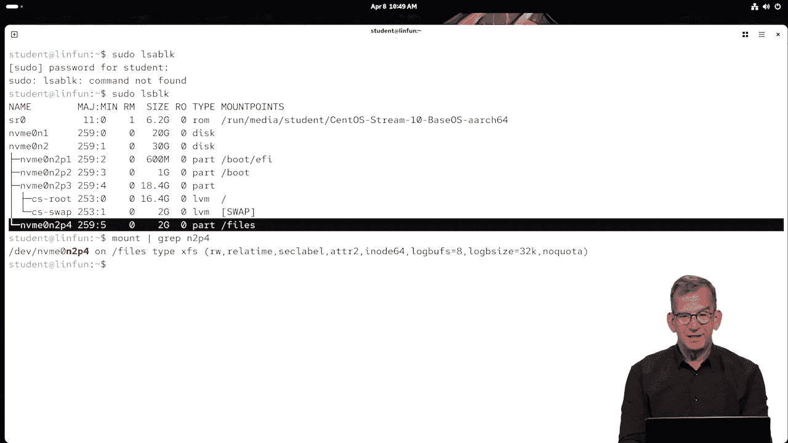

CompTIA Linux+：第125节：使挂载持久化 💾

在本节课中，我们将要学习如何让设备挂载在系统重启后依然保持有效。上一节课我们介绍了如何手动挂载设备，本节中我们来看看如何让这些挂载变成永久性的，这样你就不需要每次开机都手动输入挂载命令了，系统也能自动把分区挂载上去。


什么是持久挂载

我们刚刚学习完如何挂载设备。接下来你需要知道，这些挂载是如何被设置为持久挂载的。

所谓持久挂载，就是通过 /etc/fstab 文件来实现的。这个文件负责让挂载在重启后依然生效，确保分区能够自动回来，而不是每次都要手动操作。

在现代系统中，这个文件被用作创建 systemd 挂载的输入文件。你可以忽略这个细节，因为如果你只使用 /etc/fstab，systemd 会自动处理其余的事情，不需要你额外配置。


/etc/fstab 文件的六列结构

在 /etc/fstab 文件中，你需要用六个不同的列来定义挂载。以下是每一列的含义：

- 第一列：设备标识，可以是设备名称，也可以是 UUID。
- 第二列：挂载点，也就是你要把设备挂载到的目录。
- 第三列：文件系统类型，即你格式化时使用的文件系统。
- 第四列：挂载选项，大多数情况下不需要特别设置。
- 第五列：备份选项，大多数情况下不需要。
- 第六列：检查顺序，大多数情况下也不需要。

这里有一个核心公式，帮助你记住这一行的基本格式：

```
<设备或UUID> <挂载点> <文件系统类型> <挂载选项> <备份> <检查顺序>
```


为什么使用 UUID 而不是设备名称

很重要的一点是，在 /etc/fstab 中挂载设备时，应该使用 UUID，而不是设备名称。设备名称可能会改变，但 UUID 永远不会改变，这就是我们需要可靠持久挂载的原因。

我并不确定我的设备名称，我惊讶地发现我的旧磁盘出现为 NVMe0 和 2，而新磁盘出现为 NVMe0 n1，我不能确定重启后名称是否还是一样的，所以我打算使用 UUID。


获取设备的 UUID

第一步是找出我的设备的 UUID。以下是具体操作步骤：

每一个带有文件系统的设备都有一个唯一的块 ID，也就是我们看到的 UUID，而且这些 UUID 永远不会改变。

你可以使用下面的命令来查看：

```
sudo blkid
```

运行这个命令后，你会看到每个设备对应的 UUID，这就是我们需要记录下来的信息，之后要填入 /etc/fstab 文件中。


编辑 /etc/fstab 文件

接下来我将打开 /etc/fstab 文件，在编辑器中为刚才创建的设备添加挂载项。以下是操作过程：

你可以看到在第一列中，所有已挂载的内容都是通过 UUID 挂载的，对于我的新设备也是如此。我的 UUID 带有双引号，你可以保留它们，不需要删除，直接照抄即可。

我要挂载的旧文件系统需要一个唯一的挂载点，而这个挂载点我还需要创建。接着我要指定文件系统类型，然后是挂载选项以及第四、五、六列的其他选项，直接使用默认值 0 和 0 即可，不需要自己去猜。


测试挂载配置

在修改完 /etc/fstab 文件之后，你需要测试一下。以下是建议的测试方法：

我建议你使用下面的命令：

```
sudo mount -a
```

mount -a 命令会尝试挂载 /etc/fstab 中所有当前尚未挂载的条目，如果有任何错误阻止操作，它会报告出来，这样你就能立刻发现问题。

在这里，我们可以看到错误信息，说挂载点 /files 不存在，这是正确的。我需要先使用下面的命令创建它：

```
sudo mkdir /files
```

创建完成后，我可以再次使用 mount -a 命令，此时应该能看到挂载已经完成。你可以暂时忽略其中的提示信息，重点看有没有报错。


重启系统验证挂载



验证配置是否正确的终极测试，就是重启系统。我将使用 sudo reboot 重启系统，带上新挂载的分区，看看重启后挂载点还在不在。

我按下了 ESC 键，这样你就能看到几个启动消息，我观察的是是否有任何内容以红色显示。这些消息显示得非常快，但我看到 GDM 登录界面再次出现，这很可能意味着一切正常，没有引导失败。


确认挂载是否成功

打开终端后，我们需要验证挂载是否真的成功完成了。以下是验证步骤：

先运行下面的命令查看块设备情况：


```
lsblk
```

然后用下面的命令检查特定分区的挂载状态：

```
mount | grep n2p4
```

我们可以看到设备仍然是 NVMe0 n2，同时新分区已经挂载到了 /files 目录。这就是我们预期的结果，说明持久挂载已经配置成功，重启后分区会自动回来。




本节课中，我们一起学习了如何通过 /etc/fstab 文件让设备挂载变得持久。我们了解了 /etc/fstab 的六列结构，学会了使用 sudo blkid 获取 UUID，明白为什么应该使用 UUID 而不是设备名称，掌握了如何编辑配置文件，使用 sudo mount -a 测试配置，以及通过重启系统和 lsblk 命令来验证挂载结果。希望这节课对你有所帮助。
