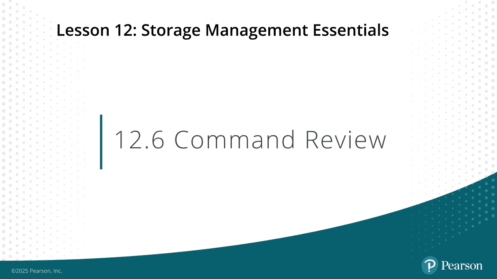
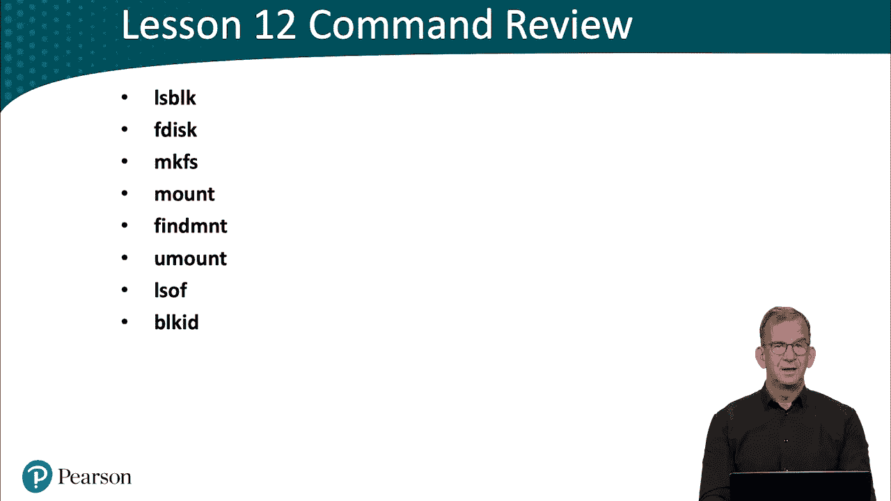

# 🐧 CompTIA Linux+ V8：126：命令复习

在本节课中，我们将要学习本课介绍的几个重要 Linux 命令。这些命令主要用于查看块设备、创建分区、制作文件系统、挂载和卸载设备，以及查看设备的 UUID。如果你是初学者，完全不需要担心，我们会用最直白的大白话把每一个命令都讲清楚，让你一看就懂。

---

## 📋 课程概述

本节课是对之前所学命令的复习，重点回顾在存储管理部分接触到的工具。我们会逐个介绍 lsblk、fdisk、mkfs、mount、findmnt、umount、lsof 和 blkid 这几个命令，了解它们各自的作用和基本用法。掌握这些命令，是学好 Linux 系统管理的重要基础。


---

## 🔹 查看块设备

上一节我们介绍了块设备的基本概念，本节中我们来看看如何在系统中查看这些设备。

以下是用于列出块设备的命令：



- **lsblk**：列出系统上的所有块设备。

使用示例如下：

```bash
lsblk
```

运行这条命令后，终端会显示出你电脑里所有的硬盘和分区信息，帮助你确认设备名称。

---

## 🔹 创建磁盘分区

在知道了如何查看块设备之后，接下来我们需要学习如何在磁盘上创建分区。

以下是用于创建分区的主要工具：

- **fdisk**：用于创建和管理磁盘分区的主要实用工具。

使用示例如下：

```bash
fdisk /dev/sdb
```

执行这个命令后，你会进入一个交互界面，可以在里面为磁盘划分分区。

---

## 🔹 创建文件系统

分区创建完成之后，下一步就是在分区上格式化出文件系统，这样操作系统才能在这个分区里存取数据。

以下是用于创建文件系统的命令：

- **mkfs**：用于创建文件系统，使用格式是 mkfs.加上文件系统名称。

常见用法示例如下：

```bash
mkfs.xfs /dev/sdb1
mkfs.ext4 /dev/sdb1
```

第一条命令用来创建 XFS 文件系统，第二条命令用来创建 EXT4 文件系统，你可以根据需要选择其中一种。

---

## 🔹 挂载设备与查看挂载状态

文件系统创建好之后，我们需要把设备挂载到系统的某个目录里才能正常使用。

以下是用于挂载设备和查看挂载信息的命令：

- **mount**：用于挂载设备。
- **findmnt**：用于查看所有已挂载设备的概览信息。

使用示例如下：

```bash
mount /dev/sdb1 /mnt/data
findmnt
```

mount 命令把设备挂载到指定目录，findmnt 命令则可以让你一眼看出系统里当前都挂载了哪些设备。

---

## 🔹 卸载设备与检查打开的文件

在拔掉设备或者重新挂载之前，必须先把设备卸载，并且确保上面没有文件被占用。

以下是用于卸载设备和检查打开文件的命令：

- **umount**：用于断开已经挂载的设备。
- **lsof**：用于找出哪些文件正被打开。

使用示例如下：

```bash
umount /mnt/data
lsof
```

如果 umount 提示设备忙，你可以用 lsof 查看是哪些进程在占用设备上的文件，然后关闭这些程序后再尝试卸载。

---

## 🔹 查看设备 UUID

在配置开机自动挂载时，直接使用类似 /dev/sdb1 这样的设备名称可能不够稳定，因为重启后设备名称可能会发生变化。这时候查看设备的 UUID 就显得很有用了。

以下是用于查看设备 UUID 的命令：

- **blkid**：用于查看你想要挂载的设备的 UUID。

使用示例如下：

```bash
blkid
```

运行这条命令后，你会看到每个分区的 UUID 等信息，可以把这些 UUID 写入 /etc/fstab 文件，实现更可靠的设备挂载。

---

## 🧪 课后实验

上面就是本课要重点掌握的所有命令。为了加深理解，建议你在自己的 Linux 系统上动手试一遍这些命令。

让我们继续，进入本节课的结束实验环节，通过实际操作巩固所学内容。



---

## 📝 本节总结

本节课中，我们一起学习了 lsblk、fdisk、mkfs、mount、findmnt、umount、lsof 和 blkid 等命令。这些命令分别用于查看块设备、创建分区、创建文件系统、挂载设备、查看挂载状态、卸载设备、检查打开的文件以及查询设备 UUID。希望通过本节大白话的讲解和代码示例，你能快速上手这些 Linux 存储管理命令。

