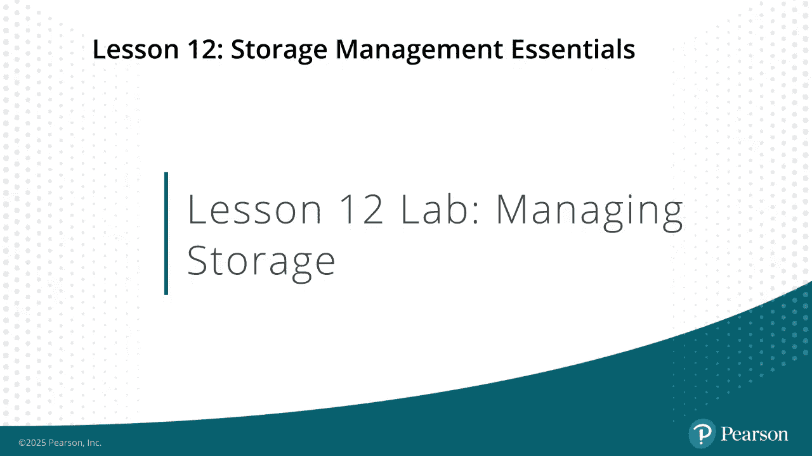
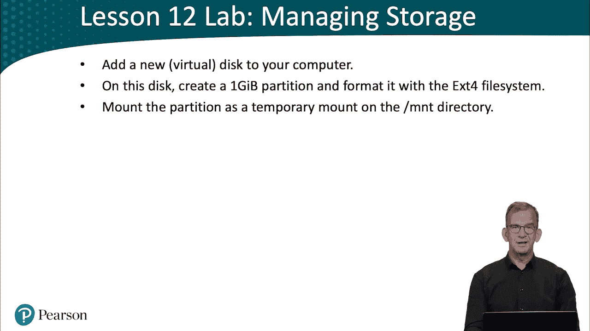

# 💾 CompTIA Linux+ V8：127：Lesson 12 Lab Managing Storage


在本节课中，我们将学习如何在 Linux 系统中添加新磁盘、创建分区、格式化文件系统以及临时挂载。本节内容属于存储管理实验，适合零基础的初学者了解 Linux 磁盘管理的完整流程。现在开始本次实验的具体操作。


本次实验的具体任务如下。你需要在计算机中添加一块新磁盘，创建一个容量为 1 GiB 的分区，使用 EXT4 文件系统对其格式化，最后将该分区临时挂载到 /mnt 目录。这些步骤涵盖了 Linux 存储管理中最核心的操作，学会之后你就能独立处理常见的磁盘配置工作。


以下是实验需要完成的关键步骤：



- 在计算机中添加一块新磁盘。
- 创建一个大小为 1 GiB 的分区。
- 使用 EXT4 文件系统格式化该分区。
- 将分区临时挂载到 /mnt 目录。


在 Linux 中，磁盘从添加到可用的完整流程，可以用下面这个公式来概括：

```text
物理磁盘 → 创建分区 → 格式化文件系统 → 挂载到目录
```

这个公式的意思是，一块新加入的物理磁盘不能直接使用，必须先划分出分区，然后为分区格式化成某种文件系统，最后通过挂载操作把它关联到系统中的某个目录，这样才能读写里面的文件。EXT4 是 Linux 里最常用的文件系统之一，稳定可靠，非常适合初学者练手。


接下来我们来看看 /mnt 目录的作用。在 Linux 系统中，/mnt 通常被用作临时挂载点，也就是说，你把分区挂载到这里之后，就可以像访问普通文件夹一样查看和修改分区里的数据。不过这种挂载是临时的，如果系统重启，挂载可能会失效，除非你把它写入 /etc/fstab 配置文件中。本次实验只要求临时挂载，因此不需要做永久配置，保持简单即可。


下面是完成上述操作时可能会用到的典型命令，你可以对照着在自己的终端中输入：

```bash
# 查看系统中当前的磁盘设备
lsblk

# 对新磁盘创建分区，这里假设新磁盘设备名为 /dev/sdb
fdisk /dev/sdb

# 将新建分区格式化为 EXT4 文件系统
mkfs.ext4 /dev/sdb1

# 将分区临时挂载到 /mnt 目录
mount /dev/sdb1 /mnt
```



这段代码展示了从检查磁盘到完成挂载的完整过程。lsblk 命令帮你确认系统是否识别到了新磁盘，fdisk 用来创建分区，mkfs.ext4 用来格式化，mount 命令则负责最后的挂载动作。每一步都不可或缺，缺少任何一步都会导致分区无法正常使用。


本节课中我们一起学习了如何在 Linux 中添加新磁盘、创建 1 GiB 分区、使用 EXT4 文件系统格式化，并将其临时挂载到 /mnt 目录。通过这些步骤，你已经掌握了 Linux 存储管理中最基础且实用的操作方法，可以在实际环境中尝试进行类似的磁盘配置任务。

