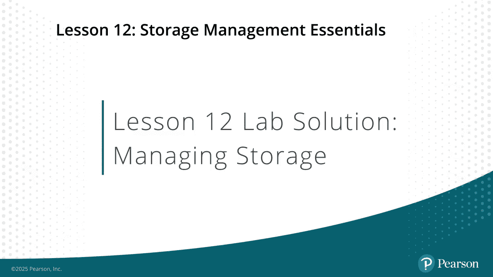
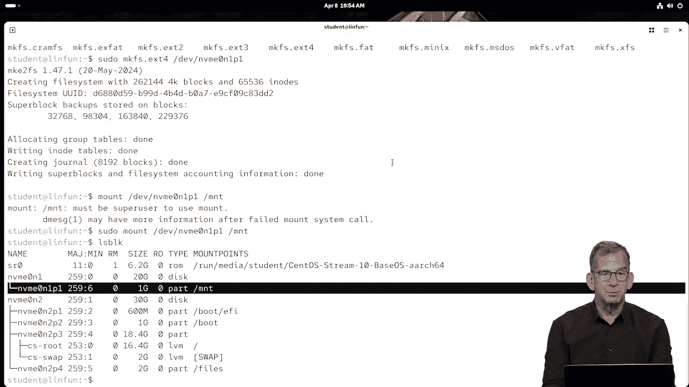

CompTIA Linux+：第12课：存储管理解决方案 💾


在本节课中，我们将一起学习如何在 Linux 系统里管理存储设备。具体来说，我们会完成一个实验的解答过程，从查看硬盘开始，一直到分区、格式化和挂载，最后确认一切正常。这适合刚接触 Linux 存储管理的初学者，讲解会尽量直白，避免晦涩的术语，让你快速上手实际操作。


## 查看块设备 🔍


上一节我们可能介绍过 Linux 设备文件的基本概念，本节中我们来看看如何查看系统里的块设备。



以下是查看块设备的方法：

- 使用 `lsblk` 命令列出所有块设备。
- 在输出中，你可以看到 `nvme0` 和 `nvme1` 这两个设备，它们就是我们要操作的目标硬盘。

`lsblk` 是一个非常实用的命令，它能以树状结构展示磁盘和分区的信息，让你一眼看出哪些设备已经被系统识别，哪些分区还没有被使用。执行这条命令后，屏幕上会列出设备名称、大小、挂载点等内容，这为接下来的操作打下基础。如果你是以普通用户身份运行，可能需要在前面加上 `sudo` 才能看到完整信息，不过这里主要演示命令本身的用法。


## 启动 fdisk 进行分区 🛠️

有了设备信息之后，我们需要对选定的硬盘进行分区。本节我们将使用 `fdisk` 工具来完成这一步。

以下是启动 fdisk 的命令：

```bash
sudo fdisk /dev/nvme0n1
```

这条命令告诉系统，我们要对 `/dev/nvme0n1` 这块 NVMe 硬盘进行分区操作。进入 fdisk 交互界面后，你可以输入不同的字母来执行不同的操作，比如创建新分区、查看分区表或者保存更改。对初学者来说，这里最重要的一点是，在退出之前务必确认分区布局已经正确，否则可能会丢失数据。这时候不要急着动键盘，先观察当前的提示符，确认已经进入了 fdisk 的命令行模式。


## 设置 GPT 分区标签 🏷️

上一节我们进入了 fdisk 界面，但默认情况下它可能会创建旧式的 MBR 分区标签。本节中我们来看看如何改为更现代的 GPT 标签。

以下是操作方法：

- 在 fdisk 提示符下输入 `g`。
- 这会创建一个全新的 GPT 分区表，替换掉默认的 MBR 标签。

为什么要这么做呢？MBR 是非常古老的分区标准，它最多只允许创建四个主分区，这在今天的大容量硬盘面前显得很局限。GPT 则支持更多分区，也更适合现代 UEFI 系统。所以我们不建议使用 MBR，直接切换到 GPT 是更好的选择。输入 `g` 之后，fdisk 会立即更新内存中的分区表类型，不过此时更改还没有写入硬盘，需要后续步骤才能保存。


## 创建新分区并指定大小 ➕

分区标签设置完成后，下一步就是划分具体的分区区域了。本节我们来看看如何创建一个新分区，并限制它的大小。

以下是创建步骤：

- 输入 `n` 来创建新分区。
- 选择分区号为 `1`。
- 当系统询问起始扇区时，直接按回车使用默认值。
- 输入 `+1G` 来指定分区大小为 1 GiB。

这里有个小细节需要注意：当你输入 `n` 之后，fdisk 会先让你确认第一个扇区的位置，这时候直接回车即可接受系统推荐的默认起始位置。然后在大小提示符处输入 `+1G`，这样分区就会正好占用 1 GiB 的空间。完成这些输入后，分区就已经在内存中规划好了，但还没有真正写入硬盘，所以不用担心这一步会破坏现有数据。


## 写入分区表 💾

分区规划完成之后，必须将更改保存到硬盘上，否则重启后就会丢失。本节中我们来看看如何将分区表写入磁盘。

以下是保存命令：

- 输入 `w` 并回车。
- fdisk 会把分区表写入 `/dev/nvme0n1` 并退出程序。

`w` 命令代表 write，也就是写入的意思。执行之后，fdisk 会把刚才在内存里设置好的分区信息真正落盘。这时候，操作系统就会识别出新的分区设备，比如 `/dev/nvme0n1p1`，p1 代表第一个分区。如果你不输入 `w` 而直接退出，那么之前的所有操作都将被忽略，分区也不会实际创建出来，所以这一步不能跳过。


## 格式化文件系统 📂

分区创建并写入之后，它还只是一块空白的磁盘区域，操作系统还无法直接存放文件。本节我们来看看如何在这个分区上创建文件系统。

以下是查看可用格式化工具的方法：

- 输入 `mkfs.` 然后按两次 Tab 键，系统会列出所有可用的 `mkfs` 命令。
- 根据需要选择合适的文件系统类型，这里我们选用 ext4。

格式化命令如下：

```bash
sudo mkfs.ext4 /dev/nvme0n1p1
```

`mkfs.ext4` 的意思是在指定设备上创建 ext4 文件系统。ext4 是 Linux 里最常用的日志文件系统之一，稳定且兼容性好。执行这条命令后，系统会在分区上写入文件系统结构，包括索引节点、块位图等内容，这样操作系统才能在这个分区里创建文件和文件夹。格式化过程通常很快，完成之后分区就可以被挂载使用了。


## 挂载文件系统 🔗

文件系统创建完成后，分区仍然不能直接使用，我们需要把它挂载到某个目录下才能读写数据。本节中我们来看看如何进行临时挂载。

以下是挂载命令：

```bash
sudo mount /dev/nvme0n1p1 /mnt
```

这条命令的意思是，把 `/dev/nvme0n1p1` 这个分区挂载到 `/mnt` 目录下，`/mnt` 通常用作临时挂载点。挂载成功后，你访问 `/mnt` 目录就相当于访问这个新分区的内容了。挂载操作不会改变分区本身的数据，只是建立了设备和目录之间的关联，非常方便。如果你以后想取消挂载，可以使用 `umount` 命令，不过在这个实验里我们只需要确认挂载成功即可。


## 验证挂载结果 ✅

最后一步是确认我们的操作是否成功。本节我们来看看如何验证分区是否已经正确挂载。

以下是验证方法：

- 再次运行 `lsblk` 命令。
- 观察输出结果，确认 `/dev/nvme0n1p1` 显示已经挂载，且挂载点为 `/mnt`。

如果 `lsblk` 的输出里能看到分区旁边标注了挂载点，那就说明整个流程已经完成。这时候实验的要求也就全部满足了，我们可以放心地进入下一课了。验证这一步非常重要，因为有时候分区创建了但挂载失败，只有通过 `lsblk` 才能发现问题所在。




## 总结

本节课中我们一起学习了如何管理 Linux 存储设备。具体来说，我们先用 `lsblk` 查看了块设备，然后用 `fdisk` 对 `/dev/nvme0n1` 进行了分区，将分区标签从 MBR 改为了 GPT，创建了一个 1 GiB 的新分区并写入了分区表。接着我们用 `mkfs.ext4` 格式化了分区，并把它挂载到了 `/mnt` 目录下，最后通过 `lsblk` 验证了挂载是否成功。希望这些步骤能帮助你更好地理解 Linux 的存储管理流程，掌握从分区到挂载的完整操作链路。
