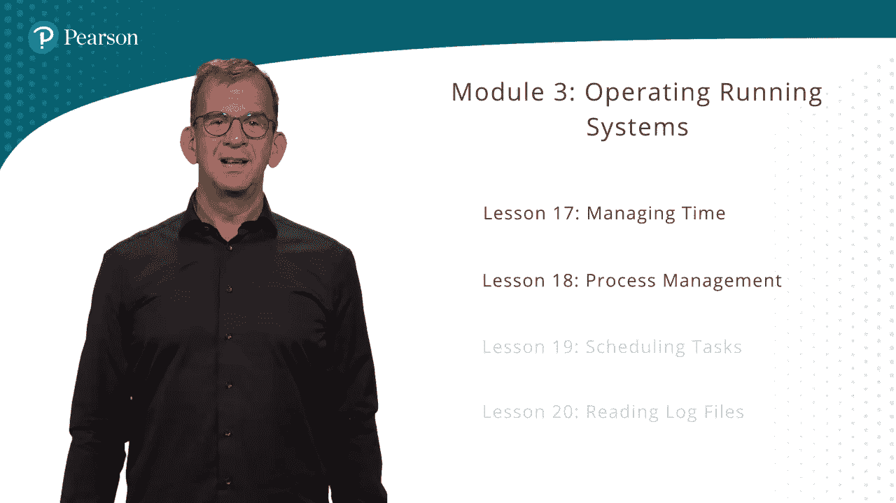

# CompTIA Linux+教程：第3模块：模块简介 🐧

在本节课中，我们将一起学习CompTIA Linux+课程的第3模块。这个模块主要讲解日常使用Linux系统时经常需要完成的各种任务，帮助你了解在实际工作中通常会遇到哪些操作。

在开始具体内容之前，我们先来看看本模块的总体安排，让你对接下来要学的内容有一个整体印象。

以下是本模块包含的主要课程主题：

- 网络基础：学习如何配置和管理Linux系统的网络连接，让计算机能够正常上网并与其他设备通信。
- systemd与软件管理：学习如何使用`systemd`管理系统服务，以及如何安装、更新和删除软件包。
- SSH服务器与SELinux：学习如何搭建`SSH`服务器实现远程连接，并使用`SELinux`增强系统安全性。
- 进程管理：学习如何查看、控制和优化运行中的程序进程。
- 任务计划与日志查看：学习如何设置定时任务，以及如何读取系统日志文件来排查问题。

接下来我们来详细看看每一部分的具体内容。

网络是Linux系统运行的基础之一，如果没有网络，很多服务都无法正常工作。本模块的第一课将带你了解网络配置的基本概念。

网络学习完成之后，我们将进入系统服务和软件管理部分。这两部分内容关系密切，因为很多系统服务都需要通过软件包来安装和管理。

核心概念可以用下面的公式来简单理解：

`系统运行 = 内核 + systemd服务 + 软件包管理`

有了系统服务的基础，下一步就是学习如何远程访问和保护系统。

SSH服务器允许你从其他计算机远程登录到Linux系统，而SELinux则提供强制访问控制，防止未经授权的程序访问敏感资源。

安全配置完成后，系统中会同时运行很多程序，我们需要了解如何管理这些程序。

进程管理是指查看正在运行的程序、调整它们的优先级，或者在程序卡死时将其终止。这可以理解为给电脑中的任务进行排序和调度。

进程管理掌握之后，很多重复性工作不需要人工每天手动执行，可以交给系统自动完成。

模块的最后两课将教你如何设置定时任务，让系统在指定时间自动运行某些命令；同时也会教你如何读取日志文件，当系统出现问题时通过日志找出原因。

自动化任务和日志分析是系统运维工作中非常实用的技能。

下面来总结一下本节课的学习内容。

本节课中我们一起学习了第3模块的简介，包括网络、systemd与软件管理、SSH服务器与SELinux、进程管理，以及任务计划和日志查看这几个主要部分。希望这能帮助你对接下来的学习有个清晰的认识。
