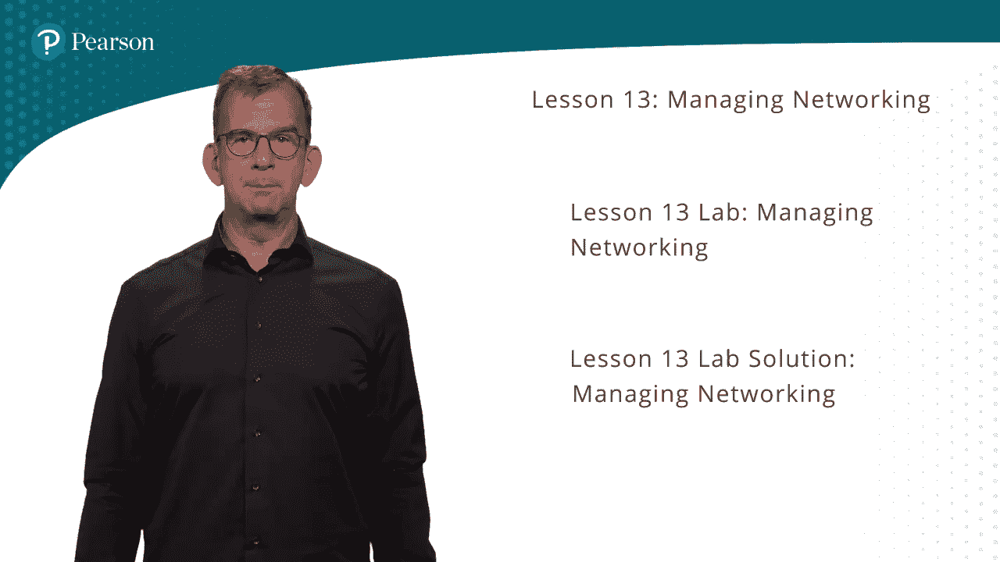

# Oreilly - CompTIA Linux+ V8：130：学习目标 🌐

在本节课中，我们将会学习如何管理 Linux 系统的网络。这节课的内容比较基础，适合刚开始接触 Linux 网络的朋友。我们会先花一点时间快速浏览 IPv4 和 IPv6，搞清楚这两种 IP 地址长什么样，有什么区别。然后会教你怎么在系统运行的时候直接给网卡配置 IP 地址，不需要重启电脑就能让设置生效。接下来会讲 Linux 里网卡是怎么命名的，主机名又该怎么设置，还有主机名和 IP 地址是怎么对应起来的。之后会介绍几个常用的网络工具，教你怎么检查网络是否通畅。最后安排一个动手实验，让你把刚才学的东西都试一遍，我也会把实验的正确答案演示给你看，方便你自己对照检查。

## 第一部分：快速认识 IPv4 和 IPv6 📡

课程刚开始，我们先来看看 IP 地址的基础知识。网络里每台设备都需要一个地址才能和别的设备通信，这个地址就是 IP 地址。你可以把它想象成快递单上的收件地址，没有地址数据包就不知道该送到哪里。目前常用的主要有两个版本，一个是 IPv4，另一个是 IPv6。IPv4 是我们最常看到的那种点分十进制地址，而 IPv6 是更新的版本，地址更长，能给更多设备分配地址。

以下是本部分要重点了解的内容：
- IPv4 地址的基本结构和写法
- IPv6 地址的基本结构和写法
- IPv4 和 IPv6 的主要区别

IP 地址可以用下面的公式简单表示：
`IP 地址 = 网络部分 + 主机部分`

## 第二部分：应用运行时网络配置 ⚙️

搞清楚 IP 地址长什么样之后，接下来我们就要学习怎么把地址配到网卡上。运行时网络配置指的是在系统正常运行的时候，直接修改网络参数。这种配置的好处是立即生效，不需要重启电脑或者重启网络服务，非常适合临时测试或者快速改一下 IP 地址。不过要注意的是，运行时配置通常不会保存到硬盘里，重启之后可能就会丢失，所以如果想让设置永久生效，还需要修改配置文件。

以下是配置运行时网络的常见步骤：
1. 查看当前网络接口的状态
2. 为指定的网卡添加 IP 地址和子网掩码
3. 设置默认网关，让数据知道怎么发出本地网络
4. 检查配置是否已经生效

运行时网络配置的常用命令形式如下：
`ip addr add <IP地址/前缀长度> dev <网卡名称>`
`ip link set <网卡名称> up`

## 第三部分：网络设备命名与主机名管理 🏷️

会配 IP 地址之后，我们还得知道网卡叫什么名字，电脑本身叫什么名字。Linux 系统里的网卡并不统一叫 eth0，现代发行版可能会根据硬件信息给网卡起像 ens33 或 enp0s3 这样的名字。主机名则是用来标识这台机器在网络里身份的名字，就像每个人都有自己的名字一样。除了设置名字，我们还要知道怎么把主机名和 IP 地址对应起来，这个过程就叫做主机名解析，有了它，你才能用名字而不是数字地址去访问其他电脑。

以下是这部分涉及的主要知识点：
- 网络设备的命名规则
- 如何查看和修改主机名
- 主机名与 IP 地址之间的解析机制

主机名解析可以用下面的关系表示：
`主机名 ↔ IP 地址`

## 第四部分：常用网络工具使用 🛠️

设备和主机名都搞清楚了，接下来就是学习怎么用工具排查网络问题。实际工作中，网络不通的情况时有发生，这时候就需要一些小工具来帮你找出问题在哪里。Linux 自带了很多好用的网络工具，可以用来测试连通性、查看路由、检查端口状态，甚至查询 DNS 解析结果。掌握这些工具，你排查网络故障的时候会快得多。

以下是常见的网络工具及其用途：
- ping：测试目标主机是否可达，看网络是否通了
- ip：查看和管理网络接口、地址和路由
- netstat 或 ss：查看当前的网络连接和监听端口
- dig 或 nslookup：查询域名的 DNS 解析结果

例如，用 ping 工具测试网络连通性的命令是：
`ping <目标 IP 地址或域名>`

## 第五部分：实验练习与答案演示 🧪

理论知识学得差不多了，最后一步当然是动手实践。光看不练假把式，课程最后安排了一个实验环节，专门让你把刚才学的东西全部实际操作一遍。你可以尝试配置网络地址，修改主机名，用网络工具检查连通性。等你做完实验之后，我也会把实验的标准答案演示给你看，帮你对照检查哪些步骤做对了，哪些地方还需要改进。

以下是实验建议的练习顺序：
1. 配置运行时网络地址
2. 修改主机名并验证解析是否正常
3. 使用网络工具检查连通性
4. 对照标准答案核对自己的操作结果

## 总结 📝

本节课中我们一起学习了 IPv4 和 IPv6 的基础概述，运行时网络配置的应用方法，网络设备命名与主机名管理及解析，常用网络工具的使用，以及最后的实验练习和答案演示。希望这些内容能帮你打好 Linux 网络管理的基础，以后配置网络不再感到陌生。

