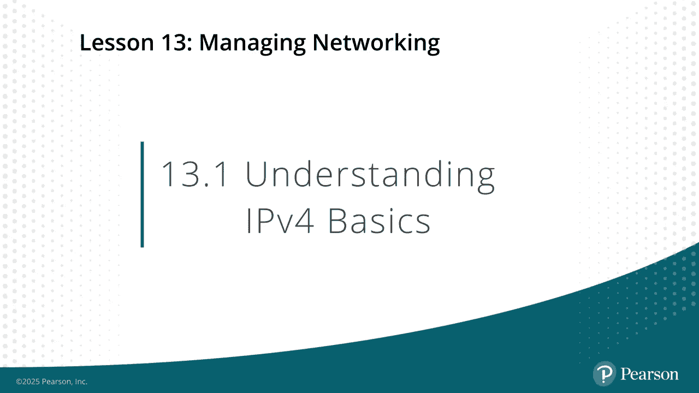

# CompTIA Linux+ V8：131：IPv4基础🌐




在本节课中，我们将一起学习IPv4网络的基础知识。首先我们会看看什么是网络，然后了解路由器是如何把不同的网络连接在一起的。接着我们会重点讲解IPv4地址的写法，尤其是网段是怎么划分的。之后我们会讨论默认网关是什么，以及DNS系统是如何帮助我们使用域名的。最后，我们会把这三个关键设置串联起来，看看一台电脑要想正常上网，到底需要配置哪些内容。希望这节课能让你对基础网络概念有清晰的认识。


## 网络的基本组成


在学习具体的地址配置之前，我们先来看看网络最基本的组成部分。

以下是构成基础网络环境的几个核心要素：

- 互联网：所有网络通信的最终目标，绝大多数上网行为都需要连接到这里。
- 局域网：属于某个机构或组织内部的私有网络，很多公司和家庭都有自己的局域网。
- 节点：连接在网络上的电脑或设备，每个节点都需要被其他设备识别。
- 连线：用于连接不同局域网的物理链路，它们把孤立的网络串联起来。


## 路由器与网络互联


上一节我们介绍了网络的基本组成，本节中我们来看看怎么让这些网络互相通信。

如果你想让不同的网络能够互相访问，最关键的一步就是把它们连接起来。而在网络世界里，完成这个任务的设备叫做路由器。路由器的英文是Router，我们经常用R来表示它。如果你只有一个局域网并且想上网，那么这个局域网必须拥有一台路由器。如果你手里恰好有两个局域网，并且希望它们能够互通，那么你同样需要一台路由器来把这两个网络连接在一起。没有路由器，网络之间就是隔绝的，数据包无法从一个网络跑到另一个网络。

```text
网络A <--- 路由器 ---> 网络B
局域网 <--- 路由器 ---> 互联网
```


## IPv4地址与网段划分


上一节我们介绍了路由器的作用，本节中我们来看看网络里的设备是怎么标识身份的。

网络里的每一台电脑都被称作节点，而每一个节点都需要拥有自己的地址，这样其他设备才能把数据发送给它。在目前大多数情况下，我们使用的默认地址方案是IPv4。每一个网络都需要拥有自己的网络地址，这个地址的写法通常是类似于192.168.0.0/24这样的形式。这里面的斜杠24非常重要，它告诉我们前三个字节用来标识网络，最后一个字节用来标识具体的节点。也就是说，如果你的网络地址是192.168.0.0/24，那么这一个网段里可以分配出很多不同的IP地址，比如192.168.0.1、192.168.0.2，依此类推。如果你同时拥有多个网络，那么每个网络都需要有自己的独立IP网络地址，比如第二个网络可能是192.168.1.0/24，里面的节点也会拥有自己独一无二的IP地址。当然，连接这些网络的路由器本身，也需要配置一个IP地址。

```
IPv4地址格式：192.168.0.0/24
前三个字节：网络标识部分
最后一个字节：节点标识部分
示例：192.168.0.1，192.168.0.2
不同网段：192.168.1.0/24
```


## 默认网关的作用


上一节我们介绍了IPv4地址和网段划分，本节中我们来看看节点怎么访问互联网。

现在来想一个实际的问题，假设网络里的一台电脑想要访问互联网，这时候它应该怎么办？数据包首先需要经过本地的路由器，然后再从这台路由器转发到另一台路由器，最终才能到达互联网。为了让这个过程顺利完成，我们需要设置一个默认网关。默认网关始终是当前网络里的一台路由器，它负责把流量转发到外部网络。对于本地的节点来说，默认网关就是它的出口。如果我们查看IP地址，通常会发现默认网关的地址要么是整个网络里最小的那个IP，要么是最大的那个IP，比如说192.168.0.1就非常常见。有了默认网关的设置，你就可以通过IP地址访问互联网上的其他节点了。

```
默认网关 = 本地网络上的路由器IP
常见示例：192.168.0.1
数据流向：节点 -> 默认网关 -> 外部路由器 -> 互联网
```


## DNS域名解析系统


上一节我们介绍了默认网关的作用，本节中我们来看看怎么用域名代替复杂的IP地址。

只通过IP地址访问互联网虽然可行，但对大多数人来说并不方便，因为没人愿意去记一串数字。为了让上网变得更轻松，网络里有一个系统叫做DNS，也就是域名系统。DNS的作用很简单，就是帮你把域名转换成对应的IP地址。比如你想要访问google.com，这个google.com就是一个域名，而DNS会帮你找到这个域名背后对应的真实IP地址，然后你的电脑才能真正地和目标服务器建立连接。

```
DNS = 域名系统 (Domain Name System)
功能：域名 -> IP地址
示例：google.com -> 对应的服务器IP
```


## IPv4配置的三个必要设置


上一节我们介绍了DNS系统，本节中我们来总结一下一台电脑要想上网到底需要配置什么。

综合前面讲到的所有内容，在一台节点上配置IPv4时，你需要设置三样不同的东西。第一是本地IP地址，也就是这台电脑在当前网络里的身份标识。第二是默认网关，也就是把数据发出去时经过的那台路由器。第三是DNS服务器，用来把域名解析成IP地址。只要这三个设置都配置正确，并且没有网络故障，这台电脑就可以正常地在互联网上进行通信了。当然，现实中有时候也会出现无法上网的情况，这时候你就需要排查一下，看看问题到底出在本地IP、默认网关还是DNS上。

以下是配置IPv4必须设置的三项内容：

- 本地IP地址：标识本机在网络中的位置。
- 默认网关：指向本地网络的路由器IP。
- DNS服务器：负责域名解析。

```
IPv4必要配置 = 本地IP地址 + 默认网关 + DNS服务器
```


本节课中，我们一起学习了IPv4网络的基础知识。我们了解了网络的基本组成，知道了路由器如何连接不同的网络，也学习了IPv4地址和网段的划分方法。接着我们讨论了默认网关的作用，了解到它是访问外部网络的必经之路。最后我们介绍了DNS系统，以及配置IPv4所需的三个关键设置，分别是本地IP地址、默认网关和DNS。希望通过这节课，你能对基础网络通信有更直观的认识。

