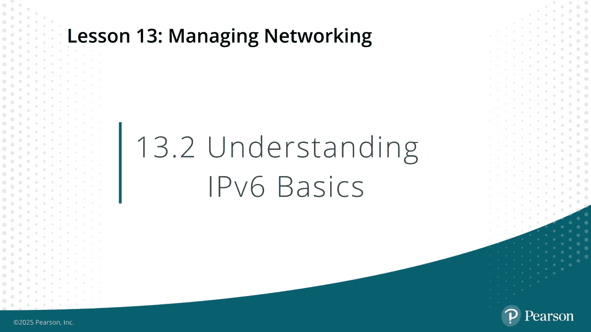
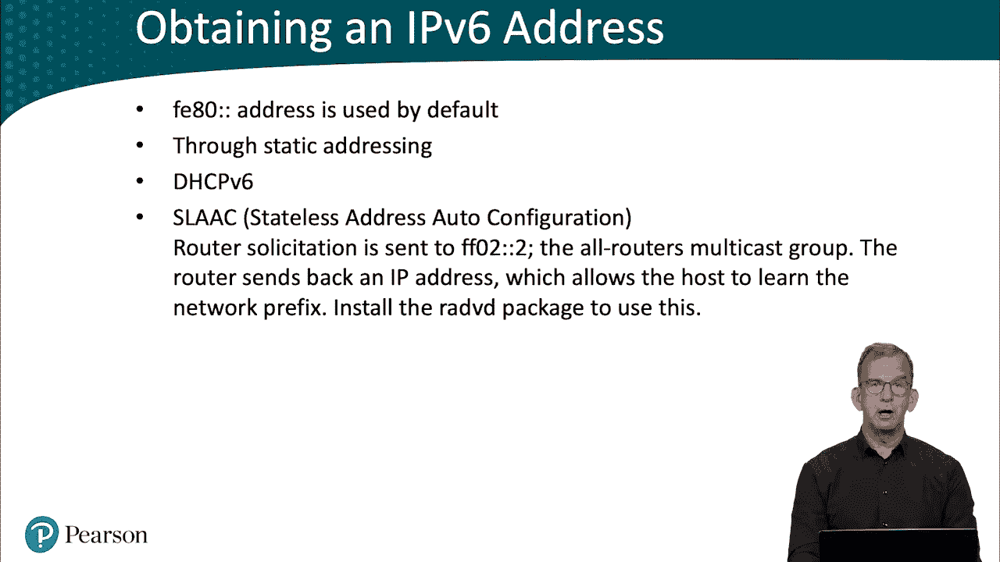

CompTIA Linux+：第132课：理解IPv6基础 🌐



在本节课中我们将要学习IPv6的基础知识。IPv6是下一代互联网协议，它的出现是为了解决IPv4地址不够用的问题。虽然IPv6早在1990年代就已经被提出，并被宣布为未来的标准，但直到今天，大部分网站仍然在使用IPv4。不过作为学习者，掌握IPv6的基本概念仍然很有必要，下面我们就来看看你需要知道的内容。

## 什么是IPv6以及地址长度

在上一节我们可能聊过IPv4的基础知识，本节中我们来看看IPv6。你需要知道，IPv6地址的长度是128位。这是一个非常长的地址，比IPv4的32位要长得多。

```text
IPv6地址长度 = 128 bits
```

因为地址非常长，所以IPv6地址采用十六进制来书写。比如，下面就是一个合法的IPv6地址示例：


```
F80:1223:334:5...
```

简单来说，十六进制可以用更少的字符表示很长的二进制串，这让超长地址的书写变得更加紧凑，也更容易阅读。

## IPv6地址的简写规则

在IPv6中，前导零可以省略，而且长串的零也可以省略。这意味着你可以写出类似下面这样的地址：

```
FE80::1
```

这里的双冒号代表中间全是零，你不需要把它们都写出来。这大大简化了地址的输入和阅读。

当你需要在IPv6地址后面加上端口号时，要把地址放在方括号里面，就像这样：

```
[FE80::1]:80
```

之所以要用方括号，是因为IPv6地址本身里面就包含冒号，如果不加括号，系统就分不清哪里是地址，哪里是端口了。

## IPv6的默认子网掩码

接着我们来看子网掩码。在IPv6中，默认的子网掩码是斜杠64。

```text
默认子网掩码 = /64
```

这是因为在IPv6里面，子网划分并不像IPv4那样那么重要，地址空间实在太大了，一般直接用/64就足够大多数情况使用。

## IPv6中的特殊地址类型

IPv6地址里面可能会包含设备的MAC地址，这在IPv6自动分配地址时很有用。IPv6可以实现IP地址的自动分配，也就是说，网卡会发现自己所在的网络，然后根据自己的MAC地址来设置节点地址。

在IPv6里面，有一些地址是被保留的，下面是常见的这些保留地址：

- `::1/128`：本地主机地址
- `::`：未指定地址，相当于IPv4里面的0.0.0.0
- `::/0`：默认路由
- `2000::/3`：全局单播地址
- `FD00::/8`：唯一本地地址，属于私有地址，不能在互联网上路由，可以用来做测试

除了这些，还有一种叫作链路本地地址的地址，比如`FE80::/64`。这也是本地专用地址，不能路由，但是会自动分配给你IP网络里面的节点。

最后，`FF00::/8`用于组播。组播就是发送组包，你可以用它来触达特定的设备组。

## IPv6地址是如何获得的

在IPv6里面，好消息是你并不总是需要手动设置地址，你可以自动获得它。那么它是怎么设置的呢？每个IPv6节点默认都会获得`FE80`开头的链路本地地址。这个地址是自动分配的，它以`FE80`开头，并且使用节点的MAC地址作为地址的后半部分。

显然，你也可以静态地分配一个IPv6地址，不过这种做法比较少见。除此之外，你可以使用DHCPv6服务器，也就是针对IPv6的DHCP服务器。

还有一个很棒的机制叫作无状态地址自动配置，简称SLAAC。

SLAAC是怎么工作的呢？主机会发送一个路由器请求到组播地址`FF02::2`，这是路由器组播组。然后路由器会发回一个IP地址信息，让主机了解网络前缀。

```text
路由器请求 -> FF02::2 (路由器组播组) -> 路由器返回IP前缀
```

如果你喜欢这种方便的方式，并且应该喜欢，那么你需要确保系统能够接收RA（路由器通告）数据包才能使用这个功能。

## 本节总结

在本节课中我们一起学习了IPv6的基础知识。我们了解到IPv6早在1990年代就被提出，但目前大多数网站仍在使用IPv4。IPv6地址长128位，采用十六进制书写，支持省略前导零和长串零，地址加端口时需要用方括号括起来。默认子网掩码是/64，地址中可能包含MAC地址并支持自动分配。我们还认识了几类保留地址，包括本地主机、未指定地址、默认路由、全局单播和唯一本地地址，以及链路本地地址和组播地址。最后，我们学习了IPv6地址的获取方式，包括静态分配、DHCPv6和SLAAC无状态自动配置。



虽然有些人已经开始使用IPv6，但在现实生活中，如果你只了解IPv4协议栈，其实也能应付大部分情况。
