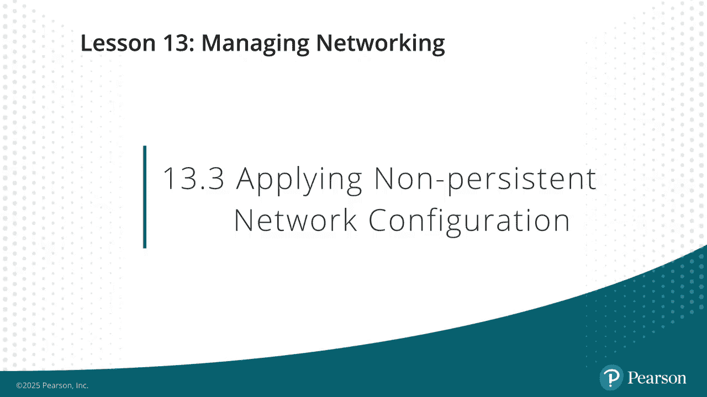
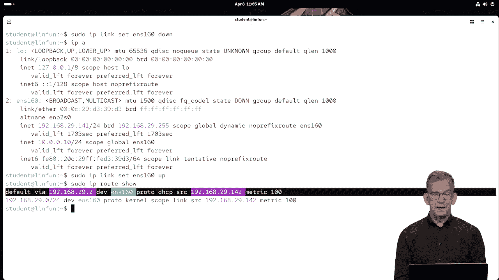

# CompTIA Linux+ V8 网络基础：第33节：应用非持久化网络配置 🌐


在本节课中，我们将要学习如何在 Linux 服务器上应用非持久化网络配置，重点掌握 ip 命令的常见操作，包括查看 IP 地址、添加临时 IP、启用或禁用网络接口，以及查看路由表。无论你是刚接触 Linux 的新手，还是想要复习网络基础知识的学习者，这节课都会用大白话把每一步讲清楚，让你明白运行时网络配置到底是怎么回事。




什么是非持久化网络配置

非持久化网络配置的意思是，你设置的网络参数只在当前系统运行期间有效，一旦重启就会失效。这对排查网络故障非常有用，因为你可以快速尝试不同的 IP 地址或路由设置，而不用担心把系统搞坏。在服务器上，IP 地址通常会被静态配置，常用的工具包括 NMCLI、NMTUI 以及 Netplan。而在普通的工作站上，IP 地址通常由 DHCP 服务器自动分配，用户不需要手动设置。

以下是非持久化配置与持久化配置的核心区别：

- 持久化配置：重启后依然生效，通常写入配置文件。
- 非持久化配置：仅在当前会话有效，重启后恢复原状。


为什么现在不再推荐使用 ifconfig

在过去，Linux 系统广泛使用 ifconfig 工具来查看和管理网络。不过如今 ifconfig 已经过时，很多现代发行版连 net-tools 软件包都不再默认安装，这个软件包正好包含 ifconfig。虽然有时会因为依赖关系而仍然出现，但已经不建议日常使用。

ifconfig 之所以被淘汰，主要有以下几个原因：

- 它使用过时的方法来处理和显示网络地址。
- 显示的网络信息不够准确，可能误导排查工作。
- 现代内核网络栈的许多新特性它无法正确展示。


ip 工具是目前的主流选择

现在检查和管理网络的主要工具是 ip 实用程序，它属于 iproute2 软件包。ip 命令功能更全面，输出的信息也更精准，是处理运行时网络配置的标准方式。接下来我们将通过一个演示，看看 ip 命令最常见的几个使用场景。


ip 命令常见操作演示

为了方便你跟随学习，下面的演示内容也会在幻灯片中展示。我们将逐步执行几个最常见的任务，每一步都会说明具体的命令和作用。

以下是查看当前 IP 地址信息的命令：

```bash
sudo ip addr show
```

运行后，你可以看到网络接口名称为 ENS160，并且已经分配了一个内网地址 192.168.29.141。`addr show` 其实是 `address show` 的缩写，作用就是显示所有网络接口的 IP 配置。

如果你想给这个网络设备添加一个额外的 IP 地址，可以使用下面的命令：

```bash
sudo ip addr add 10.0.0.10/24 dev ENS160
```

这里 `dev` 用来指定网络设备，`ENS160` 是目标接口，`10.0.0.10/24` 是要添加的 IP 地址和子网掩码。执行完之后，再次运行 `ip addr`，你会发现现在出现了一个辅助 IP 地址。

有时候我们需要临时禁用某个网络接口，可以使用 link 子命令：

```bash
sudo ip link set ENS160 down
```

这会把 ENS160 接口状态设置为 down，相当于暂时禁用它。之后用 `ip addr` 查看，接口状态确实会显示为 down。需要注意的是，这只是暂时禁用，如果你不希望网络长期中断，记得把接口再启用起来。

查看系统路由表也很重要，可以使用 route 子命令：

```bash
sudo ip route show
```

输出中你会看到路由表，其中默认路由被设置为 192.168.29.2。在演示中，讲师特意没有执行修改默认路由的命令，因为一旦改错了默认网关，系统就无法访问互联网了。对于初学者来说，查看路由表比随意修改默认路由要安全得多。


本节课总结



本节课中，我们一起学习了非持久化网络配置的基本概念，了解了为什么 ifconfig 已经过时，并掌握了使用 ip 命令查看 IP 地址、添加临时 IP、禁用网络接口以及查看路由表的方法。希望这些内容能帮助你在实际工作中更好地排查 Linux 网络问题。

