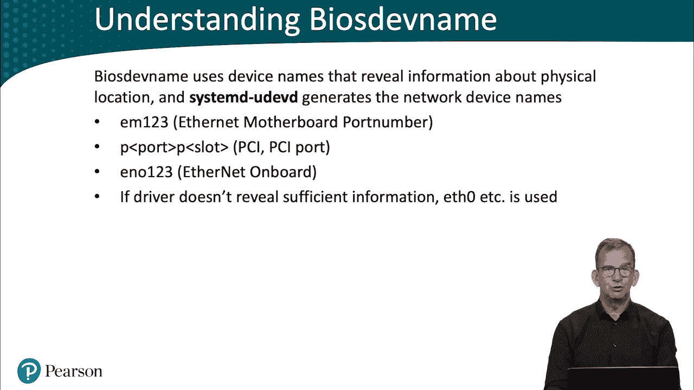
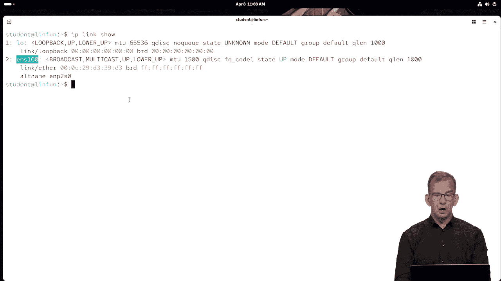

# 🌐 CompTIA Linux+ V8：134：理解网络设备命名


在本节课中，我们将一起学习Linux系统里网卡设备名是怎么来的，为什么旧系统和新系统的命名方式不一样，以及在配置IP地址之前，应该怎么确认自己该用哪个网卡名字。很多初学者刚接触Linux网络配置的时候，总是容易在这里卡住，明明命令敲对了，结果却提示找不到设备，往往就是因为用错了网卡名称。搞清楚这一节的内容之后，你再去设置网络就不会因为找不对设备名而失败了，也能更从容地处理服务器上的网络问题。


# 为什么配置IP之前要先知道设备名

在给Linux服务器或者电脑配置IP地址的时候，系统需要知道你要配置的是哪一块网卡。如果你写错了设备名，命令就会执行失败，网络也配不上去。所以说，在动手改IP之前，第一步就是要弄清楚你的网卡在系统里叫什么名字，不要凭感觉随便写一个，否则只会白费力气。

在Linux系统中，网络设备名称并不是随便起的，它有一定的命名规则，而且不同版本的Linux可能用的规则不太一样。了解这些规则背后的逻辑，有助于你更快地定位网络故障。

# 旧Linux系统里的网卡命名方式

在比较老的Linux版本中，网卡设备名的命名非常简单，主要是根据网卡的类型来决定的。那时候系统不需要考虑太多复杂的硬件信息，直接按类别分类就够了。

以下是旧Linux系统中常见的网卡命名方式：
- `eth0`：代表第一块以太网网卡
- `wlan0`：代表第一块无线网卡

这种命名方法的问题是，当你电脑里有多块网卡的时候，`eth0`、`eth1`、`eth2`这些名字并不能直接告诉你，它们分别对应主板上的哪一个物理接口，或者插在哪个PCI插槽里。管理员有时候需要猜一下，或者插拔网线来确认，很不方便，效率也很低。

# 现代Linux系统里的网卡命名方式

在现代Linux发行版中，网卡设备名不再仅仅根据类型命名，而是根据网卡在计算机里的物理位置来命名。设备名称的生成，会在网络驱动程序的协助下完成，系统会尽可能把硬件位置的信息编进名字里。

这种改变的主要原因，是为了让设备名能够反映出网卡的物理位置信息，这样管理员一看到名字，就大概知道这块网卡在硬件上的位置，而不需要再去猜测。为了实现这个目标，系统会使用一套命名程序来自动生成网卡设备名，让名字本身就带上位置含义。

以下是现代Linux系统中几种常见的网卡设备名示例：
- `em123`：表示以太网主板上的某个端口号，其中`em`代表以太网主板，后面的数字是端口编号
- `p0p1`：表示PCI总线和PCI插槽，`p0`是总线，`p1`是插槽
- `en0123`：表示板载的以太网设备

设备命名逻辑可以用下面的简单公式来理解：
```
网卡设备名 = 物理位置信息 + 硬件类型标识
```

# 当驱动程序信息不足时的备选名称

不过，现代命名方式也不是万能的。如果网络驱动程序没有提供足够的硬件位置信息，系统可能就没法生成那种带物理位置含义的设备名。在这种情况下，Linux会退回到使用比较通用的旧式名称，比如`eth0`之类，作为一种备选方案。

以下是判断当前使用哪种命名方式的通用建议：
- 不要假设你的网卡一定叫`eth0`
- 不要假设你的网卡一定叫`ens33`
- 不同的电脑、不同的Linux版本，可能会使用不同的命名规则

保持这种开放的心态，才不会在换了一台机器后发现原来的命令都不能用了。

# 如何查看当前系统正在使用的网卡名

为了避免猜错，最好的办法就是直接让系统告诉你当前都有哪些网卡设备。在Linux里，可以使用`ip link show`命令来查看，这是查网卡名最直接、最可靠的方法。

你可以在终端里输入下面的命令：
```bash
ip link show
```



执行这条命令之后，系统会列出当前所有的网络接口及其名称。在示例环境中，命令输出显示当前系统使用的网卡名是`ens160`。同时，它还对应着一个旧的设备名，也就是`enp2s0`。这里`enp2s0`反映的是网卡的物理位置信息，而`ens160`是系统最终分配给这个网卡的设备名，两者其实指向同一块网卡。

# 网卡设备名不是固定不变的

最后要提醒大家的是，网卡设备名并不是一成不变的。同样的硬件，在不同的系统里，或者在系统升级后，设备名都有可能发生变化。这是因为不同的发行版或者内核版本，可能采用不同的命名策略。

所以在实际工作中，你不能死记硬背某个设备名，而是需要在每一台机器上，用`ip link show`命令去确认当前到底使用哪个网卡名字，然后再根据这个名字去配置IP地址或者做其他网络设置。这样才能避免不必要的麻烦。

# 本节课总结



在本节课中，我们一起学习了Linux网络设备命名的来龙去脉。旧版本的Linux使用`eth0`、`wlan0`这类按类型命名的方式，而现代Linux更倾向于根据网卡的物理位置来生成设备名，比如`ens160`、`enp2s0`、`em123`或者`p0p1`。系统会借助网络驱动程序和相关命名程序来完成这个过程。如果驱动程序提供的信息不够，可能会退回到旧式命名。在实际操作中，建议始终使用`ip link show`命令来查看当前系统实际使用的网卡设备名，不要假设设备名是固定的，这样才能准确地完成IP地址配置。
