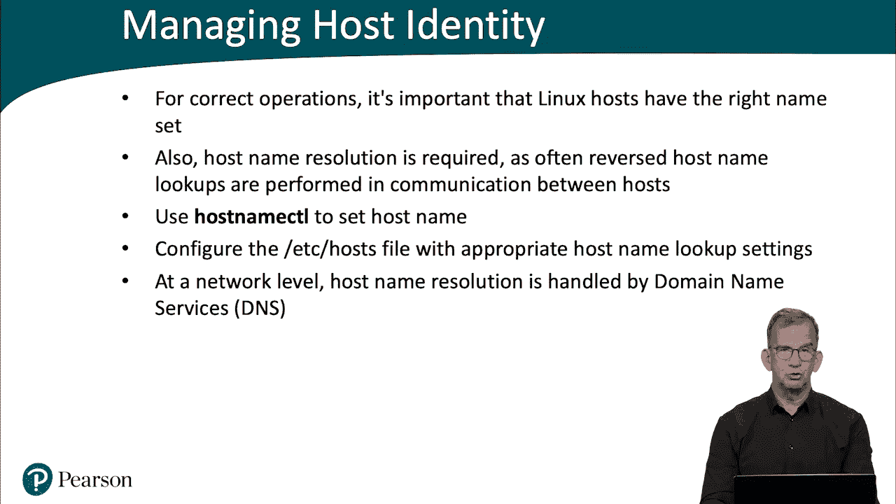
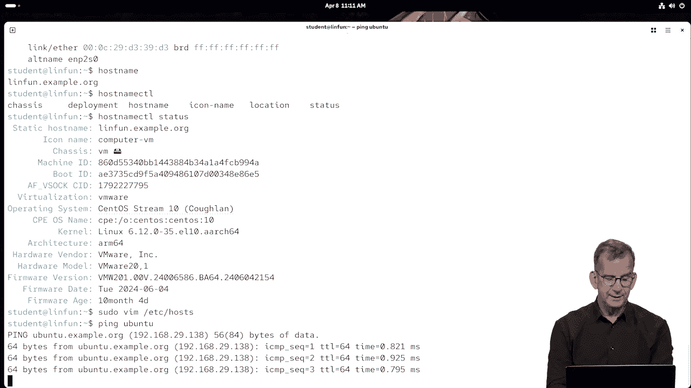

# Linux主机名管理教程：01：主机名与名称解析基础 🖥️


在本节课中我们将要学习Linux主机名的管理方法。课程会说明为什么Linux主机必须设置正确的主机名，主机名解析在主机间通信中扮演什么角色，以及当系统网络操作变慢时该如何检查。你还将学习使用hostnamectl设置主机名，配置/etc/hosts文件，理解DNS在网络层面的作用，并通过ping命令验证解析是否正常。


为什么主机名对Linux系统很重要

Linux主机要想正常运行，必须设置正确的主机名。除了主机名本身要正确之外，主机名解析也是必不可少的条件，因为在主机之间进行通信时，经常会执行反向主机名查找操作。

当你发现系统在网络上的任何操作都变得很慢时，建议首先检查主机名解析是否正常。处理主机名问题的第一步是使用hostnamectl来设置主机名，并按照适当的查找设置配置/etc/hosts文件。在网络层面，主机名解析由DNS完成，也就是域名系统。DNS通常由网络管理员负责维护，但作为Linux用户，你也应该知道如何使用/etc/hosts文件配置本地主机名解析。下面我们就来看看具体操作。


查看和修改主机名

在Linux系统中，直接运行hostname命令可以查看当前的主机名，例如linfn.example.org。如果你想获取关于当前主机的更多信息，可以使用hostnamectl命令，它支持命令补全功能，能够获取主机名相关的信息。

如果你想修改主机名，可以使用hostnamectl set-hostname命令。在本示例中，讲师已经完成了修改，因此接下来使用hostnamectl status命令，可以查看当前主机的所有相关信息。

以下是常用的主机名管理命令：

- `hostname`：显示当前系统的主机名
- `hostnamectl`：获取主机名相关信息，支持命令补全
- `sudo hostnamectl set-hostname 新主机名`：修改系统主机名
- `hostnamectl status`：显示当前主机的完整信息


配置本地主机名解析文件

为了确保主机名解析设置正确，需要使用sudo vim /etc/hosts命令打开并编辑/etc/hosts文件。在这个文件中，你会看到本地主机的默认条目，也就是localhost。

如果你想添加远程主机，唯一需要做的就是找到该主机的IP地址，然后添加对应的主机名。例如，可以添加一条记录将IP地址与Ubuntu.example.org关联，这个主机名在本例中也简称为Ubuntu。主机名通常同时拥有长名和短名，长名就是完全限定域名，即FQDN，其关系可以用公式表示为：



`FQDN = 主机名.域名后缀`

而短名则是方便日常使用的名称。

以下是/etc/hosts文件的典型配置格式：

```
IP地址   主机名   别名
127.0.0.1  localhost
192.168.1.10  Ubuntu.example.org  Ubuntu
```

当配置完成之后，如果一切正常，你应该能够ping通Ubuntu，这说明主机名解析已经正常工作。


网络层面的DNS解析

在网络层面，主机名解析是由DNS处理的。DNS是域名系统的缩写，其核心作用是将域名转换为IP地址。DNS通常由网络管理员负责配置和维护，普通Linux用户一般不需要手动处理。

不过，了解DNS的工作原理对Linux用户仍然有帮助。当本地的/etc/hosts文件无法提供足够的解析信息时，系统会向DNS服务器发出查询请求，从而获取目标主机的IP地址。本地文件和DNS可以协同工作，分别处理静态映射和网络范围的解析需求。


验证主机名解析结果

配置完成后，验证是必不可少的步骤。你可以使用ping命令发送测试包到目标主机名，观察是否能够正确解析并收到响应。如果ping命令能够成功返回结果，说明主机名和IP地址的对应关系已经生效。

以下是验证步骤的简单总结：

1. 使用hostname命令确认当前主机名
2. 使用hostnamectl status查看当前主机的所有信息
3. 使用sudo vim /etc/hosts添加或修改主机名映射
4. 使用ping目标主机名测试解析是否成功

只要上述每一步都正常工作，你的主机名管理和解析配置就完成了。


本节课程总结



本节课中我们一起学习了Linux主机名的管理方法。我们了解了正确设置主机名的重要性，认识到主机名解析在主机间通信中的必要性，学会了使用hostname和hostnamectl命令查看与修改主机名，掌握了通过编辑/etc/hosts文件配置本地主机名解析的方法，还了解了DNS在网络层面处理主机名解析的作用。最后，我们通过ping命令验证了配置是否生效。希望这些内容能帮助你更好地管理Linux系统的主机名，并在遇到网络慢的问题时知道如何排查主机名解析。

