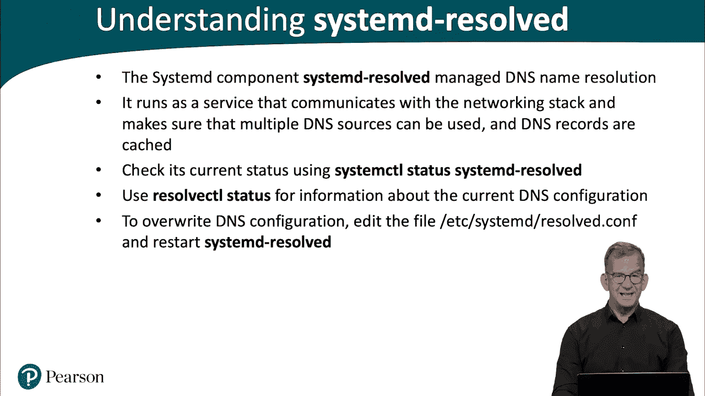
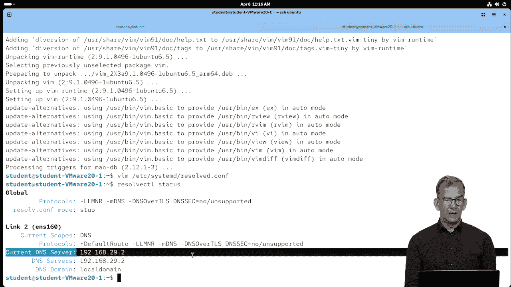

# CompTIA Linux+ V8：136：管理主机名解析 🌐


在本节课中，我们将一起学习主机名解析的相关内容。主机名解析是指将主机名与 IP 地址进行匹配，同时也支持将 IP 地址转换回主机名。我们会先回顾本地 hosts 文件和传统 DNS 配置，然后重点介绍 systemd-resolved 这一新机制，最后通过实际命令演示如何查看状态和修改配置。内容会尽量用大白话讲解，让初学者也能轻松看懂。


## 什么是主机名解析 📖

上一节我们介绍了网络基础知识，本节中我们来看看主机名解析具体是怎么工作的。

主机名解析允许主机名通过 IP 地址进行匹配，反之亦然。简单来说，当你输入一个网站名字时，系统需要知道它对应的 IP 地址才能建立连接；反过来，系统也可以根据 IP 地址找到对应的主机名。

正如我们刚才看到的，本地 /etc/hosts 文件是主要解决方案。你可以把它理解为系统自带的一本电话本，上面记录着哪个名字对应哪个 IP 地址。

但你通常也会使用域名系统，这些 DNS 服务器配置在 /etc/resolv.conf 中，这是经典方式。在经典方式中，你会使用 /etc/nsswitch.conf 来确定查找顺序。

以下是几个常见的配置文件路径：

```bash
/etc/hosts
/etc/resolv.conf
/etc/nsswitch.conf
```

## systemd-resolved 是什么 🔧

刚才我们讲完了传统的解析方法，本节中我们来看看 Ubuntu 上的新机制 systemd-resolved。

但是现在有个新玩意儿，那就是 systemd-resolved。systemd-resolved 服务在 Ubuntu 上的工作方式比较特殊，它是 systemd 的一个组件，负责管理 DNS 名称解析。

它以服务形式运行，与网络栈通信。它确保可以使用多个 DNS 源，并且 DNS 记录会被缓存。因此它充当本地 DNS 服务器来加快网络速度。

你可以把 systemd-resolved 理解为一个运行在后台的小助手，专门负责处理域名解析请求，并把结果缓存起来，下次访问同一个网站时会更快。

核心组件可以用下面的代码表示：

```bash
systemd-resolved
```

## 查看服务状态和配置 🔍

了解了 systemd-resolved 是什么之后，本节中我们来看看如何查看它的运行状态。

你可以使用 systemctl status systemd-resolved 来检查当前状态。你可以使用 resolvectl status 来获取当前 DNS 配置信息。

如果你需要覆盖 DNS 配置，可以编辑 /etc/systemd/resolved.conf 并重启 systemd-resolved。这样修改后的配置就会生效。

以下是常用的检查命令：



```bash
systemctl status systemd-resolved
resolvectl status
```

配置文件路径如下：

```bash
/etc/systemd/resolved.conf
```

## 在 Ubuntu 上实操演示 🖥️

光讲理论不够，本节中我们来看看在真实的 Ubuntu 系统上怎么操作。

当我使用 sudo systemctl status systemd-resolved 时会发生什么。我可以看到找不到 systemd-resolved。这是因为不同的 Linux 发行版走的是不同路线。

我要打开一个新终端，在新终端里 SSH 连接到 Ubuntu。在 Ubuntu 系统上，我使用 sudo systemctl status systemd-resolved。在那里我们可以看到 systemd-resolved 正在运行。

以下是演示中使用的命令：

```bash
sudo systemctl status systemd-resolved
ssh ubuntu
```

## 编辑配置文件 ✍️

服务运行起来后，本节中我们来看看配置文件长什么样。

我们有输入文件 /etc/systemd/resolved.conf，在 /etc/systemd/resolved.conf 中你会找到配置。Ubuntu 上没有 vim，我们快速安装一下，使用 sudo apt install vim，因为 vim 真的是我最喜欢的编辑器。

再试一次，这里我们可以看到 systemd-resolved 的配置内容，配置项比较多。现在如果你需要添加额外的 DNS 配置，可以把它放在这里。

以下是安装编辑器和查看配置的命令：

```bash
sudo apt install vim
/etc/systemd/resolved.conf
```

## 使用 resolvectl 查看 DNS 配置 🌐

配置文件看过了，本节中我们来看看如何用 resolvectl 查看当前 DNS 配置。

你可能最需要做的是运行 resolvectl status，它会显示当前 DNS 配置。所以在 link2 上我们可以看到当前 DNS 服务器设置为 192.168.29.2，这是 systemd-resolved 提供的本地主机内部 DNS，它允许我缓存记录，从而很好地加快连接速度。

以下是查看命令：

```bash
resolvectl status
```



本节课中，我们一起学习了主机名解析的基础知识，回顾了 /etc/hosts、/etc/resolv.conf 和 /etc/nsswitch.conf 等传统方式，重点介绍了 systemd-resolved 的作用与工作原理，并演示了如何在 Ubuntu 上查看服务状态、编辑配置文件以及使用 resolvectl 查看 DNS 配置。希望这些内容能帮助你更好地理解 Linux 里的域名解析机制。
