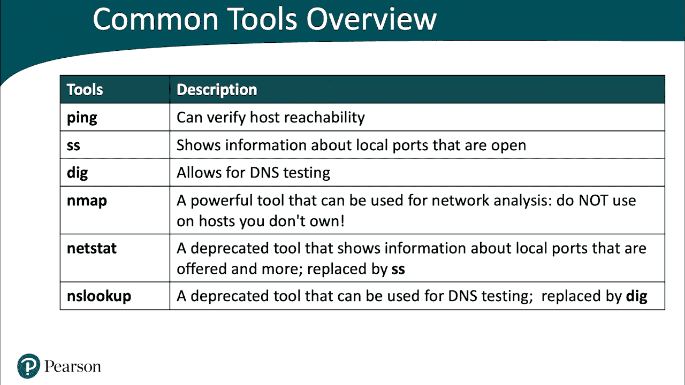
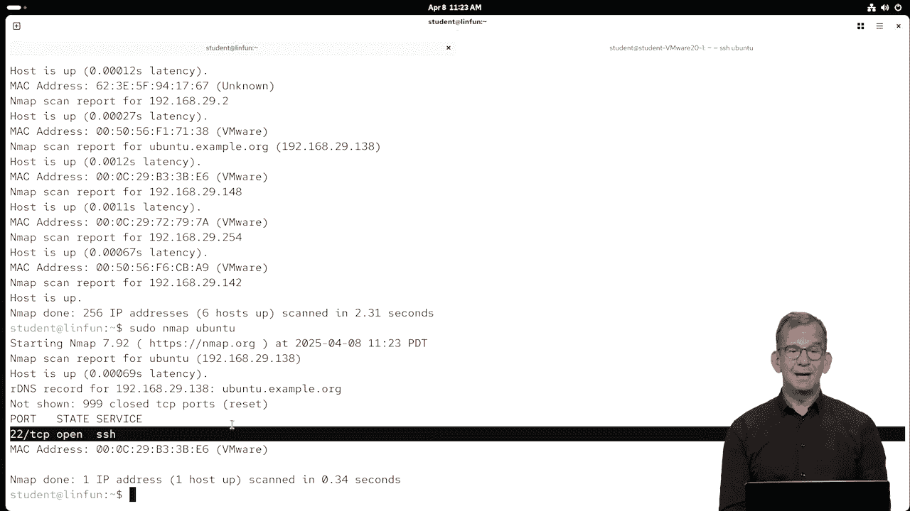

# CompTIA Linux+ V8：137：常用网络工具使用 🌐


在本节课中我们将要学习Linux系统里常用的网络排障工具。网络故障是运维工作中最常见的问题之一，不管是网站打不开、服务连不上，还是DNS解析出错，都需要靠这些工具来排查。本节内容专门面向初学者，我们会用最直白的语言，把每个命令的作用和实际用法讲清楚，并配合真实的操作演示，让你明白这些工具到底是在帮你查什么。


## 1. 常用网络工具概览 🛠️


在开始动手之前，先来看看Linux里经常用到的一些网络实用工具。这些工具各有不同的用途，有的检查主机是否可达，有的查看本地端口，有的测试DNS解析，还有的用于网络分析。下面是我们将要重点介绍的几个核心工具：


- **Ping**：用来验证主机可达性，检查网络栈是否正常工作。
- **SS**：用来显示当前监听的网络连接和开放端口。
- **Dig**：用来进行DNS域名解析测试，查询域名背后的IP地址。
- **Nmap**：功能强大的网络分析工具，用于扫描网络和主机端口。
- **Traceroute**：用来显示数据包从源到目的经过了哪些中间节点。
- **Netstat**：旧版工具，功能已被SS替代。
- **NS Lookup**：旧版DNS查询工具，如今多被Dig取代。




你可能会问，为什么要一起介绍这些工具？因为在实际排障中，它们往往是配合使用的。比如你先用Ping看网通不通，再用SS看端口开没开，最后用Dig确认域名解析对不对。下面我们就从最基础的Ping命令开始，逐一看看它们的具体用法。


## 2. 使用Ping验证主机连通性 📡


Ping是网络排障里用得最多的命令，没有之一。它的原理很简单，就是往目标主机发送数据包，然后等着对方回复。如果收到了回复，就说明目标主机可达，同时也意味着你本机的整个网络协议栈都在正常运行。我们先来看一个最简单的例子，Ping Google的公网地址：


```bash
ping google.com
```


执行这个命令之后，Ping会一直运行下去，除非你手动按下Ctrl+C停止。如果你只想发送几个包就结束，可以使用 `-c` 参数指定数量。比如只发四个包，命令写成这样：


```bash
ping -c 4 google.com
```


输出结果里包含几个值得关注的信息：响应的IP地址是多少、响应的序列号是几，最重要的是往返时间，也就是Round Trip Time，缩写为RTT。RTT数值越小，说明网络延迟越低，速度越快。我们先在公网上测试一下，看看延迟大概是多少：


```text
round trip time 75.5 milliseconds
```


75.5毫秒是在公网上访问Google的一个正常延迟值。接下来我们换一个本地局域网地址，比如 `192.168.29.2`，再来试一次：


```bash
ping -c 4 192.168.29.2
```


你会发现本地网络的延迟明显更小，这很正常，因为数据包没有经过公网，就在局域网内部转发。然后我们再在Ubuntu虚拟机上操作一下。如果你当前已经通过SSH连上了Ubuntu，直接在会话里执行：


```bash
ping -c 4 ubuntu
```


输出依然会显示往返时间，两台虚拟机之间的网络延迟也还可以。知道了怎么用Ping测连通性之后，接下来我们看看如何检查本机到底开放了哪些端口。


## 3. 使用SS查看监听端口 🔌


网络通不通是一回事，服务有没有启动、端口有没有开启是另一回事。这时候就需要用到SS命令了。SS可以显示当前系统中正在监听的网络连接，也就是告诉你哪些端口正在等待外部连接。下面是最常用的用法：


```bash
ss -tuln
```


这个命令会列出所有TCP和UDP的监听端口，并且直接用数字显示端口号。如果你希望看到服务名称而不是端口号，可以去掉 `-n` 参数：


```bash
ss -tl
```


这时候你会发现SSH服务正在监听所有IPv4地址，同时也在监听所有IPv6地址。这里出现的服务名称，是根据 `/etc/services` 文件的内容来对应的。这是一个系统标准配置文件，里面记录了每个服务分配的具体端口。除了SS，还有一个老工具叫Netstat，曾经也能完成类似的工作：


```bash
sudo netstat -topen
```


Netstat能得到差不多同样的信息，但它已经被官方废弃了，不建议在新系统中继续使用，我们应该优先使用SS。


搞定了端口查看，我们再来看看域名解析的问题。DNS就像是互联网的电话簿，负责把域名翻译成IP地址。如果你发现某个网站打不开，很可能就是DNS解析失败了。Dig就是专门用来测试DNS解析的工具。


## 4. 使用Dig进行DNS解析测试 🌐


我们来查询一下 `google.com` 的DNS记录：


```bash
dig google.com
```


执行之后，Dig会显示DNS服务器返回的答案部分，其中包含该域名对应的IP地址。如果你能顺利看到IP，说明DNS解析是正常的。系统里还有一个老工具叫NS Lookup，功能差不多，但现在已经不怎么推荐使用了，Dig是更现代、更推荐的选择。


DNS只是网络链路中的一环。有时候你知道目标主机的IP，但数据包在传输过程中出了问题，这时你需要知道包到底经过了哪些中间节点。Traceroute正好能解决这个问题，它会显示数据包从你的机器到目标主机之间经过的每一跳服务器，也就是所谓的跳数。下面先安装Traceroute：


## 5. 使用Traceroute追踪网络路径 🛤️


```bash
sudo dnf install -y traceroute
```


安装完成后，我们对 `google.com` 进行路径追踪：


```bash
traceroute google.com
```


输出结果会列出从你的本地网关开始，一直到目标服务器之间的每一个中间节点，最多能显示十几跳。比如你当前身处加州旧金山，访问某个远程服务器，中间会经过多个地区的网络节点，这就是网络距离的体现。Traceroute能帮你快速定位，到底是哪一段链路出现了延迟或丢包。


路径追踪能解决“在哪里断”的问题，而最后一个工具Nmap，则能帮你深入了解一台主机具体开放了哪些端口。Nmap功能非常强大，但使用时需要注意，它在某些场合会被视为一种具有攻击性的工具，所以只能在自己的服务器或授权的网络范围内使用。扫描操作需要root权限。下面先安装Nmap：


## 6. 使用Nmap扫描网络和端口 🔍


```bash
sudo dnf install -y nmap
```


安装好之后，我们先用 `-sn` 参数对本地网段进行网络扫描，找出当前网络中处于活跃状态的所有IP地址：


```bash
sudo nmap -sn 192.168.29.0/24
```


执行后，Nmap会列出局域网里所有在线主机，你的Ubuntu虚拟机就会出现在结果中。如果你想查看某台具体主机开放了哪些端口，可以直接对该主机IP执行Nmap扫描：


```bash
sudo nmap <Ubuntu主机IP>
```


输出会给出该主机上所有处于监听状态的端口列表。Nmap还有很多高级功能，大部分普通用户用不到，但作为一个快速查看主机开放端口的工具，它非常方便。


## 7. 本节总结 📝




在本节课中我们一起学习了Linux下常用的网络排障工具。首先介绍了Ping，用来验证主机连通性并查看往返时间；接着讲解了SS，用来显示当前监听的网络端口及对应服务；然后介绍了Dig，用于测试DNS域名解析；随后演示了Traceroute，用来追踪数据包经过的中间节点；最后介绍了Nmap，用于扫描局域网活跃主机和具体主机的开放端口。我们也提到了已经废弃的Netstat和NS Lookup，了解即可。掌握这些工具后，你就能更有信心地处理日常的Linux网络故障了。

