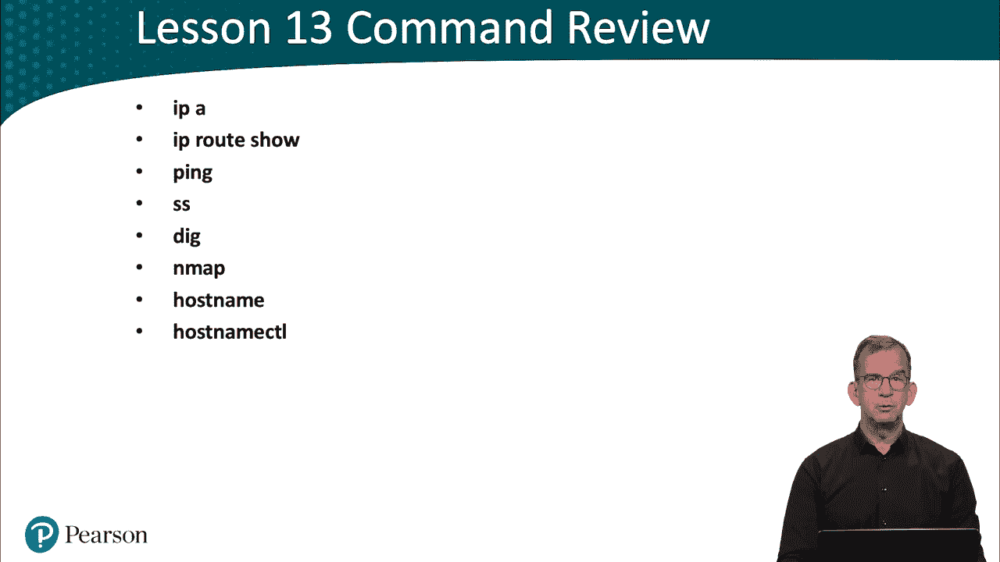

# Oreilly - CompTIA Linux+ V8 - Pearson Cert Prep (Video)：part2 p38：138 命令回顾 🐧

在本节课中，我们将一起回顾本课之前学习过的 Linux 网络相关命令。这些命令是日常系统运维和网络故障排查的基础工具，掌握它们能帮助你更好地理解系统的网络配置、路由转发、连通性检测以及主机名管理。本节内容专门面向初学者，会用最直白的语言把每个命令的作用讲清楚，让你即使没有太多 Linux 经验也能快速上手。

首先我们来看本节课提到的第一个命令。这个命令用于查看系统当前的 IP 地址配置信息，包括网卡地址、子网掩码等关键内容。

`ip`

它是 Linux 系统中查看网络接口配置的基础工具，执行后可以直接看到每个网卡当前分配到的 IP 地址和相关参数。

接下来我们要看的是用来查看路由表的命令。以下命令会展示系统当前的路由表，告诉你数据包会通过哪个网关发送，以及流量会走哪条路径。

`ip route show`

路由表决定了网络流量的走向，理解它对排查网络不通的问题非常重要，尤其是在服务器有多个网卡或多个网关时。

然后我们来看看连通性检测命令，以及用来查看监听端口的命令。以下命令用于验证两台主机之间是否能正常通信：

`ping`

它通过发送 ICMP 报文来测试目标主机是否可达，是排查网络故障时最常用的第一步工具。而下面这个命令则用于显示系统当前正在监听的网络端口：

`ss`

`ss` 命令可以列出哪些端口正在监听，帮助你确认 Web 服务、数据库或其他网络服务是否已经正常启动并监听在指定端口上。

接下来是 DNS 配置验证命令和网络路径测试命令。以下命令用于验证 DNS 解析配置是否正确：

`dig`

它可以查询域名对应的 IP 地址，帮助你判断 DNS 服务器是否工作正常，以及域名是否能正确解析。而下面这个命令则用于测试主机之间的网络路径：

`mtr`

`mtr` 结合了 ping 和 traceroute 的功能，可以显示数据包经过的每一跳，帮助你定位网络延迟或丢包发生在哪个节点，适合用来分析复杂的网络不通问题。

最后我们来看看主机名相关的命令。以下命令允许你查看和设置系统的主机名：

`hostname`

这是一个传统的工具，可以用来查看当前主机名，也可以临时修改主机名，适合快速确认系统在网络中的标识名称。不过现在有一个更现代的工具，它是目前管理主机名的首选：

`hostnamectl`

`hostnamectl` 是较新的实用工具，功能更全面，是现在管理系统主机名的推荐方式，能够更方便地查看和修改静态主机名、暂态主机名等信息。

通过以上内容，我们回顾了本节课涉及的所有网络命令。从查看 IP 配置到检查路由表，再到验证 DNS 解析和测试网络连通性，每个命令都有它特定的用途。主机名管理部分则对比了传统工具和新工具，让你了解现代 Linux 系统的推荐做法，避免使用过时的方法。

本节课中我们一起学习了 ip、ip route show、ping、ss、dig、mtr、hostname 和 hostnamectl 等命令的基本用途，并用简单的语言解释了它们在实际工作中的作用。希望这些内容能帮助你打好 Linux 网络基础，为后续的学习和实践奠定坚实的基础。
