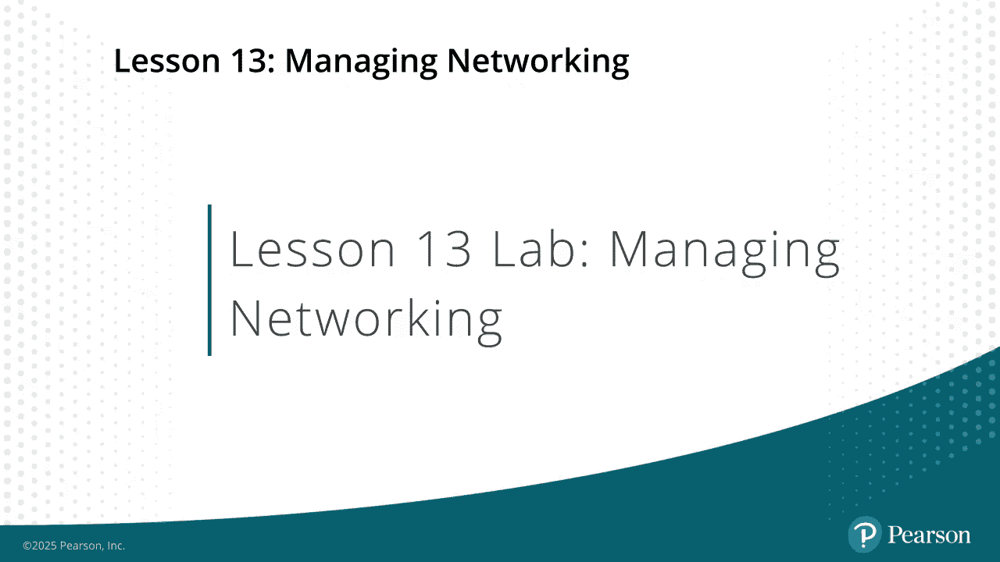
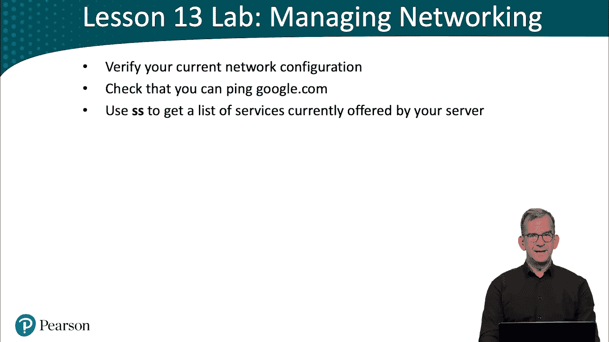

# 🌐 Oreilly - CompTIA Linux+ V8 - Pearson Cert Prep (Video) part2：13：🖧 Managing Networking

## 本节课概述

在本节课中，我们将会学习如何管理 Linux 系统中的网络配置。具体来说，我们会检查你当前的网络设置是否正确，验证能否访问外部网站，并使用常用工具查看系统提供的服务列表。这些内容对于理解 Linux 网络管理非常重要，尤其是当你需要排查连接问题时。

在学习过程中，你会接触到 ping 命令、ss 命令以及 Nmap 工具。下面我们将一步步介绍具体的操作方法。

## 实验目标

在本节实验中，你需要完成以下几项核心任务。这些任务将帮助你确认网络是否正常工作，以及系统当前运行了哪些服务。

以下是本节实验需要完成的具体步骤：


- 验证你当前的网络配置信息。
- 使用 ping 工具检查是否能够访问 google.com。
- 使用 ss 工具获取系统当前提供的服务列表。
- 使用 Nmap 工具完成相同的服务扫描任务。

执行完上述操作后，你就完成了本节实验的全部要求。

## 核心概念说明



为了让初学者更容易理解，这里把几个关键命令用简单的方式说明。

网络连通性测试可以表示为：

ping 目标地址 = 检查本机与目标之间是否能正常通信

服务列表查询可以用伪代码表示：

services_list = ss 或 Nmap 扫描本机开放端口

在 Linux 中，查看当前网络配置通常需要查看 IP 地址、子网掩码、网关和 DNS 等信息。你可以把这些信息想象成你家的地址、邮政编码和联系方式，它们决定了电脑如何与其他设备交流。

ping 命令的作用是向目标发送数据包，然后等待对方回复。如果收到回复，说明网络连通；如果没有回复，可能说明网络不通或者目标禁止了 ping 探测。

ss 命令用于显示套接字信息，也就是当前系统正在监听哪些端口、运行了哪些网络服务。Nmap 则是一个更强大的网络扫描工具，它可以帮助你发现本机或远程主机开放了哪些端口，运行了什么服务。

## 操作步骤详解

下面是具体的操作流程，请按顺序执行。

首先，你需要确认当前的网络配置。这包括查看 IP 地址是否正确获取，网络接口是否处于启用状态。如果配置有误，后续的网络测试可能都无法正常进行。

第二步是使用 ping 命令测试外部连接。具体操作如下：

```bash
ping google.com
```

如果屏幕上显示类似 "64 bytes from ..." 的回复信息，并且没有丢包，就说明你的系统可以正常访问互联网。

第三步是使用 ss 命令查看本机服务。执行以下命令：

```bash
ss -tuln
```

这个命令会列出当前系统监听的 TCP 和 UDP 端口，帮助你知道哪些服务正在运行。

第四步是使用 Nmap 对本机进行扫描。你可以运行：

```bash
nmap localhost
```

Nmap 会扫描本机的常见端口，并显示哪些端口是开放的，对应运行了哪些服务。这与 ss 命令的结果大致相同，但 Nmap 提供的信息更详细，扫描方式也更像真实的网络攻防场景。



## 本节小结

本节课中，我们一起学习了如何在 Linux 系统中管理和验证网络配置。具体包括检查当前网络设置、使用 ping 测试对 google.com 的连通性、使用 ss 查看系统提供的服务列表，以及使用 Nmap 完成相同的服务扫描任务。

通过这些操作，你可以确认网络是否正常工作，并掌握几个常用的网络排障工具。希望本节内容对你有所帮助，祝你学习顺利。
