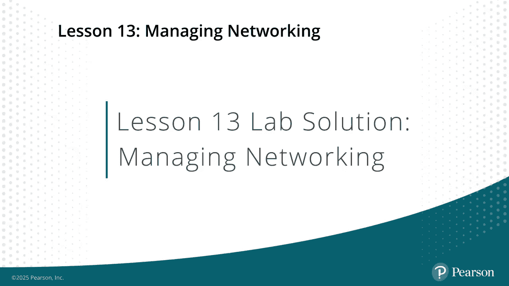
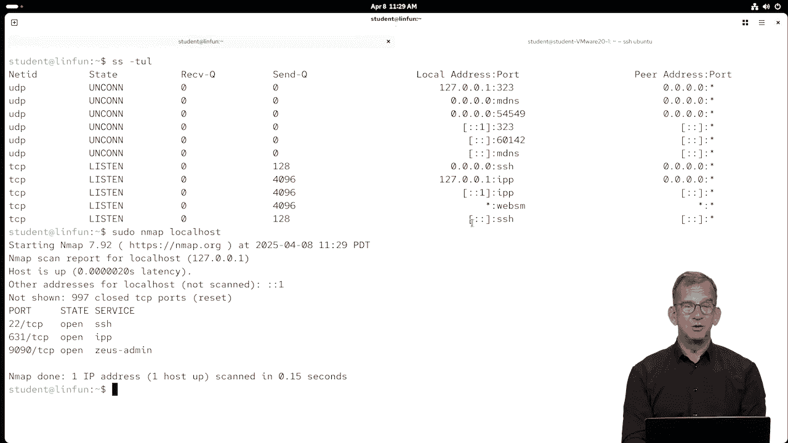

CompTIA Linux+ V8：第13课：管理网络实验解答 🌐


在本节课中我们将要学习如何在Linux系统中管理网络。具体来说，我们会先查看网卡的当前状态，确认网络接口是否已经启动，并且已经拿到了正确的IP地址。接着会测试系统能否访问外部网络，看看域名解析和基础连通性是否正常。最后我们还会检查本机当前运行了哪些网络服务，以及哪些端口处于监听状态。这些操作构成了排查网络问题最基本的技能，学会之后你可以快速判断故障到底出在网络连通、域名解析还是本地服务配置上。



### 查看网络接口状态

首先我们要做的是查看网卡当前的工作状态，确认它是否已经启动，并且拿到了正确的IP地址。

在Linux系统里，查看网卡信息最常用的命令就是ip地址命令，也就是ip a。虽然有些同学会习惯性在命令前面加上sudo来获取管理员权限，但其实查看网卡状态不需要特殊权限，普通用户直接运行即可。在这个演示里，教程作者还是自动加上了sudo，这样做完全没有坏处，只不过是多敲了几个字符，不影响结果。

在系统输出中我们可以看到一块名为ENS160的网卡，当前状态显示为up，也就是说网卡已经开启，可以正常收发数据。接下来我们要关注的是IP地址的分配方式。从输出结果里可以看到，这块网卡使用了动态分配的地址，这背后意味着网络里运行着一台DHCP服务器，负责自动给设备发放IP地址，省去了手动配置的麻烦。

核心命令如下：
```bash
ip a
```

网卡状态标记：
```
ENS160: state UP
```

具体到地址本身，我们会看到IPv4地址，这是目前绝大多数网络中使用的主流地址格式。系统同时也会显示一个IPv6地址，这是新一代的网络地址标准，不过在日常教学和大多数企业环境中，IPv6的使用频率并不高，暂时不需要过多关注。

确认网卡状态和IP地址没问题之后，下一步就是检查系统到底能不能访问外网。

### 测试网络连通性

有了IP地址之后，我们需要验证系统能否与外部通信，最直接的方法就是使用ping命令。

为了验证网络是否畅通，我们尝试ping一下google.com。如果ping命令成功返回，说明基础网络连通，同时域名解析也正常。在这个实验里，作者并没有特意去检查主机名解析或路由表，因为如果ping google.com都能通，通常就意味着这些环节都没问题，没有必要再花时间排查。

只有当ping google.com失败时，我们才需要深入查看域名解析和路由表，找出到底是哪个环节出了故障。

要演示什么时候会出问题，我们可以ping一个不存在的域名。这时候系统会报出"名称或服务未知"这类错误信息。这种情况通常意味着域名在DNS服务器里找不到对应记录，也就是说DNS解析失败了。

如果某个本该可以访问的服务器无法通过域名ping通，那下一步测试就应该直接ping IP地址。这里大家非常熟悉的8.8.8.8就是一个很好的测试目标，它是Google提供的公共DNS服务器，全球范围内都可以访问，非常适合用来做连通性测试。如果你能ping通8.8.8.8，却ping不通域名，那么问题大概率出在DNS解析上，而不是网络路由本身。

常用的连通性测试命令如下：
```bash
ping google.com
ping 8.8.8.8
ping nonexistent-domain.example.com
```

完成外部连通性测试之后，我们还需要了解本机当前运行了哪些网络服务。

### 查看服务与端口扫描

最后我们来看看系统里正在提供哪些网络服务，以及哪些端口处于监听状态。

查看系统当前提供的网络服务，可以使用ss命令，带上-tln参数就能显示当前监听的TCP端口。这个操作不需要root权限，普通用户也可以直接运行。不过如果你想用nmap来扫描本机的开放端口，那就需要加上sudo来获取管理员权限了。

我们对localhost执行sudo nmap扫描时，会发现一个有趣的现象：nmap默认只会扫描一些最常见的端口，并不会把全部65535个端口都扫一遍，所以扫描结果可能看起来不完整。nmap其实拥有非常丰富的参数选项，如果你想深入了解这个工具的全部功能，建议课后多花时间去探索。

常用的服务和端口查看命令如下：
```bash
ss -tln
sudo nmap localhost
```

至此，网络管理的基础实验就全部完成了。



本节课中我们一起学习了如何查看Linux网卡状态，如何确认IP地址是否通过DHCP动态分配，如何使用ping测试外网连通性，如何判断问题是出在DNS解析还是路由转发，以及如何使用ss和nmap查看本机运行的网络服务和开放端口。这些技能构成了Linux网络故障排查的基础，掌握它们后你就能更有条理地定位和解决常见的网络问题。
