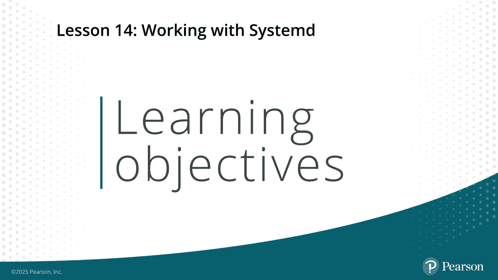
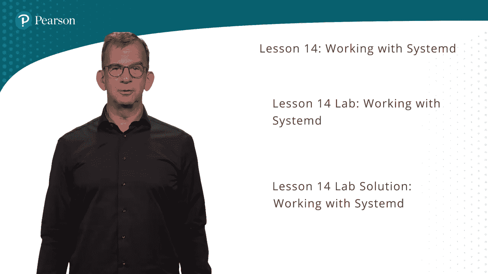

# CompTIA Linux+ V8: 141: 使用 systemd 管理服务 📚




在本节课中，我们将学习 systemd 是什么，以及如何管理 systemd 服务。讲师还会讲解如何修改服务配置，并教你如何把任何程序都变成一个 systemd 服务。下一节课会介绍 target，帮助你理解系统启动时的状态管理，最后我们会进行系统管理的实验练习，并查看实验答案。


本节我们先来认识 systemd。systemd 是 Linux 系统里的初始化系统，也是系统和服务管理器。你可以把它看作系统的“总管”，负责启动和停止后台程序，处理服务之间的依赖关系，并记录运行日志。有了 systemd，系统就能更有条理地运行各种任务。


以下是 systemd 的主要职责：

- 在系统启动时初始化硬件和内核模块。
- 管理系统运行中的服务生命周期。
- 处理服务之间的依赖关系。
- 记录服务的运行日志。


systemd 常用的操作命令可以用下面的代码来表示：

```bash
systemctl start 服务名
systemctl stop 服务名
systemctl enable 服务名
systemctl status 服务名
```


接下来，我们来看看如何修改服务的配置。默认的服务设置不一定完全适合你的实际需求，所以你需要知道如何编辑服务的单元文件，重新加载配置，然后重启服务，让修改生效。


以下是修改服务配置的常见步骤：

1. 找到对应的单元文件，通常位于 /etc/systemd/system/ 目录下。
2. 使用文本编辑器打开该文件，修改需要的参数。
3. 执行配置重新加载，让 systemd 识别新的设置。
4. 重启相关服务，使修改真正生效。


你还可以把普通的程序或脚本封装成 systemd 服务。这意味着只要你写一个简单的单元文件，就能让任何自定义程序像系统服务一样被 systemd 管理，包括开机自启、异常重启和日志记录等功能。


下一节课程将会介绍 target 的概念。target 可以理解为系统运行的“模式”或“状态”，比如图形界面模式、多用户模式或者救援模式。通过 target，你可以方便地控制系统启动到哪个阶段，也能查看当前系统处于什么状态。


以下是常见的 target 类型：

- multi-user.target：多用户命令行模式，适合服务器。
- graphical.target：图形界面模式，适合桌面电脑。
- rescue.target：救援模式，用于系统故障修复。
- reboot.target：重启系统的目标状态。


target 的切换和管理也可以通过 systemctl 完成，例如下面的代码所示：

```bash
systemctl get-default
systemctl set-default multi-user.target
systemctl isolate graphical.target
```




在课程的最后部分，我们会进行一次 systemd 的实践实验。实验中你会动手操作服务的启动、停止、配置修改以及 target 的切换。讲师会在实验结束后，讲解标准的实验答案，帮助你核对自己的操作是否正确。


本节课中我们一起学习了 systemd 的基本概念、服务管理方法、配置修改步骤，以及 target 在系统状态管理中的作用，最后还预告了即将进行的实验练习和答案讲解。

