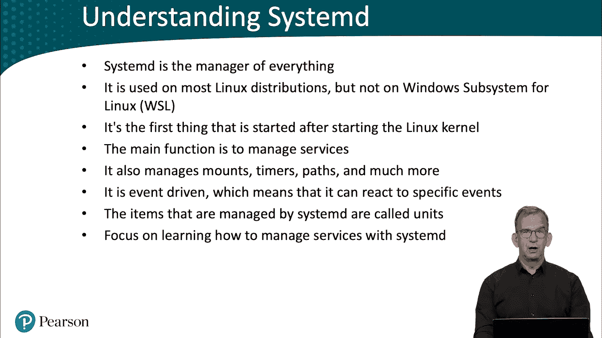
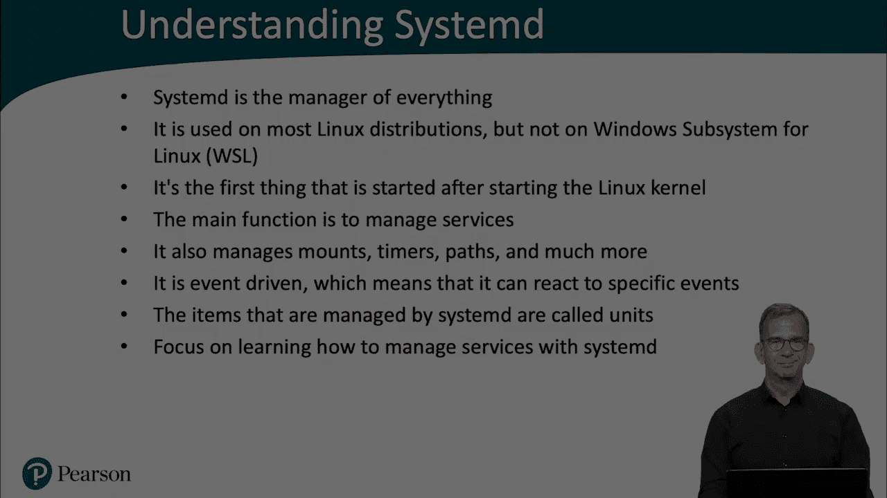

# Oreilly - CompTIA Linux+ V8：142：理解 Systemd 🔧

在本节课中，我们将要学习 systemd 是什么，以及它在 Linux 系统中扮演的角色。systemd 听起来可能有点复杂，但实际上它就像是一个系统管家，负责协调各种后台任务。我们会用最直白的语言把核心概念讲清楚，让完全没有基础的初学者也能听得懂。不管你之前是否接触过 Linux 服务管理，这节课都会从最基础的地方开始，逐步带你建立起对 systemd 的整体认识。

## 什么是 Systemd

首先，我们来看看 systemd 到底是什么东西。Systemd 是一个管理一切的工具，它几乎在大多数 Linux 发行版中都被用来管理系统里的各种资源。你可以把它想象成一个总控制中心，负责启动、停止和监控系统里的不同部分。

但是，不是所有的 Linux 系统都使用 systemd。有些系统不使用它，其中最常见的例子就是 Windows 子系统 Linux，也就是 WSL。如果你在使用 WSL，可能会发现里面没有 systemd，或者 systemd 的行为和普通 Linux 发行版不太一样。

如果一台电脑的 Linux 系统里确实安装了 systemd，那么它会在启动 Linux 内核之后，成为第一个被启动的程序。简单来说，启动顺序就像下面这样：

```text
Linux 内核启动 → systemd 启动 → 其他服务和程序启动
```

这意味着 systemd 接管了系统启动后的大部分工作，是整个系统运行的基础。

## Systemd 能管理什么

上一节我们介绍了 systemd 是什么，以及它在系统启动中的位置，本节中我们来看看它具体能管理哪些东西。systemd 的功能非常广泛，远不止是启动服务那么简单。

以下是 systemd 可以管理的常见项目：

- 服务（services）
- 挂载点（mounts）
- 定时器（timers）
- 设备硬件（hardware）
- 还有很多其他系统资源

也就是说，不管你是想让某个程序在开机时自动运行，还是想管理磁盘挂载，亦或是设置定时任务，systemd 都有能力处理。它的职责范围非常宽，几乎涵盖了系统运行中需要维护的方方面面。

## 事件驱动特性

了解了 systemd 能管理什么之后，我们再来看看它的一个重要特性。systemd 的一个关键特征是它是事件驱动的，这也是它和旧版系统管理工具的一个重要区别。

事件驱动是什么意思呢？简单来说，systemd 可以对系统里发生的特定事件做出反应，并且确保某些程序或资源只有在真正需要的时候才会被加载。它的工作逻辑可以用下面这个简单的公式来表示：

```
特定事件发生 → systemd 响应 → 按需加载所需资源
```

比如，当你插入一根 USB 设备时，systemd 可以感知到这个事件，并自动加载相关的驱动程序，而不是在系统启动时就把所有可能的驱动都加载一遍。这样做可以节省系统资源，让启动速度更快，也让系统运行更高效。

## 什么是单元（Units）



在学习如何具体使用 systemd 之前，我们需要知道一个基础概念。被 systemd 管理的所有项目，统称为单元（units）。不管是一个服务、一个定时器还是一个挂载点，在 systemd 眼里它们都是一个单元。

你应该重点学习如何使用 systemd 来管理服务，因为服务管理是 Linux 基础知识中最常用、最重要的部分。当然，systemd 实际上能做的事情远比这多得多，但如果你是初学者，先把服务管理搞清楚就足够了。掌握了服务管理，你就已经迈出了理解 systemd 的关键一步。



本节课中我们一起学习了 systemd 的基本概念、它能管理的内容、事件驱动特性以及单元的概念。systemd 是一个功能强大的系统管理工具，几乎在所有主流 Linux 发行版中都扮演着核心角色。希望通过这节课，你已经对 systemd 有了初步的认识，并明白它在 Linux 系统中是如何工作的。

