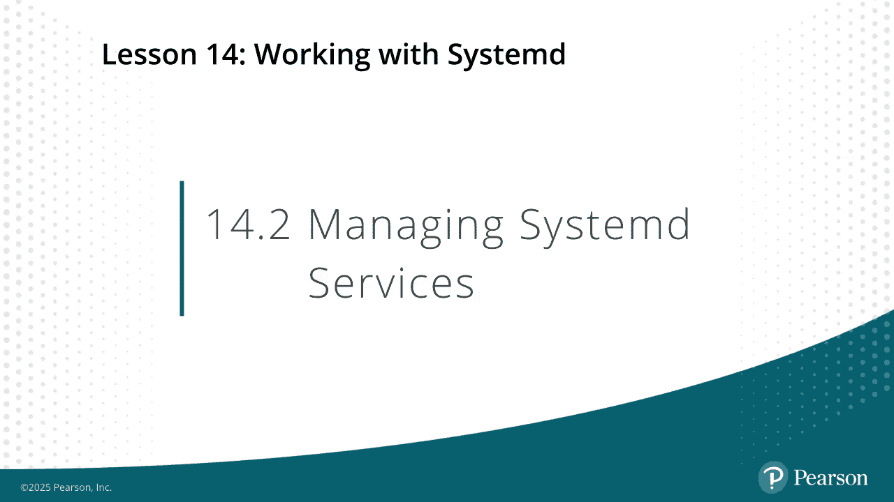
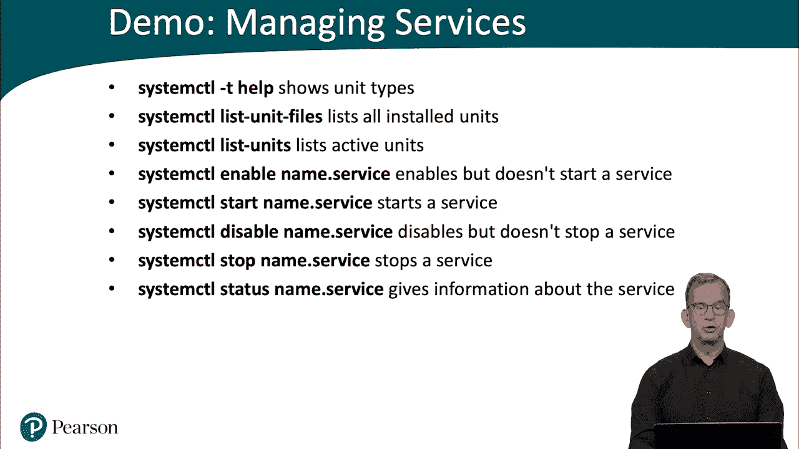
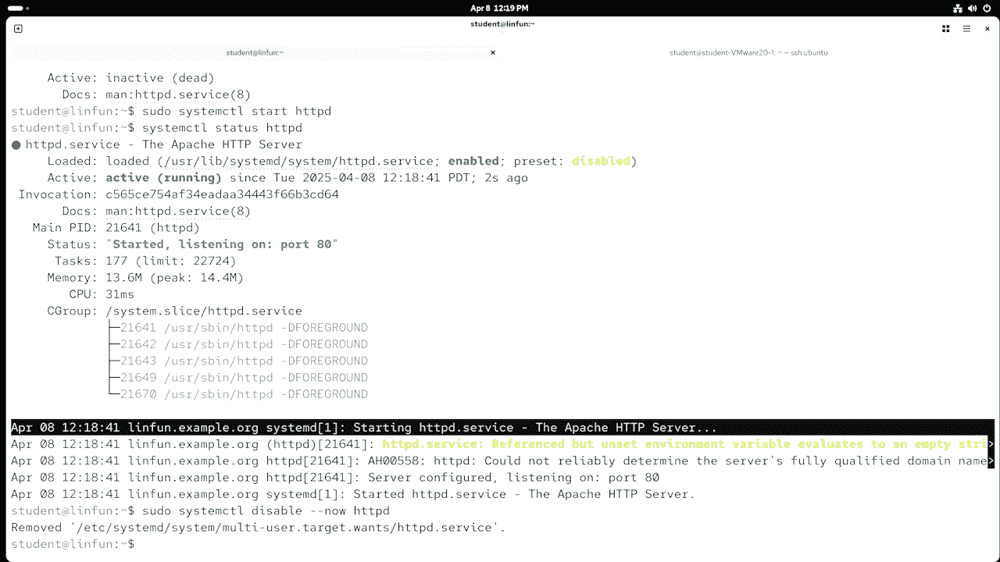

# CompTIA Linux+ V8：143：使用 Systemd 管理系统服务 🛠️

在本节课中，我们将要学习如何使用 systemd 来管理 Linux 系统中的各种服务。systemd 是现代 Linux 发行版中负责启动、停止和监控系统服务的核心工具，通过它你可以控制网络服务、日志服务、定时任务等几乎所有后台程序。我们会一起看看常用的 systemctl 命令，如何查看服务状态，如何让服务开机自动启动，以及如何在不需要时把服务关掉，全部用大白话讲解，保证初学者也能听懂。



systemctl 是 systemd 的主控工具，几乎所有的服务操作都要通过它来完成。它自带详细的帮助信息，支持制表符补全，输入不完整的命令按一下 Tab 键就能自动补全，非常方便。如果你不确定某个参数的意思，也可以直接加上 --help 查看说明，系统会告诉你当前在做什么。下面这个命令用来列出 systemd 当前管理的所有单元类型，这里的 -d 参数代表 type，也就是类型的意思。

以下是查看 systemctl 帮助和单元类型的命令：

```bash
systemctl --help
systemctl -t help
```

list-unit-files 命令会把系统中安装的所有单元文件列出来，不管它们现在是不是在运行。你可以把单元文件理解为 systemd 的“配置档案”，每个服务、挂载点、定时任务都有对应的文件。执行这个命令后，你会看到 mounts（挂载）、paths（路径监视）以及最重要的 services（服务）等分类，这些文件决定了你的服务器应该承担什么工作。注意，这里展示的是文件层面的概览，包括那些当前没有被激活的文件。

以下是查看所有已安装单元文件的命令：

```bash
systemctl list-unit-files
```

如果你只想看当前正在运行的服务，而不是所有安装过的文件，可以使用 list-units 命令。它会过滤掉那些没有启动的单元，只显示处于 active 状态的内容，方便你排查系统到底在跑什么。另外，如果某个服务启动失败，这里也会显示失败标记，你可以据此进一步调查问题原因，然后决定要不要重新启动或者修改配置。

以下是只显示活动单元的命令：

```bash
systemctl list-units
```

接下来我们进入最实用的部分，也就是如何启动和运行一个服务。光有配置文件还不够，服务要真正干活，必须被 systemd 加载并启动。为了演示方便，我们先安装一个常见的网页服务器软件，这里以 Apache HTTPD 为例。安装完成后，它还不会自动运行，我们需要手动来操作 systemd。

以下是安装 HTTPD 服务的命令：

```bash
sudo dnf install -y httpd
```

安装好之后，第一件事是查看这个服务现在的状态。使用 systemctl status 命令可以看到 httpd 服务是否已被 systemd 识别，配置文件在哪里，以及它现在是不是在运行。通常初始状态下，服务是 loaded（已加载）但 disabled（禁用）和 inactive（非活动），也就是说 systemd 知道它的存在，但不会让它开机自启，也不会让它当前运行。

以下是查看 httpd 服务状态的命令：

```bash
systemctl status httpd
```

如果你希望 httpd 在系统启动时自动运行，就需要把它标记为 enabled。执行 enable 命令之后，systemd 会在后台做好自动启动的标记，但请注意，这只改变将来的行为，不会立刻让服务开始运行。如果你想让服务马上起来工作，还得手动执行 start 命令。启动之后再次用 status 查看，你会看到大量详细信息，包括当前运行状态、监听的网络端口、主进程 ID、内存占用量，以及 systemd 专门为这个服务记录的日志条目，这些信息通过 journald 系统统一管理。

以下是启用服务自动启动的命令：

```bash
systemctl enable httpd
```

以下是手动启动服务的命令：

```bash
systemctl start httpd
```

有时候你会想把某个服务从活动状态中移除，既不让它现在运行，也不让它以后自动启动。这时候可以把 disable 和 start 的反向操作组合起来用。disable --now 这个组合参数会同时完成两件事：取消自动启动标记，并且立刻停止正在运行的服务。执行完之后，再次查看状态，你会发现 httpd 已经不再处于 active 状态，系统也恢复到了最初的样子。

以下是同时禁用并停止服务的命令：

```bash
systemctl disable --now httpd
```



在本节课中，我们一起学习了 systemd 服务管理的基础操作。首先认识了 systemctl 主控工具及其帮助系统，学会了用 list-unit-files 查看所有安装的单元文件，并用 list-units 只看当前活动的服务。接着通过安装 HTTPD 作为实例，演示了如何用 status 查看服务状态，用 enable 设置开机自启，用 start 手动启动服务，最后又用 disable --now 把服务彻底停下来并取消自动启动。希望这些内容能帮你建立对 systemd 的直观认识，以后管理 Linux 服务时会更加得心应手。

