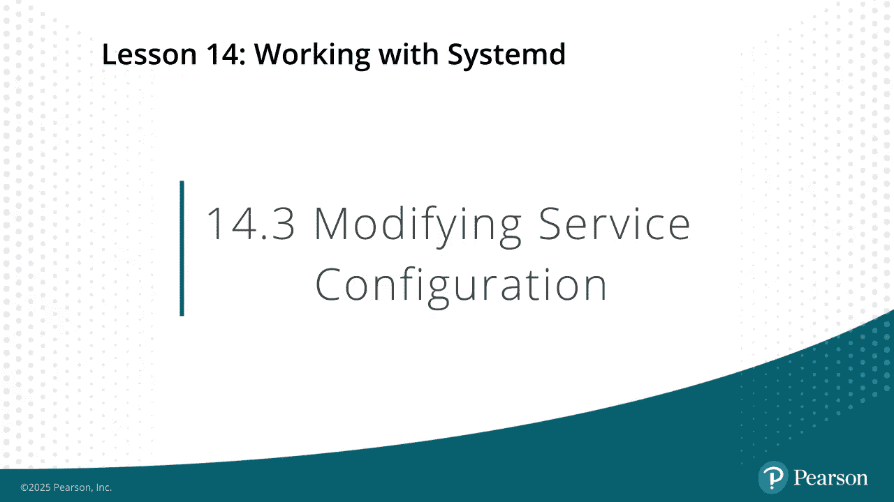
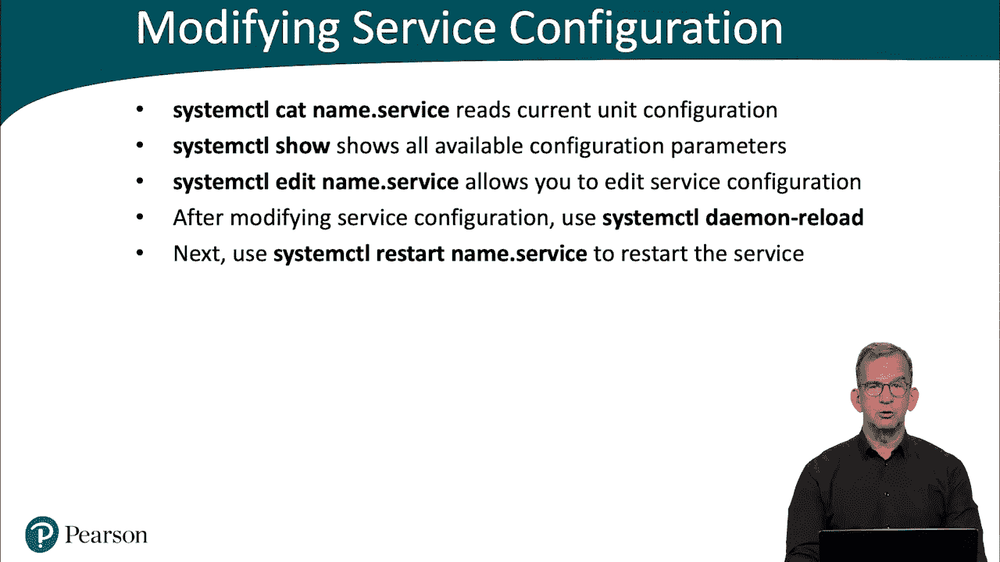
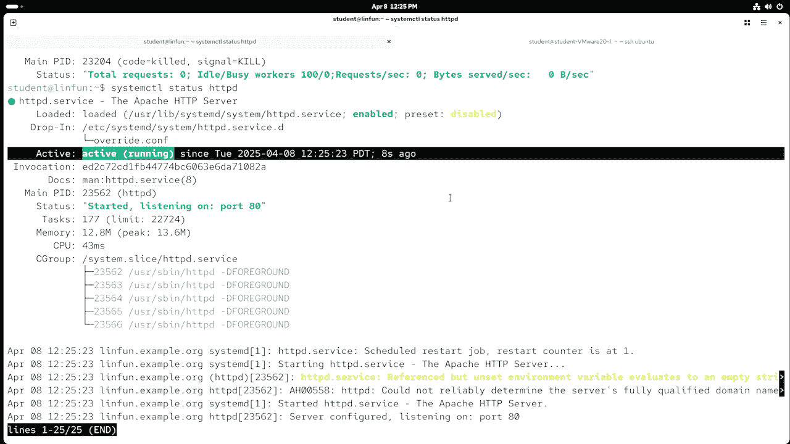

CompTIA Linux+：144：修改服务配置 ⚙️

在本节课中我们将要学习如何在Linux系统里修改服务的配置，重点掌握systemctl工具的使用方法，包括查看当前配置、编辑单元文件、重新加载守护进程以及验证服务状态等操作。这些知识是Linux系统管理的基础，掌握之后你就可以随心所欲地控制系统服务的行为了。

在Linux系统中，所有的服务单元背后都有对应的配置文件，而这些配置是可以被管理员管理的。systemctl cat命令用来显示当前单元的完整配置，之所以要用这个命令，是因为一个服务的配置信息通常分散在多个位置，systemctl cat能够把这些信息全部拼接在一起，让你在一个视图里看到完整的画面。此外，systemctl工具还提供了很多参数，其中systemctl show命令可以列出所有可用的配置参数，方便你了解服务支持哪些设置项。

以下是systemctl中常用的配置查看命令：

- `systemctl cat <服务名>`
- `systemctl show <服务名>`

当你想要修改某个服务的配置时，systemctl edit命令是最方便的选择。使用这个命令编辑服务配置之后，如果你操作正确，就不需要做任何额外的事情，修改会立即生效，系统会自动识别并应用新的设置。

然而，如果你是直接编辑服务的配置文件，而不是通过systemctl edit来修改，那么情况就有所不同了。这时候，使用systemctl daemon-reload是一个明智的主意，这会告诉systemd守护进程去获取所有的变更，让它重新加载配置。除此之外，你可能还需要对相关服务使用systemctl restart命令，特别是当你修改的是服务本身的配置文件，而不是单元文件的时候。



以下是直接编辑配置文件后需要执行的命令：

- `systemctl daemon-reload`
- `systemctl restart <服务名>`

之所以需要这些步骤，是因为Linux系统里有一条黄金法则：如果你改动了任何东西，就需要让某些组件重新加载或重启，这样系统才能意识到你的变更，并按照新的配置运行。

下面让我演示一下这个过程是如何工作的。首先我想给你看一下sshd.service的systemctl cat输出，因为sshd服务是我在服务定义中比较熟悉、也比较喜欢的一个服务。我打算复制其中的两行配置，然后把它们放到HTTPD服务的配置里面去。

接下来我使用`sudo systemctl edit httpd.service`命令来编辑httpd服务。这时系统会调用nano编辑器打开配置文件。虽然nano并不是我最喜欢的编辑器，但我不会因此抱怨。我需要把刚才复制的两行分隔开，并且把它们放到[Service]段落里面，否则就有可能导致这些配置无法被正确识别。

以下是编辑时需要添加的配置段落示例：

```
[Service]
Restart=always
RestartSec=21
```

这些配置行的作用是确保服务在失败时会自动重启，默认的重启间隔是42秒。我觉得这个时间有点太长了，所以我把它改成了21秒。保存更改之后，我使用`sudo systemctl cat httpd.service`来查看合并后的配置内容。

这时候我们可以看到所有配置拼接在一起的结果。上面的部分是默认服务文件，来自软件包安装；下面的部分是我刚才编辑操作创建的内容，存放在`/etc/systemd/system/httpd.service.d/override.conf`路径下。这个覆盖文件会被自动包含，并且它的优先级高于默认配置。也就是说，如果两者之间存在冲突，你自己创建的配置永远会生效。

查看完配置后，我按Q退出查看界面。正如我刚才所说，如果你使用systemctl edit来修改配置，就不需要重启或重启任何东西，一切应该都已经正常了。

接下来我需要回到httpd服务的systemctl status页面来查看状态。对了，服务目前还没有加载，显然我需要先启动它。我使用`sudo systemctl enable --now httpd`命令来启动并启用httpd服务，然后再次使用systemctl status来查看运行情况。

此时页面显示主进程正在运行，进程ID是23204。为了验证自动重启是否真的生效，我决定用`kill -9 23204`强制结束这个进程。关于kill命令的更多细节我之后会再讲，现在我们先执行这个操作。

我们想要知道的是，我刚才修改的自动重启参数是否真的起作用了。从输出结果里可以看到，系统正在激活自动重启，因为我刚才更改了配置参数，服务会在任何失败时重启，大约20秒左右就会恢复运行。正如你所见，服务已经再次运行了，运行时间大约是8秒。这就是自动重启功能在起作用。

这个自动重启选项非常出色，仅凭这一点就足够让你喜欢上systemd了。



在本节课中我们一起学习了如何修改Linux服务的配置，掌握了systemctl cat、systemctl edit、systemctl daemon-reload以及systemctl restart等命令的使用方法，还通过httpd服务的实际演示了解了配置覆盖文件的优先级和自动重启机制。

