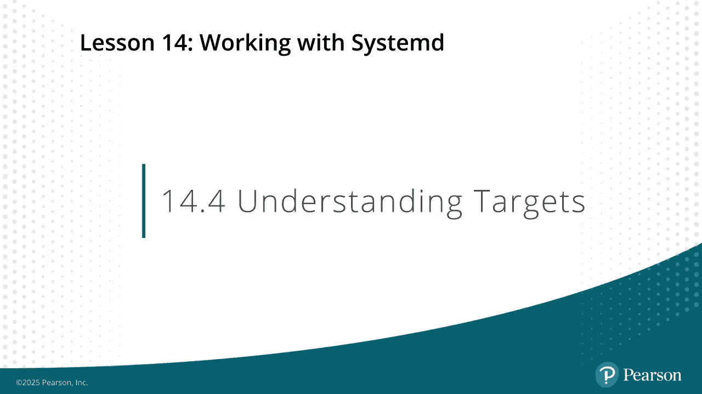
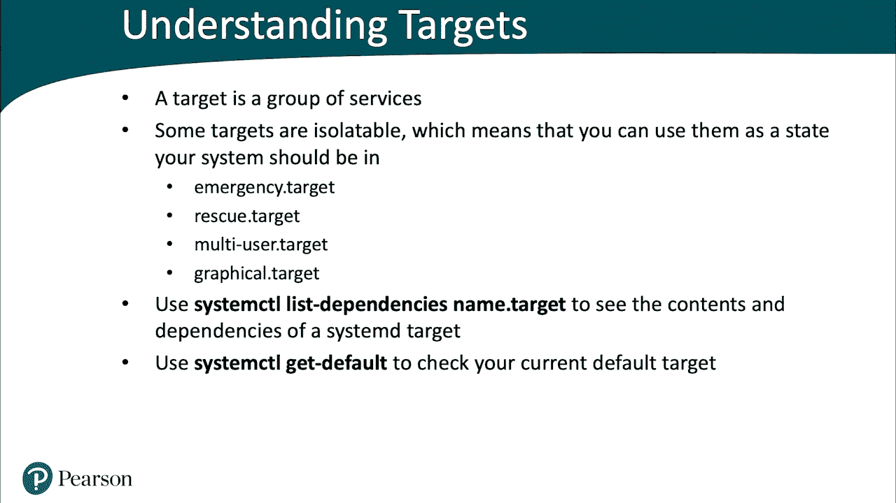
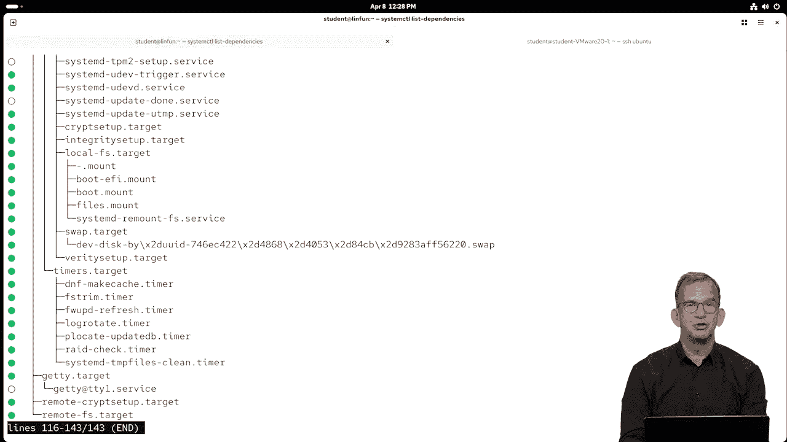

🐧 CompTIA Linux+ V8：14：理解 systemd 目标


在本节课中，我们将学习 systemd 中的目标（Target）概念。目标是 systemd 用来管理系统运行状态的一种机制，它本质上是一组服务的集合。我们会先了解什么是目标，接着介绍四个你必须知道的常用目标，然后学习如何查看目标中启动的服务及其依赖关系，最后讲解如何查看和修改系统的默认目标。通过本节内容，即使你是 Linux 初学者，也能清楚地明白系统启动时到底运行了哪些服务，并且掌握切换系统运行状态的基本方法。




## 一、什么是 systemd 目标

上一节我们初步接触了 systemd 的基本命令，本节中我们来看看 systemd 是如何通过目标来组织和管理服务的。

当你使用 systemd 时，必然会接触到目标。目标是一组服务，也就是系统在某个特定状态下需要运行的服务集合。你可以把它理解为系统运行状态的快照，不同的目标对应不同的运行场景。核心关系可以用下面的公式来表示：

```
目标 = 服务组
```

这意味着当系统进入某个目标时，属于该目标的所有服务都会被系统管理和启动。这样设计的好处是，你不需要一个一个去启动服务，只需要切换到对应的目标，systemd 就会自动处理好其中的依赖和启动顺序。


## 二、四个常用目标及其适用场景

了解了什么是目标之后，本节中我们来看看四个你必须知道的常用目标。以下是这四个目标的名称和用途：

- emergency 目标：紧急模式，仅在系统出现严重问题需要修复时使用。
- rescue 目标：救援模式，同样只在你需要修复系统时启动。
- multi-user 目标：多用户模式，没有图形界面，是典型服务器的默认启动状态。
- graphical 目标：图形模式，带有图形桌面环境，是图形工作站的默认启动状态。

其中 emergency 和 rescue 只在故障排查时使用，日常运维中基本不会接触。multi-user 目标适合服务器，因为服务器通常不需要图形界面，只需要多用户命令行环境即可。graphical 目标适合个人电脑或工作站，用户需要通过图形桌面进行操作。


## 三、查看目标中的服务和依赖关系

介绍完四个常用目标之后，本节中我们来看看如何查看某个目标内部到底启动了哪些服务。

在目标中，会启动不同的系统单元。你可以使用下面的命令查看目标的内容和依赖关系：

```
systemctl list-dependencies <目标名称>
```

执行这个命令后，systemd 会以树形结构展示目标下的所有单元及其依赖。这样做的目的就是让你一目了然地知道，当系统进入这个目标时，到底启动了哪些服务，它们之间有什么依赖关系。通过这种方式，你可以排查服务启动问题，也可以验证系统是否按照预期配置运行。


## 四、查看和修改默认目标



了解了如何查看目标依赖之后，本节中我们来看看如何确认系统当前的默认目标，以及如何将其更改为其他目标。

你可以使用以下命令查看当前的默认目标：

```
systemctl get-default
```

如果你希望将另一个目标设置为系统默认启动目标，可以使用下面的命令：

```
systemctl set-default <目标名称>
```

修改默认目标后，系统下次启动时就会进入新设置的目标。比如你可以把服务器从 graphical 目标改为 multi-user 目标，以节省图形界面的资源；也可以把某些测试机从 multi-user 改为 graphical，方便使用桌面环境。


## 五、实际演示与状态点的含义

前面我们讲解了查看和修改默认目标的命令，本节中我们来看看在实际操作中，这些命令的输出结果应该如何解读。

使用 systemctl 时，你可以配合 Tab 键进行自动补全。系统会自动显示可用的命令和参数，这对初学者非常友好。如果你想确认自己的默认目标是什么，输入 systemctl get-default 并补全命令即可。大多数桌面系统的默认目标是 graphical 目标。如果你想知道当前目标中发生了什么，可以使用 systemctl list-dependencies 命令。

运行该命令后，你会看到目标下所有单元的状态，系统会用不同颜色的点来表示运行情况：

- 绿点：表示该服务当前正在运行。
- 白点：表示该服务当前没有运行。
- 红点：表示服务启动过程中出了问题。

通过这些颜色标记，你可以快速判断系统是否进入了预期的状态，以及哪里出了故障。这对于理解系统启动流程和排查问题非常有帮助。




本节课中，我们一起学习了 systemd 目标的基本概念，掌握了 emergency、rescue、multi-user 和 graphical 四个常用目标的含义与适用场景。我们还学习了如何使用 systemctl list-dependencies 查看目标中的服务和依赖关系，以及如何使用 systemctl get-default 和 systemctl set-default 查看和修改系统默认目标。最后，我们解读了命令输出中绿点、白点和红点的含义。希望这些内容能帮助你更好地理解和管理 Linux 系统的运行状态。
