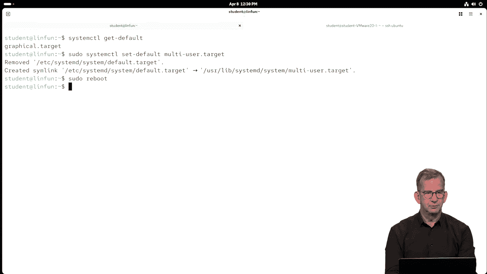
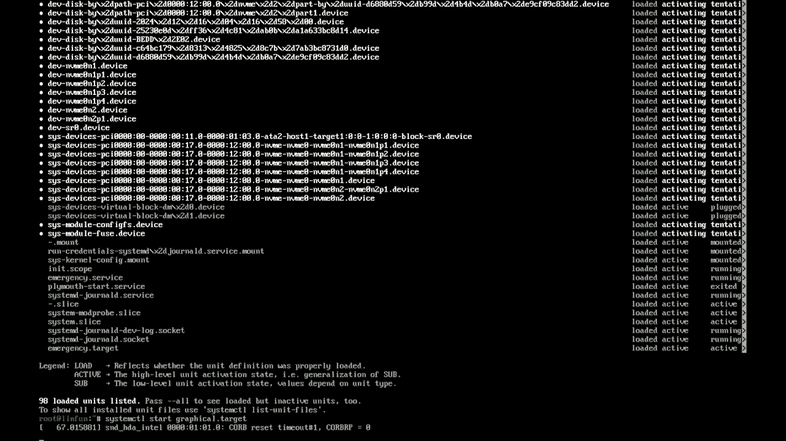

CompTIA Linux+ V8：145：管理目标🎯

在本节课中我们将要学习 systemd target 的管理操作，包括如何查看当前的默认目标、如何修改默认目标、重启后如何验证变化、如何查看目标包含的服务依赖、如何切换到紧急模式、如何设置 root 密码以及如何切换回图形界面。这些内容对理解 Linux 系统的运行状态和恢复模式非常重要，建议大家跟着演示一步步操作，不要跳过任何一个步骤，因为每个命令都有它特定的使用场景。

首先，我们来看看如何查看系统当前使用的默认目标。

以下是查看默认目标的命令。

```bash
systemctl get-default
```

这条命令会告诉你系统当前的默认目标是什么，也就是系统开机后默认进入哪个模式。你可以把它理解为系统的默认启动配置，运行后屏幕会直接显示目标名称，比如 graphical.target 或 multi-user.target。

接下来，我们尝试把默认目标修改为多用户模式，也就是不带图形界面的命令行模式。



以下是修改默认目标的命令。

```bash
sudo systemctl set-default multi-user.target
```

执行这条命令后，现在屏幕上可能看不到任何变化，因为这只是把默认目标写成了 multi-user.target，真正的变化要等到下一次重启才会显示出来。换句话说，当前运行的系统状态不会立即改变，但重启之后系统就会按照新的默认目标启动，进入没有图形界面的命令行环境。

修改完成之后，我们需要重启系统来确认更改是否真的生效。

以下是重启系统的命令。

```bash
reboot
```

重启之后，系统进入 multi-user.target，这时没有图形用户界面，只能通过命令行登录。你可以直接登录进去，确认自己确实到达了多用户目标，此时屏幕应该是黑底白字的登录提示。

进入多用户目标之后，我们想知道这个目标到底包含哪些服务和单元。

以下是查看目标依赖关系的命令。

```bash
systemctl list-dependencies multi-user.target
```

这条命令会显示 multi-user.target 正在管理的所有服务单元，同时你也能看到它本身包含了 basic.target，如果继续向下滚动，还能看到更多被包含的单元。简单来说，multi-user.target 就像一个容器，负责启动和维护一组系统服务，确保系统在多用户命令行模式下能正常运行。

接下来，我们学习如何在系统运行时切换到另一个目标，比如紧急模式。

以下是切换到紧急目标的命令。

```bash
sudo systemctl isolate emergency.target
```

`systemctl isolate` 命令用于从功能较多的目标切换到功能较少的目标。执行之后，系统进入 emergency 模式，屏幕会提示无法打开控制台访问，并且 root 账户被锁定。这时候如果你按回车，很遗憾地发现进不了 emergency 模式，因为 emergency target 需要访问 root 账户，而没有密码是无法进入的。

因为 emergency 模式需要 root 密码，我们需要先退回到正常的运行目标，然后为 root 设置密码。

以下是返回正常目标并设置 root 密码的操作。

```bash
sudo passwd root
```

你先退回到之前的正常目标，然后使用 `sudo passwd root` 为 root 账户手动设置一个密码。如果没有 root 密码，你是无法进入 emergency 模式的。如果实际工作中真的需要，也可以尝试破解 root 密码，但这里我们先直接手动设置，最简单直接，不需要额外的工具。

设置好 root 密码之后，我们再次进入 emergency 模式来看看里面的情况。

以下是再次切换到紧急目标的命令。

```bash
sudo systemctl isolate emergency.target
```

进入 emergency target 之后，你会发现它是一个特殊的救援环境，只加载最少量的系统单元。这时候可以使用下面的命令查看当前加载的所有单元概览。

以下是查看当前加载单元的命令。

```bash
systemctl list-units
```

这条命令会列出系统当前加载的所有单元，让你了解 emergency 模式下到底运行了哪些最基本的服务，帮助你判断系统处于什么样的救援状态。

现在我们已经了解了 emergency 模式，想要回到正常的图形工作状态，不再停留在多用户命令行模式。

以下是启动图形目标的命令。

```bash
systemctl start graphical.target
```

这里我们不选择进入 multi-user.target，而是直接启动 graphical.target，这样就能把系统带回完整的图形桌面环境，恢复正常的图形化操作，让你再次看到熟悉的桌面界面。



本节课中我们一起学习了 systemd target 的管理，包括查看默认目标、修改默认目标、重启验证、查看依赖关系、切换到 emergency 模式、设置 root 密码、以及切换回图形界面。希望大家能掌握这些命令，在实际的 Linux 系统管理和故障恢复中灵活应用。
